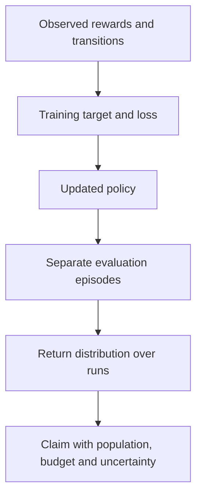
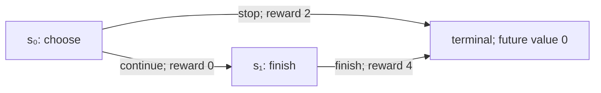
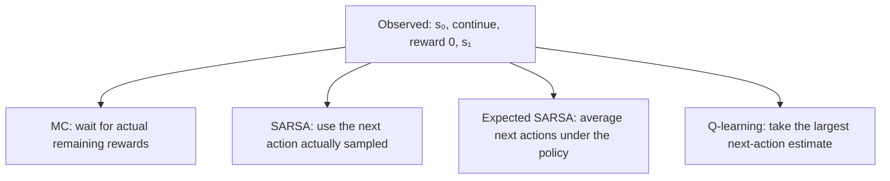
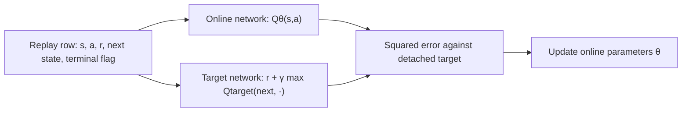
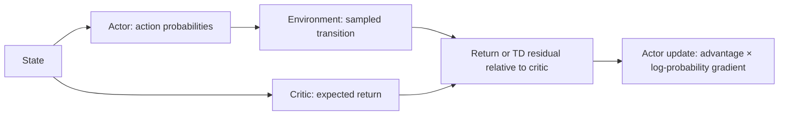
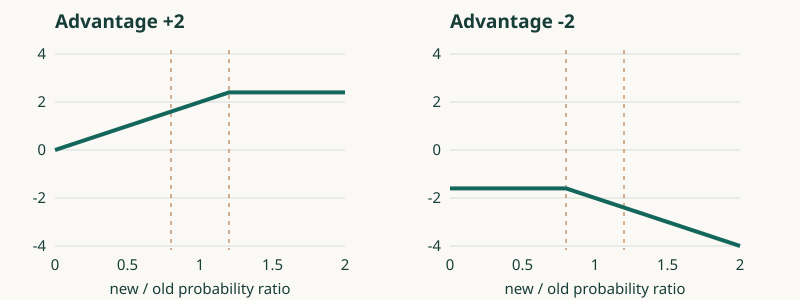
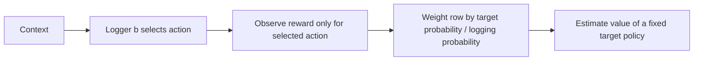
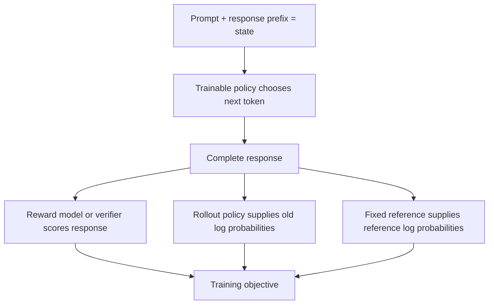
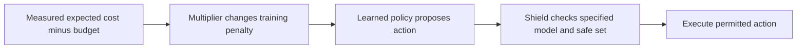
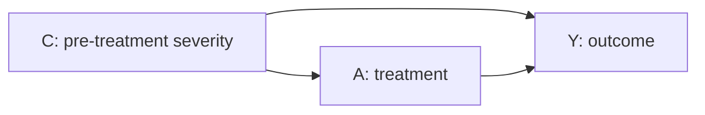

# Visual explanations: keep the problem fixed

[Choose a route](LEARNING_MAP.md) · [Study guide](STUDY_GUIDE.md) · [Interactive lab](../study-lab/README.md) · [Glossary](GLOSSARY.md)

Read one panel when you encounter its topic. Each diagram has a text equivalent
and a small calculation, so the explanation still works in a Markdown viewer
without Mermaid support. All numbers below are invented teaching fixtures.

## How to read an interactive figure

Before moving a slider, name the horizontal variable, the vertical quantity
and the input held fixed. A slider changes a mathematical experiment. It does
not by itself run or validate a trained RL system.

| Figure | What moves | What the readout means | A useful prediction |
|---|---|---|---|
| Return timeline | Discount or reward | Discounted sum on a specified path | At gamma 0, only the first reward survives |
| Bellman sweep | Backup count | Current estimates from a fixed model | Terminal information travels backward through predecessors |
| PPO branches | Probability ratio, advantage, clip radius | One sample's clipped surrogate | Negative advantage has its plateau on the lower-ratio side |
| Importance weights | Logging and target probabilities | Contribution and concentration under a specified log | Making a useful action rare can concentrate weight on few rows |
| GAE trace | Lambda and boundary type | Weighted sum of TD residuals | Lambda 1 still retains an unfinished segment's endpoint bootstrap |
| Learning curve | Training interactions or updates | A measured statistic over runs | Changing the smoothing window does not change the raw observations |

Pause or reset an animation to inspect one transition. Identify which arrows
represent data, which represent a computed target, and which represent an
optimiser update. An arrow marked “repeat” is not a proof that repetition
converges. Use the matching week's notebook investigation to reproduce a
number in Python before trusting the visual pattern.

### One curve, four different claims

**Read the separation:** training loss describes fitting to an objective.
Evaluation return describes behaviour on its evaluation distribution.
A confidence interval describes uncertainty under a stated sampling or
resampling procedure. A theorem describes a claim under mathematical
assumptions. None becomes another just because they appear on one chart.

For a concrete example, returns `(-10,10)` have mean zero, as do `(0,0)`.
The means agree but the outcomes differ. A narrow band around a mean might
represent standard error, standard deviation, a confidence interval or
variation across random seeds; read its label. More evaluation episodes can
reduce evaluation noise while leaving variation between independently trained
policies unresolved.

When comparing plots, keep axes and reward definitions consistent. A clipped
vertical axis can hide failures; a changing heatmap colour scale can exaggerate
small values; smoothing can hide a collapse. Show raw measurements or make
them inspectable, state how aggregates were formed, and mark extrapolation
beyond the input range represented in the data.

## Reward, return and value

**Read the arrows:** rewards belong to transitions. Stopping pays 2 now.
Continuing pays 0 now and 4 one step later. The terminal node pays nothing
extra. At discount `γ=0.9`, stop returns 2 and continue returns `0+0.9×4=3.6`.
The first reward is multiplied by `γ⁰=1`, even though its index is `rₜ₊₁`.

If the policy continues with probability `p=0.25`, its value is
`V(s₀)=(1−p)×2+p×3.6=2.4`. A reward is an observation, a return adds rewards
along one trajectory, and a value averages possible returns under a named
policy. The value 2.4 is not an additional outcome.

**Change just one thing:** at `γ=0.4`, continuing returns 1.6, so stopping wins.
The switch occurs at `4γ=2`, or `γ=0.5`. Changing `p` changes the average
value; here it does not change either action's value, because there is no
later choice. In a general MDP, later choices also affect $Q^\pi$.

Try [Return and advantage](../study-lab/index.html#return-lab), then
[week 2](../week-02-bellman-dp/teaching_guide.md). On GitHub, follow the
[lab opening instructions](../study-lab/README.md) to run HTML locally.

## One transition, different targets

Hold the observed first transition fixed: continue gives reward 0 and reaches
`s₁`. For this comparison only, extend `s₁` to offer two terminal actions:
finish pays 4 and detour pays 1. The learner estimates their values as 3 and 1.
The behaviour policy picks finish with probability 0.75; this episode picks
detour and observes 1. Discount is 0.9.

| Method | Evidence after the first transition | Target for `Q(s₀, continue)` |
|---|---|---|
| Monte Carlo | The completed detour trajectory | `0+0.9×1 = 0.9` |
| SARSA | The sampled next action, detour, and its estimate | `0+0.9×1 = 0.9` |
| Expected SARSA | Both estimates, weighted by the specified policy | `0+0.9×(0.75×3+0.25×1) = 2.25` |
| Q-learning | The largest estimated next-action value | `0+0.9×max(3,1) = 2.7` |
| Exact model evaluation | The true payoffs, weighted by that policy | `0+0.9×(0.75×4+0.25×1) = 2.925` |

**Read the branches:** MC uses the eventual outcome; the three TD methods use
current estimates. The equal MC/SARSA numbers here are a coincidence: change
the detour estimate to 2 and SARSA becomes 1.8 while MC remains 0.9.
Q-learning's max describes its target policy; its data can still come from
an exploring policy. Expected SARSA is on-policy when the expectation uses
the behaviour policy, as it does here.

All four sampled/estimated learning targets can enter the same update
`estimate ← estimate + α(target−estimate)`. A target is not the updated estimate.
For an old estimate 1 and `α=0.5`, target 2.7 produces 1.85.
See [weeks 3](../week-03-monte-carlo/teaching_guide.md)
and [4](../week-04-td-sarsa-q/teaching_guide.md).

## Where DQN sends the gradient

**Read the arrows:** a replay row supplies both the prediction inputs and target
inputs. Only the prediction path receives this regression gradient; the
target parameters are refreshed separately. Using a network instead of a
table shares changes across states, which is why tabular convergence arguments
cannot simply be copied.

For prediction 1 and detached target 2.7, half-squared error is
`0.5×(1−2.7)²=1.445`; its derivative with respect to the prediction is −1.7.
Gradient descent increases the prediction. Double DQN instead uses the
online network to select the next action and the target network to evaluate
that selection. See [week 5](../week-05-dqn/teaching_guide.md)
and [week 6](../week-06-rainbow-bbf/teaching_guide.md).

## The actor and critic answer different questions

**Read the arrows:** the actor chooses; the critic predicts; the advantage
compares a choice with the policy's average. The actor treats the advantage
coefficient as fixed during its update. A critic can also have its own
regression loss.

In the original delivery task, continue's advantage is `3.6−2.4=1.2`;
stop's is `2−2.4=−0.4`. A positive reward can therefore have a negative
advantage. The policy-weighted average advantage is
`0.25×1.2+0.75×(−0.4)=0`.
That does **not** make the gradient zero: the two log-probability derivatives
are different. For continue probability `sigmoid(z)`, the expected derivative
is `0.25×0.75×1.2 + 0.75×(−0.25)×(−0.4)=0.3`.

GAE combines residuals `δₜ = rₜ₊₁+γV(sₜ₊₁)−V(sₜ)` at different horizons.
With residuals `(1,2)` and `γλ=0.72`, the first advantage estimate is
`1+0.72×2=2.44`. Do not carry the residual sum across an environment reset.
True termination removes the next value; an external collection cutoff
can retain a bootstrap from the final real observation.
Try [TD boundaries](../study-lab/index.html#td-lab) and
read [week 8](../week-08-a2c-gae-trpo/teaching_guide.md).
This boundary distinction follows
[Gymnasium's time-limit guidance](https://gymnasium.farama.org/tutorials/gymnasium_basics/handling_time_limits/).

## PPO: the sign decides the plateau

**Read the curves:** the horizontal axis is new/old action probability;
the vertical axis is the surrogate to **maximise**, not the loss to minimise.
For advantage +2, the curve rises then flattens above 1.2. For advantage −2,
it is flat below 0.8 and falls as the ratio increases.

| Ratio | Advantage | Raw product | Clipped candidate | Minimum (surrogate) |
|---|---:|---:|---:|---:|
| 1.5 | +2 | 3 | 2.4 | 2.4 |
| 1.5 | −2 | −3 | −2.4 | −3 |
| 0.5 | +2 | 1 | 1.6 | 1 |
| 0.5 | −2 | −1 | −1.6 | −1.6 |

The negative training loss reverses the vertical sign. Clipping removes an
incentive after an improvement; it retains penalties for moving a bad action
the wrong way. It does not bound the actual probability ratio or KL.
Move the ratio in the [PPO experiment](../study-lab/index.html#ppo-lab), then
derive the branches in [week 9](../week-09-ppo/teaching_guide.md).
Source: [Spinning Up's PPO equations](https://spinningup.openai.com/en/latest/algorithms/ppo.html).

## Logged data and support

**Read the arrows:** a log does not reveal unchosen rewards. If a logger takes
action B with probability 0.25 but the target always takes B, a B row has
weight `1/0.25=4`, while an A row has weight zero.
For observed actions `(A,A,A,B)` and rewards `(1,1,1,4)`, IPS is
`(0+0+0+4×4)/4=4`. This tiny constructed log is not an uncertainty estimate.

If the logger never takes B, its reward is unobserved. Dividing by epsilon
does not recover it. If it almost never takes B, support may exist in theory
while a finite dataset contains none: report insufficient evidence rather
than interpreting a zero observed contribution as a true zero value.
Try the [support experiment](../study-lab/index.html#support-lab), then
[week 11](../week-11-contextual-bandits-ope/teaching_guide.md).
The change-of-policy evaluation problem is developed in
[Dudík, Langford and Li](https://arxiv.org/abs/1103.4601).

## LLM training: keep four roles separate

**Read the arrows:** the rollout policy is the policy that generated a batch.
The reference is a separate anchor. They can initially match but serve
different roles. A reward model predicts a preference score; a verifier checks
a specified property. Neither is a guarantee of overall response quality.

| Method | Training evidence | Question to ask |
|---|---|---|
| SFT | Demonstration tokens | Which tokens contribute to cross-entropy? |
| DPO | Preferred/rejected response pairs | How does the policy/reference log-ratio margin change? |
| PPO-style RLHF | Fresh responses, rewards and a critic | Which old log probabilities define the ratio, and where is the reference penalty? |
| RLOO / GRPO | Groups of responses and rewards | Which axis is centred, and what happens when all rewards tie? |

For rewards `(1,0)`, the inclusive centred coefficients are `(0.5,−0.5)`;
leave-one-out coefficients are `(1,−1)`. With `(1,1)`, both are zero.
This removes the within-group reward signal even though both answers succeeded.
The full update may still include a reference penalty.
Follow [18](../week-18-rlhf-ppo-llm/teaching_guide.md) →
[19](../week-19-dpo-zoo/teaching_guide.md) →
[20](../week-20-grpo-rloo-rlvr/teaching_guide.md) →
[21](../week-21-reward-hacking-oversight/teaching_guide.md)
for derivations and their primary sources.

## A budget and a shield act in different places

**Read the arrows:** the multiplier changes learning incentives; a shield
changes the action executed. For cost 3, budget 2, multiplier 0.5 and multiplier
step size 0.1, the projected update gives `max(0,0.5+0.1×(3−2))=0.6`.
It penalises costly behaviour more strongly. It does not prove that the
resulting policy obeys the budget.

An expected-cost constraint can still allow individual bad outcomes.
A shield's protection depends on its safe set, dynamics assumptions and
feasible actions; an empty permitted-action set must be handled explicitly.
See [week 22](../week-22-cmdp-cpo-lagrangian/teaching_guide.md) and
[week 23](../week-23-safe-exploration-shielding-robust/teaching_guide.md).

## Causal questions need a different graph

**Read the arrows:** severity influences both treatment and outcome, so the
path `A ← C → Y` can confound their association. Comparing treatment groups
within severity strata, then averaging using the target population's severity
distribution, addresses that path under the identification assumptions.
It does not address an unmeasured common cause by itself.

In the [week 26 example](../week-26-causal-discovery-biological-data/teaching_guide.md#numerical-example-1-confounding-reverses-a-decision),
each severity stratum has treatment effect +1, while the pooled treated group
looks worse because it contains more severe cases. Better outcome prediction
does not by itself identify the effect of setting treatment.

## Check whether the diagrams helped

Close this page. Draw the delivery task, then annotate where each of MC,
TD and policy gradients gets its evidence. Reopen only the part you could not
reconstruct. Next, change the final reward from 4 to 1: the return,
advantage sign and policy-gradient direction should all change consistently.
Use [the progressive coding exercises](INTERACTIVE_LEARNING.md) to check the calculations.
