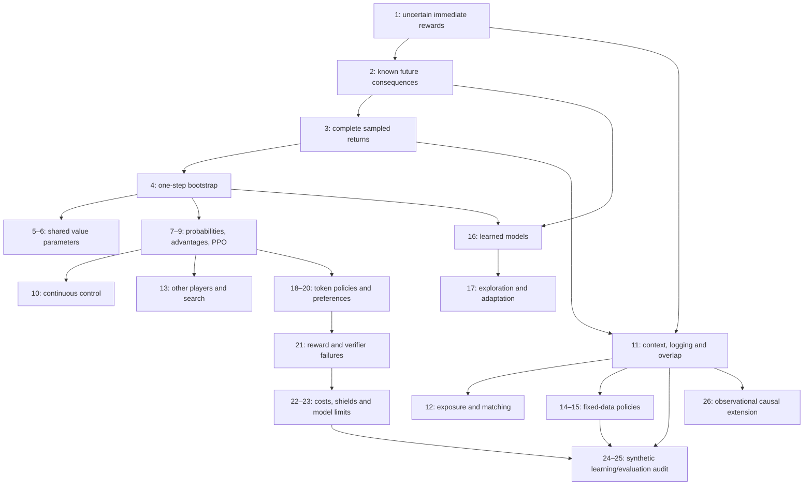

# A connected path through reinforcement learning

Start with one choice, then change one part of the learning problem at a time.
You do not have to understand all 26 weeks before you can run your first useful
experiment. The [interactive learning guide](INTERACTIVE_LEARNING.md) provides
controls, runnable coding projects and practical challenges; each weekly
teaching guide now begins with a **Learning bridge** that names what you reuse
and what changes.

## Your first session: about 30–45 minutes

1. Start [the local browser lab](INTERACTIVE_LEARNING.md) and open
   [the bandit playground](../interactive/index.html#bandit). Choose a route,
   record its reward and estimate its mean. Explain why trying a poorly measured
   route can help even if its current average is low.
2. Read the first-pass route in [week 1](../week-01-mdps-bandits/teaching_guide.md).
   Do the mean update before the optional Beta, discounting and theory sections.
3. Implement only `mean_update` in [the five coding exercises](../learning_projects/exercises.py),
   then run `python -m learning_projects.check_exercises --exercise 1` from the
   repository root. This checks only the current function; leave the four later
   exercises for their weeks, following [the project guide](INTERACTIVE_LEARNING.md).
4. Save a prediction, the result and one explanation in a study journal.
   Continue to week 2 when you can update an arm average without a reference solution.

For a first pass through [the study guide](STUDY_GUIDE.md), read its learning loop
and the immediate-versus-delayed delivery story. Its Bellman, MC/TD and policy
gradient calculations are staged references: return to them in weeks 2, 3–4 and 7.
Chain-rule and tensor-shape checks become relevant when you reach policy
gradients and neural networks. They need not delay a first bandit experiment.

## One delivery story, four different sources of evidence

The shared two-step task has invented teaching rewards. At the start, **stop**
pays 2 and ends the episode. **Continue** pays 0, moves to a second state, then
**finish** pays 4 and ends the episode. With discount gamma 0.9, continuing
returns 3.6. It is a tiny calculation anchor; the grid courier is a separate
larger game that reuses reward, action, return and target ideas.

| When | What changes | What stays the same | A readiness check |
|---|---|---|---|
| Week 1 | Repeated choices reveal uncertain rewards | Chosen-action feedback | Compute one action’s average using only its pulls |
| Week 2 | An action changes the next state; the map is known | Actions, reward timing and expectations | Explain why continue is worth 0+0.9×4, not 4 now |
| Week 3 | Hide the reward law and observe complete trips | The discounted return definition | Compute two sampled returns and their average |
| Week 4 | Stop waiting for the full trip; insert a next-state estimate | The return’s first reward plus future | Explain why a TD target changes when the critic estimate changes |
| Week 7 | Learn choice probabilities directly | The same two action values | Explain why stop can earn positive reward and have negative advantage |
| Week 9 | Change the policy-update incentive | Signed advantages and old probabilities | Predict which PPO branch flattens for each advantage sign |

Use [two-step delivery](../learning_projects/two_step.py) for hand arithmetic and
[the courier game](../learning_projects/courier.py) for a policy that actually
learns a route. Do not add neural networks until you can inspect a tabular target.

## Choose a track after the foundation

For the sequential RL track, complete weeks 1–4 first. Then choose the smallest
branch that fits the thing you want to build. A one-step contextual-bandit
project can instead follow week 1 and the probability/weighted-average checks
directly into week 11. The full sequence remains available; a side branch does
not require learning every acronym in between.

| You want to build | Start here | Add later | Concrete deliverable |
|---|---|---|---|
| A small game-playing agent | 1–4, then 5–6 or 7–9 | 13 for competing/cooperating players | Courier policy, then a tic-tac-toe search player |
| A study-activity recommender | 1, then 11 | 12 for ranking, 14 for fixed logs | Simulated contextual activity choices and an OPE report |
| A planning agent with a learned map | 1–4, then 16 | 17 for targeted exploration | Predicted versus real courier return over a chosen horizon |
| A constrained decision system | 1–4, 7–9 and 11, then 21–23 | 24–25 for a synthetic audit | Separate reward/cost curves and a shield failure test |
| An LLM preference experiment | 7–9, then 18–20 and the LLM lab | 21 for verifier/proxy attacks | Saved SFT/DPO adapter with held-out generation evaluation |
| An observational causal study | 11 and basic regression, then 26 | 14 and 25 for support/audit practice | Explicit target, assumptions, adjusted estimate and a failure counterexample |

These shortcuts still have prerequisites. Before weeks 5–6, practise neural
network gradients and batch shapes. The finite planning toy in week 16 follows
weeks 1–4; its deep world-model project additionally needs neural-network
training and the actor/critic ideas from 7–8. Before 7–10 or 18–20, practise log
probabilities and the chain rule. Before week 26, practise regression and
train/validation/test splits; causal identification is an additional question.

## All 26 bridges: one new difficulty at a time

The browser toys expose particular mechanisms. A link to a toy does not mean it
implements every algorithm covered in that week. Use the weekly project and
reading when you need the broader method; the last column names that boundary.

| Week and guide | Carry forward → new difficulty | Experiment or coding bridge | Scope of the bridge |
|---|---|---|---|
| [01](../week-01-mdps-bandits/teaching_guide.md) | Observed reward → adaptive choices | [Bandit → running mean](../interactive/index.html#bandit) · [weekly code](../week-01-mdps-bandits/project/) | Stationary synthetic bandits; contextual evaluation is later stretch. |
| [02](../week-02-bellman-dp/teaching_guide.md) | Chosen action → changed next state | [Delivery → discounted return](../interactive/index.html#bellman) · [weekly code](../week-02-bellman-dp/project/) | Two-step known model, then the weekly finite-MDP exercises. |
| [03](../week-03-monte-carlo/teaching_guide.md) | Known model average → completed samples | [Two-step MC/TD → sampled returns](../interactive/index.html#targets) · [weekly code](../week-03-monte-carlo/project/) | Target timing; the weekly workbook adds first/every visit and importance sampling. |
| [04](../week-04-td-sarsa-q/teaching_guide.md) | Completed return → estimated future | [Courier → Q target](../interactive/index.html#courier) · [weekly code](../week-04-td-sarsa-q/project/) | Real tabular courier learning; not deep control. |
| [05](../week-05-dqn/teaching_guide.md) | Table entry → shared network parameters | [Weekly batch target](../week-05-dqn/project/solutions.py) · [tabular analogy](../interactive/index.html#courier) | Weekly DQN network/replay; browser courier remains tabular. |
| [06](../week-06-rainbow-bbf/teaching_guide.md) | DQN labels/replay → selection and sampling changes | [Weekly Double/PER ablation](../week-06-rainbow-bbf/project/solutions.py) · [target analogy](../interactive/index.html#courier) | Double targets and scalar Rainbow-lite; not full Rainbow/BBF. |
| [07](../week-07-policy-gradients/teaching_guide.md) | Action values → learned choice probabilities | [Policy → advantage](../interactive/index.html#policy) · [weekly code](../week-07-policy-gradients/project/) | Exact two-action policy gradient; not a full sampled continuous actor. |
| [08](../week-08-a2c-gae-trpo/teaching_guide.md) | TD + policy gradient → blended critic residuals | [Browser GAE weighting](../interactive/index.html#policy) · [weekly residual exercise](../week-08-a2c-gae-trpo/project/solutions.py) | Fixed-residual weighting plus weekly A2C/TRPO building blocks; no full TRPO trainer. |
| [09](../week-09-ppo/teaching_guide.md) | Signed advantage → clipped update incentive | [Policy → clipped curve](../interactive/index.html#policy) · [weekly code](../week-09-ppo/project/) | Clipped objective shape; curve alone establishes no training guarantee. |
| [10](../week-10-sac-td3/teaching_guide.md) | Discrete probabilities → continuous density/entropy | [Weekly density/Jacobian](../week-10-sac-td3/project/solutions.py) · [discrete analogy](../interactive/index.html#policy) | Weekly continuous-density and SAC/TD3 work; discrete toy is an analogy. |
| [11](../week-11-contextual-bandits-ope/teaching_guide.md) | Chosen-action reward → context and logged propensities | [Study bandit → OPE](../interactive/index.html#ope) · [weekly code](../week-11-contextual-bandits-ope/project/) | Synthetic contextual activity logs; no real-user efficacy claim. |
| [12](../week-12-rl-ranking-matching/teaching_guide.md) | Selection → exposure and examination | [Weekly exposure correction](../week-12-rl-ranking-matching/project/solutions.py) · [selection ingredient](../interactive/index.html#ope) | Weekly position-bias/ranking/matching components; OPE toy is one action. |
| [13](../week-13-multi-agent-alphazero/teaching_guide.md) | Single decision-maker → another player’s perspective | [Weekly tic-tac-toe search](../week-13-multi-agent-alphazero/project/tictactoe.py) · [single-player contrast](../interactive/index.html#courier) | Weekly tic-tac-toe/search and coordination; courier is single-player. |
| [14](../week-14-offline-rl-1/teaching_guide.md) | Logged experience → no further collection | [OPE → missing support](../interactive/index.html#ope) · [weekly code](../week-14-offline-rl-1/project/) | Coverage mechanism plus weekly offline objectives; no evidence for absent outcomes. |
| [15](../week-15-decision-transformer-diffusion/teaching_guide.md) | Fixed logs → conditional action sequences | [Weekly sequence masking](../week-15-decision-transformer-diffusion/project/solutions.py) · [coverage ingredient](../interactive/index.html#ope) | Weekly sequence/masking/diffusion exercises; no transformer in the browser. |
| [16](../week-16-model-based/teaching_guide.md) | Known map → learned predicted consequences | [Model → imagined/actual gap](../interactive/index.html#model) · [weekly code](../week-16-model-based/project/) | Finite model-error planning; not Dreamer/MuZero training. |
| [17](../week-17-exploration-meta/teaching_guide.md) | Uncertainty → novelty and task adaptation | [Weekly novelty and adaptation](../week-17-exploration-meta/project/solutions.py) · [exploration ingredient](../interactive/index.html#bandit) | Weekly RND/meta-learning exercises; stationary browser bandit has no meta-learner. |
| [18](../week-18-rlhf-ppo-llm/teaching_guide.md) | Action probabilities → tokens and reference policy | [Preferences → LLM lab](../interactive/index.html#preferences) · [weekly code](../week-18-rlhf-ppo-llm/project/) | Pair intuition in browser; actual pretrained-model training lives in the LLM lab. |
| [19](../week-19-dpo-zoo/teaching_guide.md) | Reference anchor → relative pair margin | [Preferences → DPO lab](../interactive/index.html#preferences) · [weekly code](../week-19-dpo-zoo/project/) | DPO pair margin plus the real LLM lab; not every preference-loss variant. |
| [20](../week-20-grpo-rloo-rlvr/teaching_guide.md) | Actor baseline → within-prompt groups and verification | [Weekly group/verifier checks](../week-20-grpo-rloo-rlvr/project/solutions.py) · [pair comparison](../interactive/index.html#preferences) | Weekly group/verifier calculations; browser pair toy has no GRPO trainer. |
| [21](../week-21-reward-hacking-oversight/teaching_guide.md) | Optimized signal → proxy failure | [Preferences → proxy failure](../interactive/index.html#preferences) · [weekly code](../week-21-reward-hacking-oversight/project/) | Toy proxy counterexample and weekly hacking lab; reward labels need scrutiny. |
| [22](../week-22-cmdp-cpo-lagrangian/teaching_guide.md) | Task metrics → explicit expected-cost budget | [Safety → cost budget](../interactive/index.html#safety) · [weekly code](../week-22-cmdp-cpo-lagrangian/project/) | Reward/cost budget mechanism; a finite run is not a safety certificate. |
| [23](../week-23-safe-exploration-shielding-robust/teaching_guide.md) | Expected budget → executed-action filter | [One-decision shield → grid extension](../interactive/index.html#safety) · [weekly code](../week-23-safe-exploration-shielding-robust/project/) | One-decision browser shield; Python grid filter under exact dynamics, not general formal verification. |
| [24](../week-24-capstone-safe-matching/teaching_guide.md) | Separate methods → separate evidence claims | [Weekly held-out audit](../week-24-capstone-safe-matching/project/audit.py) · [evaluation ingredient](../interactive/index.html#ope) | Synthetic binary recommend/skip capstone; not a complete hiring ranking. |
| [25](../week-25-synthetic-ats-rl-audit/teaching_guide.md) | Synthetic evaluation → bounded application audit | [Weekly bounded audit memo](../week-25-synthetic-ats-rl-audit/project/audit.py) · [evaluation ingredient](../interactive/index.html#ope) | Synthetic shortlist audit; not an external architecture or deployment audit. |
| [26](../week-26-causal-discovery-biological-data/teaching_guide.md) | Overlap → causal identification assumptions | [Causal → severity adjustment](../interactive/index.html#causal) · [weekly code](../week-26-causal-discovery-biological-data/project/) | Toy standardization/confounding; no general causal discovery implementation. |

## A project that grows with you

Keep one courier experiment as a portfolio rather than starting from zero each
week. Add only the next row you can explain.

| Stage | Small addition | Evidence to keep |
|---|---|---|
| Weeks 1–2 | A running mean and the two-step discounted return | Hand calculation matching code |
| Weeks 3–4 | A route learned from episodes, then inspect one Q-learning target | Seed, parameters, route and reward history |
| Weeks 5–9 | Move to the weekly DQN or actor project after the table is understood | Which target/update changed, plus repeated-seed evaluation |
| Week 11 | Collect synthetic contextual choices with full logged propensities | Logs, overlap check and a held-out target-policy estimate |
| Weeks 14–16 | Freeze a dataset or introduce an imperfect model | Coverage limits or imagined-versus-real gap |
| Weeks 21–23 | Separate delivery outcome, reward proxy and hazard cost; compare penalty and shield | Both reward and cost, plus one model-change failure case |
| Weeks 24–25 | Write a bounded claim about that experiment | Action, population, split, assumptions, uncertainty and limits |

The supplied starter projects implement the early tabular/one-step pieces and
courier hazard/shield experiments. Neural agents, offline objectives and learned
world models are extensions through their weekly projects, not switches hidden
in the starter. See [the project guide](INTERACTIVE_LEARNING.md) for commands and
[the five exercises](../learning_projects/exercises.py) for functions to implement.

## Check understanding before moving on

For each week, be able to do three things without copying a reference solution:

1. Predict one numerical target, update direction or failure case.
2. Explain where the evidence came from and which part is an estimate.
3. Change one assumption and explain why the result changes, or why the data
   cannot answer the changed question.

If a check fails, revisit that week’s tiny example, not an entire track. If it
passes, keep the calculation and continue. A reviewer’s ease-of-understanding
score is feedback about the materials; your own transfer exercise is the
evidence that you can use the idea.
