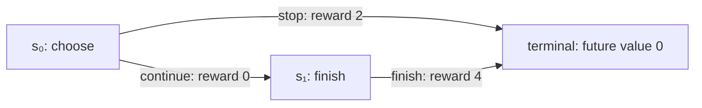

# How to learn from STUDY-RL

Start with a small decision problem, work out the answer yourself, then use the
algorithm to reproduce it. This guide connects the 24 core weeks, the applied
audit in week 25, and causal biology in week 26. Each week has a `teaching_guide.md` alongside its lecture
notes, with worked calculations, an analogy, a derivation, and self-checks.

For a first session, use the [connected learning path](LEARNING_PATH.md) and
[interactive activities](INTERACTIVE_LEARNING.md). Begin with one route choice
and one average; leave future-value calculations for week 2 and gradients for
week 7. The [browser lab](../interactive/index.html#bandit) and standard-library
projects make each step observable before adding a larger method.

When you reach weeks 18–21, add the [practical LLM post-training lab](../llm-lab/README.md).
Its five lessons take the token-policy maths into real LoRA SFT, DPO, quantisation,
saved-adapter inference, and measured evaluation. Work locally on CPU/MPS or use
the [NVIDIA / RTX 5090 guide](../llm-lab/NVIDIA.md) for LoRA and 4-bit QLoRA.

## A weekly learning loop

1. **Predict.** Read the week's teaching guide up to the first calculation. Write
   down which action, update direction, or estimate you expect, and why.
2. **Calculate.** Do the tiny example on paper. Label every probability, reward,
   value, and index before substituting numbers.
3. **Explain.** Read the derivation in the guide, then the corresponding lecture
   section. Explain aloud what licenses each equality: a definition,
   conditioning, linearity, differentiation, or an approximation.
4. **Implement.** Attempt the workbook exercise before opening a hint or calling
   `project/solutions.py`. Some supplied cells already call the reference solution;
   running these verifies the example, not your ability to implement it.
5. **Transfer.** Change a number or assumption. Predict the result before running
   the code. Use the hidden-answer questions at the end of the teaching guide.
6. **Revisit.** At your next study session, reproduce one update from memory. At
   the end of a track, explain how its algorithms differ using the same example.

Keep a short error log: **my prediction → observed result → mistaken assumption
→ smallest example that reveals the mistake**. A green test is useful feedback;
being able to explain and vary the example is a separate learning objective.

## Prerequisite check: five tools you will reuse

For week 1, try the weighted-average and conditional-probability checks.
Return to geometric series in week 2, vector shapes before week 5, and the
chain rule before week 7. Practise a tool when its track needs it.

| Tool | Tiny question | Where you will use it |
|---|---|---|
| Weighted average | Outcomes 2 and 8 occur with probabilities 0.75 and 0.25. What is the mean? | Bellman equations, OPE |
| Conditional probability | Does observing the chosen action tell you the rewards of actions not chosen? | Bandit feedback, selection bias |
| Geometric series | What solves $v=1+0.9v$? | Discounted values, contraction bounds |
| Chain rule | If $p=\sigma(z)$, what is $d\log p/dz$? | Policy gradients, DPO |
| Vector shape | For a batch of $B$ states and $K$ actions, what is the shape of all Q-values? Of chosen Q-values? | DQN, actor-critic losses |

Answers and explanations

1. $0.75(2)+0.25(8)=3.5$. The weights sum to one; a sample outcome need not equal the mean.
2. No. A bandit log reveals the reward of the chosen action. Recovering a target
   policy's average reward requires assumptions about logging and coverage.
3. $v-0.9v=1$, so $v=10$. More generally,
   $\sum_{k\ge0}\gamma^k=1/(1-\gamma)$ when $|\gamma|<1$.
4. $(1/p)\,dp/dz=(1/p)p(1-p)=1-p$. For the other action,
   $d\log(1-p)/dz=-p$.
5. All values have shape $[B,K]$; selecting each observed action gives
   $[B]$, or $[B,1]$ if you retain the action axis. Subtracting a
   $[B]$ target from a $[B,1]$ prediction can broadcast to $[B,B]$:
   a valid tensor operation that computes the wrong loss.

## One decision problem across several algorithms

This is a synthetic two-step delivery task. Numbers are invented for teaching.
At state $s_0$, **stop** ends the episode with reward 2; **continue** gives
reward 0 and moves to $s_1$. At $s_1$, the only action ends the episode
with reward 4. Let $\gamma=0.9$. Here $r_{t+1}$ means the reward
received **after** taking $a_t$; see the [notation bridge](GLOSSARY.md).

**Prediction.** Which action is better? Immediate reward favours stop; the
discounted return of continuing is $0+0.9(4)=3.6$, so continue is better.
The terminal state's value is zero because the reward has already been paid
on the transition into it.

Week 2 reference: Bellman evaluation

### 1. Bellman evaluation: separate the next reward from the rest

For an episode ending at time $T$, define

$$
G_t=\sum_{k=0}^{T-t-1}\gamma^k r_{t+k+1}
   =r_{t+1}+\gamma\underbrace{\sum_{j=0}^{T-t-2}\gamma^j r_{t+j+2}}_{G_{t+1}}.
$$

The second equality removes the first term and re-indexes the remainder;
$G_T=0$. Taking expectations conditional on the present state gives the
Bellman equation. For a fixed policy $\pi$, choose an action with
$\pi(a\mid s)$, then a next state with $P(s'\mid s,a)$:

$$
V^\pi(s)=\sum_a\pi(a\mid s)\sum_{s'}P(s'\mid s,a)
\left[\bar r(s,a,s')+\gamma V^\pi(s')\right],
$$

where $\bar r$ is the conditional **mean** reward. This form assumes a Markov
state and a stationary policy. Finite-horizon tasks can include time in the
state. For infinite-horizon bounded rewards, $\gamma<1$ makes the return
well-defined. These definitions connect reward, return, value, and policy;
compare [Spinning Up's formalism](https://spinningup.openai.com/en/latest/spinningup/rl_intro.html).

Let $\pi(\text{continue}\mid s_0)=0.25$. Then

$$
V^\pi(s_1)=4,\qquad V^\pi(s_0)=0.75(2)+0.25(3.6)=2.4.
$$

An episode returns either 2 or 3.6; **2.4 is an expectation**, not a third
possible episode. Improving the policy to always continue changes the value
to 3.6. Policy evaluation and policy improvement are different operations.

Weeks 3–4 reference: Monte Carlo and TD

### 2. Monte Carlo and TD: same question, different evidence

Suppose the learner currently estimates $\hat V(s_0)=1$,
$\hat V(s_1)=3$, and takes continue. Use learning rate $\alpha=0.5$.

| Method | Target for $s_0$ | Updated estimate | When available? |
|---|---|---|---|
| Monte Carlo | $0+0.9(4)=3.6$ | $1+0.5(3.6-1)=2.3$ | After the episode |
| TD(0) | $0+0.9(3)=2.7$ | $1+0.5(2.7-1)=1.85$ | After the first transition |
| Exact action evaluation | $0+0.9V^\pi(s_1)=3.6$ | No sampling update required | With the correct model/value |

TD uses an estimate inside its target: this is **bootstrapping**. Its smaller
update here reflects the underestimated next-state value, not a smaller true
reward. Both sampled updates concern the visited state under the chosen data
collection scheme; neither individual update must equal $V^\pi(s_0)=2.4$.

**Change one assumption.** Make the last reward 0 or 8 with equal probability.
The true action value stays 3.6, but the continuing episode's return is now 0 or
7.2. With an exact critic, the last-step TD error is still $-4$ or $+4$.
Accurate expectations do not remove randomness from individual outcomes.

Week 7 reference: advantages and policy gradients

### 3. Advantage and policy gradients: compare an action with the policy average

Under the same policy,

$$
A^\pi(s_0,\text{continue})=3.6-2.4=1.2,\qquad
A^\pi(s_0,\text{stop})=2-2.4=-0.4.
$$

Check that $0.25(1.2)+0.75(-0.4)=0$. A negative advantage can accompany
a positive reward: stop is worthwhile in absolute terms but worse than this
policy's average choice at $s_0$.

Parameterise continue's probability as $p=\sigma(z)$. Directly,
$J(z)=2(1-p)+3.6p=2+1.6p$, so

$$
\frac{dJ}{dz}=1.6p(1-p)=1.6(0.25)(0.75)=0.3.
$$

The score-function calculation agrees:

$$
\mathbb E[\nabla_z\log\pi(a\mid s_0)A(s_0,a)]
=0.25(0.75)(1.2)+0.75(-0.25)(-0.4)=0.3.
$$

Both outcomes contribute to favouring continue. This exact one-decision
calculation is a useful check before adding trajectory sampling, a learned
critic, GAE, and PPO. The score-function identity and action-independent
baseline cancellation are derived in
[Spinning Up's policy-gradient derivation](https://spinningup.openai.com/en/latest/spinningup/rl_intro3.html).

Week 4 onward: termination and collection cutoffs

### 4. Terminal and truncated trajectories: two meanings of “the data stopped”

If the task ends after the reward 4, the final target is 4. If collection stops
at $s_1$ because an external rollout budget expired, the task still has a
future: bootstrapping $\hat V(s_1)$ may be needed. Do not turn a collector
boundary into an absorbing state. In a finite-horizon task whose time limit is
part of the objective, reaching that horizon *is* termination, and remaining
time belongs in the state when it affects decisions. See
[Gymnasium's time-limit guidance](https://gymnasium.farama.org/tutorials/gymnasium_basics/handling_time_limits/).

## How to read an unfamiliar algorithm

Before reading pseudocode, fill in this table. It makes algorithm comparisons
more useful than remembering a list of acronyms.

| Question | What to identify |
|---|---|
| What is optimised? | Expected return, entropy-regularised return, preference likelihood, or a constrained objective |
| Where did the data come from? | Current policy, older policies, fixed logs, or a learned simulator |
| What is learned? | Values, policy probabilities, a reward model, or dynamics |
| What is the target? | Full sampled return, bootstrapped target, ranking label, or verifier result |
| Where is the approximation? | Function class, sampling, clipping, model error, or a relaxed constraint |
| What can fail? | Coverage, reward design, numerical stability, or the assumptions behind a theorem |

For an analogy, name what each object represents **and where the comparison
stops working**. “A critic is a forecast” helps explain a value estimate. It
does not imply the forecast is correct, causal, or unchanged after the policy
changes. Use the equation to resolve those questions.

## Week-by-week teaching guides

The core sequence is 1–24; week 25 applies it to an audit, and week 26 adds causal
discovery for biological data. For each row, aim to
answer the question without copying a formula.

| Week | Guide | Question to master |
|---|---|---|
| 01 | [MDPs and bandits](../week-01-mdps-bandits/teaching_guide.md) | Why can the arm with the lower sample mean still be worth trying? |
| 02 | [Bellman and DP](../week-02-bellman-dp/teaching_guide.md) | Why does a backup propagate information about the future? |
| 03 | [Monte Carlo](../week-03-monte-carlo/teaching_guide.md) | Which visit and whose trajectory does this return estimate? |
| 04 | [TD, SARSA, Q-learning](../week-04-td-sarsa-q/teaching_guide.md) | Which next action belongs in each target? |
| 05 | [DQN](../week-05-dqn/teaching_guide.md) | Which network selects an action and which evaluates it? |
| 06 | [Rainbow and BBF](../week-06-rainbow-bbf/teaching_guide.md) | What distinct failure does each component address? |
| 07 | [Policy gradients](../week-07-policy-gradients/teaching_guide.md) | Why does reward multiply a log-probability gradient? |
| 08 | [A2C, GAE, TRPO](../week-08-a2c-gae-trpo/teaching_guide.md) | How do temporal residuals become an advantage estimate? |
| 09 | [PPO](../week-09-ppo/teaching_guide.md) | Which branch is clipped for each sign of advantage? |
| 10 | [SAC and TD3](../week-10-sac-td3/teaching_guide.md) | How does entropy change the objective and its gradient? |
| 11 | [Contextual bandits and OPE](../week-11-contextual-bandits-ope/teaching_guide.md) | When can logged actions evaluate a different policy? |
| 12 | [Ranking and matching](../week-12-rl-ranking-matching/teaching_guide.md) | How do relevance, exposure, and observed clicks differ? |
| 13 | [Multi-agent RL and AlphaZero](../week-13-multi-agent-alphazero/teaching_guide.md) | Whose perspective does a search value use? |
| 14 | [Offline RL](../week-14-offline-rl-1/teaching_guide.md) | What happens when the maximisation chooses an unsupported action? |
| 15 | [Decision Transformer and diffusion](../week-15-decision-transformer-diffusion/teaching_guide.md) | Why is a requested return not a guaranteed outcome? |
| 16 | [Model-based RL](../week-16-model-based/teaching_guide.md) | How can small model errors compound under planning? |
| 17 | [Exploration and meta-learning](../week-17-exploration-meta/teaching_guide.md) | How do novelty and task usefulness differ? |
| 18 | [RLHF and PPO for LMs](../week-18-rlhf-ppo-llm/teaching_guide.md) | Which policy supplies each log-probability and each sample? |
| 19 | [DPO and relatives](../week-19-dpo-zoo/teaching_guide.md) | Why does the normalising constant disappear in a preference pair? |
| 20 | [GRPO, RLOO, RLVR](../week-20-grpo-rloo-rlvr/teaching_guide.md) | What information does a within-prompt baseline remove? |
| 21 | [Reward hacking and oversight](../week-21-reward-hacking-oversight/teaching_guide.md) | What could improve the proxy while worsening the actual objective? |
| 22 | [Constrained MDPs](../week-22-cmdp-cpo-lagrangian/teaching_guide.md) | Why does excess cost increase the penalty multiplier? |
| 23 | [Shielding and robust RL](../week-23-safe-exploration-shielding-robust/teaching_guide.md) | Under which dynamics and safe-set assumptions does the filter protect you? |
| 24 | [Safe matching capstone](../week-24-capstone-safe-matching/teaching_guide.md) | Which evidence supports each claim in the audit? |
| 25 | [Applied ATS audit](../week-25-synthetic-ats-rl-audit/teaching_guide.md) | Which conclusions transfer beyond the synthetic demonstration? |
| 26 | [Causal discovery and biological data](../week-26-causal-discovery-biological-data/teaching_guide.md) | Which assumptions turn observational patterns into intervention claims, and does enhancement preserve them? |

## Taking the causal-biology week

Week 26 has a five-session plan totalling about 10 hours. You can take it after
week 11; week 14 helps with coverage and extrapolation, but the later policy and
LLM weeks are not prerequisites. The existing OPE lessons assume a logging
mechanism and ask about policy value. This extension asks what identifies a
causal effect or graph when biological measurements come from different
patients and environments, and how missingness and enhancement can alter the
answer.

Start with the [guide](../week-26-causal-discovery-biological-data/teaching_guide.md),
then work through its confounding example before the discovery material. Use
the [research dossier](../research/causal_biology.md) to follow primary sources.
The project uses invented patient data with known mechanisms, so you can check
an effect estimate against ground truth and compare preprocessing on an unseen
environment. Those checks teach experimental design; they do not validate a
drug target or reproduce Synlico's proprietary platform.

## Know what you have demonstrated

Use four separate milestones in your [progress tracker](PROGRESS.md): explain
the idea; reproduce a numerical update; implement a transfer case; evaluate the
result. A toy run verifies a mechanism on its fixtures. Reproducing a paper's
reported performance additionally requires its environment, budget, baselines,
evaluation protocol, and uncertainty estimates. A production claim requires
evidence about the actual system and its users.

Read the [teaching review](archive/TEACHING_REVIEW.md) for corrections made in this pass
and limitations that remain in the existing curriculum.
