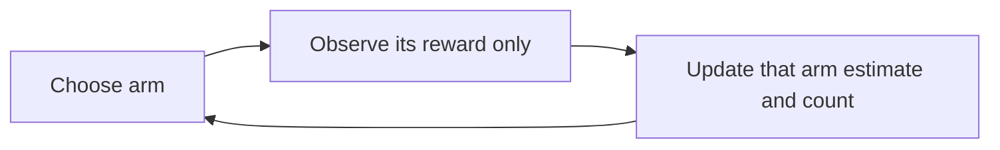

# Week 01 teaching guide — deciding what to try

**Course navigation:** [Start here](../docs/LEARNING_MAP.md) ← **Week 01 / 26** → [Week 02](../week-02-bellman-dp/teaching_guide.md)

[Routes](../docs/LEARNING_MAP.md) · [All weeks](../docs/STUDY_GUIDE.md#week-by-week-teaching-guides) · [Notation](../docs/GLOSSARY.md) · [Progress](../docs/PROGRESS.md)

[Lecture PDF](notes.pdf) · [Workbook](workbook.ipynb) · [Extended reading PDF](extended_reading.pdf)

**You are here:** Why can the arm with the lower sample mean still be worth trying?

**Recall first:** [weighted averages and probabilities](../docs/STUDY_GUIDE.md#prerequisite-check-five-tools-you-will-reuse). If unfamiliar, use the [repair tasks](../docs/LEARNING_MAP.md#if-a-prerequisite-is-missing).

**Visual anchor:** [See the connected diagram](../docs/CONCEPT_ATLAS.md#reward-return-and-value). Use it to explain the mechanism before the derivation.

Use this beside [the workbook](workbook.ipynb) and [the notes](notes.tex).
Read each **Predict** prompt before uncovering the arithmetic.

**Statistics companion:** [A posterior mean is not the observed success fraction](../docs/statistics/08-adaptive-data.md) · [Related foundation](../docs/statistics/03-sampling-uncertainty.md) · [Textbook source map](../docs/statistics/SOURCES.md).

**Bounded first route:** Update one arm mean, explain chosen-action feedback, then distinguish the estimate from uncertainty about its reward law. Leave LinUCB and trajectory OPE for the later route.

## Learning bridge

Follow [the staged learning path](../docs/LEARNING_PATH.md) when a topic is new.

- **Carry forward:** A reward is one observed outcome; its average estimates an action’s unknown mean.
- **Add one difficulty:** Keep three delivery routes fixed and change only how often you try each route. Future-state consequences can wait until week 2.
- **Try after the worked example:** Use the [bandit experiment](../interactive/index.html#bandit), then implement `mean_update` in [the coding exercises](../learning_projects/exercises.py). Start with an estimate of 0.5 from two pulls and observe reward 1.

Check your prediction

2/3: the new observation is the third pull of this action, so the update is 0.5+(1−0.5)/3. Other routes’ pulls do not change this count.

**Carry it onward:** The [next lesson](../week-02-bellman-dp/teaching_guide.md) keeps actions and rewards, then adds a next state and a delayed reward.

## Mechanism at a glance

**Read the diagram:** Only the selected arm supplies a new reward. Its count determines a sample-average step size; unchosen arms do not receive invented observations.

## First pass: one action, one reward, one running average

Read **Before you start**, the lunch-stall analogy, the average-update derivation
and Example 1. Try epsilon-greedy in [the bandit experiment](../interactive/index.html#bandit),
then implement the running mean. That is a complete first lesson.
Treat the Beta-posterior example as an optional probability extension; the
discounting example is your preview of week 2. Read the advanced stretch below
after the basic loop feels familiar. You do not need LinUCB, OPE or a regret
proof to update one arm correctly.

## Before you start

You need expectations, sample averages, and probabilities that sum to one.
A reward is one observation; an expected reward averages over possible outcomes.
This week adds a decision: your action determines which reward you observe.
Next week adds consequences: an action can also change the next state.

## Analogy: choosing a lunch stall

You repeatedly choose between stalls whose meal quality is uncertain.

| Story element | Mathematical object |
|---|---|
| Stall | Arm/action $a$ |
| Quality of today's meal | Sample reward $R_t$ |
| Stall's long-run average quality | Unknown mean $\mu_a$ |
| Your record of visits | Count $N_a$ and estimate $\hat\mu_a$ |
| Trying a poorly measured stall | Exploration |

**Limit:** the stationary bandit model assumes the reward law stays fixed.
A stall getting crowded because you recommend it creates action-dependent
future conditions; that calls for an MDP or a changing-bandit model.
Random exploration is not automatically optimism: UCB explicitly adds a bonus;
Thompson sampling randomises through a posterior; epsilon-greedy randomises actions.

## Derivation: from an average to an online update

Let $R_1,\ldots,R_n$ be the rewards from one arm's first $n$ pulls.
Define $Q_n=(R_1+\cdots+R_n)/n$; $n$ counts this arm, not all rounds.
Then

$$
Q_n=\frac{(n-1)Q_{n-1}+R_n}{n}
=Q_{n-1}+\frac{R_n-Q_{n-1}}{n}.
$$

1. The old sum is $(n-1)Q_{n-1}$.
2. Add the newly observed reward, then divide by the new count.
3. The innovation $R_n-Q_{n-1}$ tells you which direction to move.
4. The step size $1/n$ makes old and new observations equally weighted overall.

For independent stationary rewards with mean $\mu_a$, this estimates $\mu_a$.
With changing means, a constant step size forgets old data but is no longer
exactly the all-history sample average.

## Optional bookkeeping: expected regret

You can first implement the mean update and return here to interpret the
playground’s regret graph. The simulator knows the reward means; the agent does not.

Now let $\mu^*=\max_a\mu_a$ and $\Delta_a=\mu^*-\mu_a$.
Conditional on the chosen arm, $\mathbb E[R_t\mid A_t]=\mu_{A_t}$.
Therefore expected regret after $T$ rounds is

$$
\mathcal R_T=\sum_{t=1}^T\mathbb E[\mu^*-\mu_{A_t}]
=\sum_a\Delta_a\mathbb E[N_a(T)].
$$

This is an accounting identity: expected loss per pull times expected pulls.
Do not confuse this expected regret with a realised reward shortfall.

## Example 1: update, regret, and one lucky observation

**Predict:** can an inferior arm give reward 1 and still incur regret?

Arm means are $(0.2,0.5,0.8)$; a realised action sequence is $(2,1,2,3)$,
using one-based arm labels. Thus counts are $(1,2,1)$.
The gaps are $(0.6,0.3,0)$, so the sum of mean gaps on this path is

$$1(0.6)+2(0.3)+1(0)=1.2.$$

Suppose arm 2's two observed rewards are $(1,0)$.
Its estimates are $Q_1=1$ and $Q_2=1+(0-1)/2=0.5$.
The first observed success still incurred gap $0.8-0.5=0.3$.

**Interpretation:** the simulator knows the means and can compute these gaps.
A deployed learner sees only the chosen reward and cannot directly observe regret.
If observed rewards on the full path are $(1,0,0,1)$, their sum is 2;
$4(0.8)-2=1.2$ happens to agree here, but generally it will not.

## Optional probability extension: uncertainty is different from disappointment

**Predict:** after a failed pull, must posterior variance increase?

A Beta$(3,2)$ posterior has mean $3/5=0.6$ and variance

$$\frac{3\cdot2}{5^2(5+1)}=0.04.$$

A Bernoulli failure changes it to Beta$(3,3)$.
The new mean is $3/6=0.5$ and the variance is

$$\frac{3\cdot3}{6^2(6+1)}=\frac1{28}\approx0.035714.$$

**Interpretation:** this observation makes the arm less attractive and, measured
by variance, less uncertain. Posterior mean and posterior uncertainty are different.
Thompson sampling draws a value from the posterior; it does not always select
the arm with the highest posterior mean.

## Week 2 preview: discounting changes the question

**Predict:** which is better, reward 2 now or reward 3 one step later?

Immediate action: rewards $(2,0)$, return $2+\gamma0=2$.
Delayed action: rewards $(0,3)$, return $0+\gamma3=3\gamma$.
At $\gamma=0.5$, delayed return is 1.5; at $\gamma=0.9$, it is 2.7.
The preference switches at $\gamma=2/3$.

**Interpretation:** discounting expresses an objective; changing it can change
which action is optimal. It also affects mathematical conditioning.

## Bridge to this week's code

- [agent.py](project/agent.py): `EpsilonGreedyAgent.update` and `UCB1Agent.update`
  implement the count-then-average update. `select` handles unplayed arms first.
- [solutions.py](project/solutions.py): exercises 1, 4, and 6 correspond directly
  to the mean, Beta update, and discounted-return calculations above.
- [env.py](project/env.py): `regret` and `instantaneous_regret` use known simulator
  means; these are evaluation oracles, not information available to the agent.

### Optional stretch: return after week 11

The following contextual-bandit and evaluation code is available in this bundle,
but it is not a week 1 prerequisite. First learn the running mean above; use
[week 11](../week-11-contextual-bandits-ope/teaching_guide.md) when you want to learn
from context or evaluate a different policy from logged actions.

- `SyntheticLeadBrokerBandit.expected_reward` uses a sigmoid. Linear LinUCB is
  therefore a modelling approximation here, not an exact instance of its linear theorem.
- `exercise_8_snips` validates observed probabilities and normalises importance
  weights; it rejects an all-zero target-weight sum as undefined. Validation cannot
  recover outcomes for actions absent from the logging policy's support.

## Optional theory: what the regret result does and does not say

Read this after you can distinguish a realised reward from a mean gap. The bound
is background for deeper study; deriving it is not required for your first
bandit implementation.

UCB1's pull bound scales as $\log(T)/\Delta_a^2$; multiplying by $\Delta_a$
gives regret of order $\log(T)/\Delta_a$.
Compare **regret** coefficients $8/\Delta_a$ and $\Delta_a/\mathrm{KL}$,
or compare **pull-count** coefficients $8/\Delta_a^2$ and $1/\mathrm{KL}$.
The original proof must union-bound over possible adaptive sample counts.
See [Auer, Cesa-Bianchi and Fischer, Theorem 1 and its proof](https://homes.di.unimi.it/~cesabian/Pubblicazioni/ml-02.pdf).

## Choose your explanation depth: Why uncertainty shrinks with observations

Open the first layer for the idea, the second to calculate, and the third to check the assumptions. The worked examples above and investigation below provide the longer route.

1 · Intuition

An estimated mean and confidence in that mean are different quantities. Two actions can have the same average reward while the less-tested action has a larger exploration bonus. UCB gives that uncertain action a chance to collect evidence; it does not claim its true reward is larger.

2 · Work a numerical case

At a fixed round, compare counts 1, 4 and 16. The UCB bonus is proportional to one over the square root of the count, so their bonuses have ratio 4:2:1. A lucky reward increases the mean estimate; another observation also shrinks the uncertainty term. These are separate effects.

3 · Derive it and state the limits

For independent rewards in $[0,1]$, Hoeffding gives $P(\bar R_n-\mu\ge b)\le e^{-2nb^2}$. Setting $b=\sqrt{2\log t/n}$ makes this fixed-count probability at most $t^{-4}$. A bandit chooses sample counts adaptively, so the full regret proof must also account for possible counts and rounds. Stationarity and boundedness are assumptions, not conclusions of a shrinking bonus. See the earlier regret section for the gap-dependent pull bound.

**Try it in Jupyter:** jump to [`exercise_3_ucb1_bonus` in the workbook](workbook.ipynb#cell-14), then run the setup cells above it. Hold `t` fixed while changing counts; otherwise time and count effects are mixed. Expected bonus ratios are exact up to floating-point rounding, whereas a one-seed regret ranking is not guaranteed.

## Notebook investigation: track uncertainty separately from reward

Open [the actual Jupyter workbook](workbook.ipynb) and find **Exercises 1, 3 and 6**.
The [GitHub week folder](https://github.com/samuel-zhang01/STUDY-RL/tree/main/week-01-mdps-bandits)
contains this notebook, its `project/` imports and tests. Follow the
[download and Jupyter workflow](../docs/LEARNING_MAP.md#download-and-open-the-jupyter-materials)
so the shared `common/` package is available.

Start with rewards `(1,0,1,0)` in exercise 1. Before running, write the four means:
`1, 0.5, 2/3, 0.5`. Replace the reference call with your own update if you are practising implementation.
Then use exercise 3 with counts `(1,4,16)` at a fixed round `t=100`: the bonuses should be in the ratio
`4:2:1`, since only the square root of count changes. A lower bonus is less uncertainty under the
bound's assumptions, not a worse reward estimate.

Draw two separate panels: running mean against **pulls of that arm**, and bonus against **arm count**.
Keep the round number fixed for the second panel. Finally change exercise 6's discount from 0 to 1
on rewards `(1,1,1)`; return changes from 1 to 3. Neither this return curve nor an arm's sample mean
is its cumulative regret.

Check your interpretation: Why can a bonus increase between two decisions even when that arm received no new reward?

Its count can stay fixed while the global round t increases, increasing log(t) in the UCB bonus. The estimate and the bonus answer different questions.

## Statistics bridge: A posterior mean is not the observed success fraction

**Model and unit.** Use independent stationary Bernoulli rewards and an explicitly chosen Beta prior for one arm. This is a probability-model illustration, not an algorithm ranking.

**Calculate before running.** After three successes and one failure, a Beta$(1,1)$ prior becomes Beta$(4,2)$. The observed success fraction is $3/4$, but the posterior mean is $4/6=2/3$ and posterior variance is $4(2)/(6^2(7))=2/63\approx0.031746$. With a Beta$(10,10)$ prior, the same observations give Beta$(13,11)$, mean $13/24\approx0.541667$.

**Interpret the result.** The data are identical; the posterior changes because the prior is part of the model. A posterior variance is not the frequentist SE of the observed success fraction, and a UCB exploration bonus is another object again.

**Change one assumption.** Replace the prior by Beta(2,2). Calculate the new mean and explain whether a smaller posterior spread would establish lower deployed regret.

Check the changed assumption

The posterior is Beta$(5,3)$, with mean $5/8=0.625$. A posterior summary under this reward model does not establish deployed regret or protection against a changing reward law.

Work through the [foundation lesson](../docs/statistics/08-adaptive-data.md) and the statistics investigation near the end of the [workbook](workbook.ipynb). Textbook grounding: Siegrist §7.4, PDF p.929; §6.2, PDF p.817; [edition and page details](../docs/statistics/SOURCES.md). These are course-created numerical fixtures, not new benchmark measurements.

## Retrieve and transfer

1. Why not divide an arm's update by the total round number?

An arm pulled twice should average its two observations. Total rounds count
other arms' data and would underweight this arm's new observation.

2. Optional week 11 transfer: when is lead routing more than a contextual bandit?

When a routing choice changes future broker capacity, later opportunities, or
other persistent state that affects reward. Those consequences need modelling.

3. Optional week 11 transfer: can clipping repair an action with no logged support?

No. Clipping can limit valid large weights, but it cannot repair a zero logging
probability or supply counterfactual evidence.
Coverage is a property of data collection, not a denominator repair.

Arithmetic check: the finite sums, posterior variances, and discount threshold
were recomputed with local Python; no training run is required for these checks.
