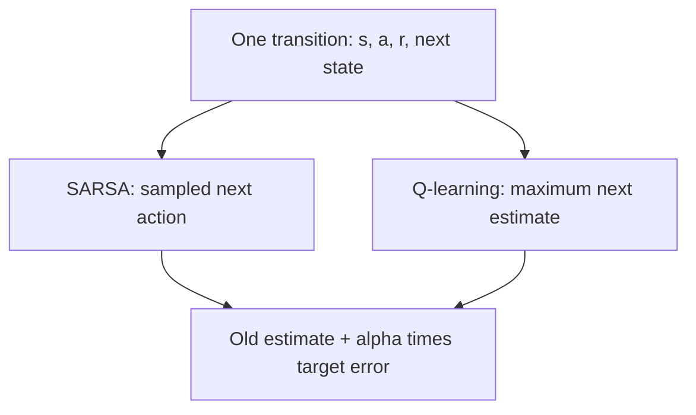

# Week 04 teaching guide — learning before the episode ends

**Course navigation:** [Week 03](../week-03-monte-carlo/teaching_guide.md) ← **Week 04 / 26** → [Week 05](../week-05-dqn/teaching_guide.md)

[Routes](../docs/LEARNING_MAP.md) · [All weeks](../docs/STUDY_GUIDE.md#week-by-week-teaching-guides) · [Notation](../docs/GLOSSARY.md) · [Progress](../docs/PROGRESS.md)

[Lecture PDF](notes.pdf) · [Workbook](workbook.ipynb) · [Extended reading PDF](extended_reading.pdf)

**You are here:** Which next action belongs in each target?

**Recall first:** [Week 02](../week-02-bellman-dp/teaching_guide.md), [Week 03](../week-03-monte-carlo/teaching_guide.md). If unfamiliar, use the [repair tasks](../docs/LEARNING_MAP.md#if-a-prerequisite-is-missing).

**Visual anchor:** [See the connected diagram](../docs/CONCEPT_ATLAS.md#one-transition-different-targets). Use it to explain the mechanism before the derivation.

Use with [the workbook](workbook.ipynb) and [the notes](notes.tex).
For every update, say aloud which policy supplies the next-action value.

## Learning bridge

Follow [the staged learning path](../docs/LEARNING_PATH.md) when a topic is new.

- **Carry forward:** Retrieve the week 1 incremental update and the week 2 reward-plus-future decomposition.
- **Add one difficulty:** Replace the unobserved remainder of a trip with a current estimate. Q-learning chooses the best estimated next action; SARSA uses the next action actually sampled.
- **Try after the worked example:** Try [the courier game](../interactive/index.html#courier), then implement `q_target` in [the coding exercises](../learning_projects/exercises.py). For reward 0, gamma 0.9 and next-action values (2,3.6), predict a Q-learning target and a SARSA target if the sampled next action has value 2.

Check your prediction

Q-learning uses 0+0.9×3.6=3.24; SARSA uses 0+0.9×2=1.8. The difference comes from the next action, not different observed rewards.

**Carry it onward:** [DQN](../week-05-dqn/teaching_guide.md) keeps this target idea but replaces the table with shared neural-network parameters.

## Mechanism at a glance

**Read the diagram:** Both methods use an observed reward and a bootstrapped future. The next-action rule differs even when the same transition supplies the data.

## Before you start

Week 02 supplied exact Bellman expectations; Week 03 supplied full sampled returns.
TD takes one observed transition and substitutes an estimate for the unobserved future.
You need both the Bellman equation and the incremental update from Week 01.
Here $r=R_{t+1}$ follows the current action, even when code names it `r_t`.

## Analogy: revising an arrival-time estimate mid-journey

| Journey idea | TD object |
|---|---|
| Old predicted remaining journey | $V(s)$ |
| Time actually spent on the next road | Immediate cost $-r$ |
| New estimate from the next junction | Bootstrap $V(s')$ |
| Difference between new evidence and old prediction | TD error $\delta$ |
| How much you revise the estimate | Step size $\alpha$ |

You need not finish the entire journey before revising the estimate.
**Limit:** the next-junction estimate can itself be wrong. Bootstrapping trades
waiting for reliance on a learned prediction; it does not create ground-truth labels.

## Derivation: a sampled Bellman update

For a fixed policy $\pi$, the Bellman equation is

$$V^\pi(s)=\mathbb E_\pi[r+\gamma V^\pi(S')\mid S=s].$$

Given a transition, define $d=1$ only for a true terminal next state and use

$$y=r+\gamma(1-d)V(s'),\qquad \delta=y-V(s),
\qquad V_{\rm new}(s)=V(s)+\alpha\delta.$$

1. The reward is observed data.
2. The continuation is a current estimate, masked away on termination.
3. The error compares that target with the prediction before the update.
4. For $0<\alpha\le1$, the new value is $(1-\alpha)V(s)+\alpha y$.

If $V=V^\pi$, the **conditional mean** of $\delta$ at each state is zero.
Individual TD errors can still be nonzero because rewards/transitions are random.
With an approximate value, the mean error is the Bellman residual $T_\pi V-V$.
This residual vector need not be nonzero at every individual state.

For action values, the three target choices are

| Method | Bootstrap at a nonterminal $s'$ |
|---|---|
| SARSA | $Q(s',A')$, with actual next action $A'\sim\pi$ |
| Expected SARSA | $\sum_b\pi(b\mid s')Q(s',b)$ |
| Q-learning | $\max_bQ(s',b)$ |

The last targets greediness even when behaviour still explores.

## Example 1: the same transition, three different lessons

**Predict:** if the next exploratory action is bad, which update notices?

Let $Q(s,a)=2$, $r=-1$, $\gamma=0.9$, and $\alpha=0.5$.
At $s'$, $Q(s',\cdot)=(4,-2)$. Epsilon-greedy uses $\epsilon=0.2$,
so action probabilities are $(0.9,0.1)$, including random draws of the greedy action.
Suppose the sampled next action is the second one.

SARSA: $y=-1+0.9(-2)=-2.8$;
$\delta=-2.8-2=-4.8$; new $Q=2+0.5(-4.8)=-0.4$.

Expected SARSA: expected bootstrap $0.9(4)+0.1(-2)=3.4$;
$y=-1+0.9(3.4)=2.06$; new $Q=2+0.5(0.06)=2.03$.

Q-learning: $y=-1+0.9(4)=2.6$;
new $Q=2+0.5(0.6)=2.3$.

**Interpretation:** SARSA uses one realised next action; Expected SARSA averages
that source of randomness; Q-learning evaluates the greedy continuation.
The methods are learning about different continuation behaviour.
Expected SARSA has no greater conditional target variance from sampling $A'$;
equality occurs when all next-action values are equal or the policy is deterministic.

## Example 2: termination is an objective boundary

**Predict:** should a terminal reward 5 be followed by a value prediction of 100?

Let old $V(s)=2$, $\gamma=0.9$, $\alpha=0.5$, reward 5, and stored $V(s')=100$.
For a true terminal transition, $d=1$: $y=5$, $\delta=3$, new value $3.5$.
Without the mask, $y=5+0.9(100)=95$ and new value becomes $48.5$.

At an artificial sampling cutoff in a continuing task, future rewards still exist;
a suitable $V(s')$ is precisely what allows bootstrapping past the cutoff.
If 100 were a justified continuation estimate there, 95 would be the appropriate target.

**Interpretation:** the same observation array can require different targets
depending on why collection stopped. A reset observation is not the final observation.

## Derivation and example 3: the n-step bridge to MC

Expand the Bellman recursion $n$ times and keep the final estimate:

$$G_t^{(n)}=\sum_{k=0}^{n-1}\gamma^kR_{t+k+1}
+\gamma^nV(S_{t+n}).$$

For rewards $(1,2)$, $\gamma=0.5$, $n=2$, continuation value 4:
$G^{(2)}=1+0.5(2)+0.5^2(4)=3$.
If the second transition truly terminates, continuation is zero and the return is 2.
If the episode ends after the first reward, the return is just 1.

With exact $V^\pi$ and square-integrable returns, these conditional expectations
form a martingale as more future outcomes are revealed; variance is nondecreasing
with $n$ by the conditional-variance decomposition.
With inaccurate learned values, variance and bias need not vary monotonically.

## Bridge to this week's code

- [solutions.py](project/solutions.py), exercises 3–5, expose the three targets
  as tiny pure operations. Set the same arrays to reproduce Example 1.
- `exercise_1_td0` uses `sp == -1` for a terminal state.
- `exercise_2_nstep_return` infers early termination from a short reward list.
  For termination exactly at $n$, explicitly pass `V_terminal=0`.
- [agents.py](project/agents.py) contains full SARSA/Q-learning loops and exploration
  schedules. These loops reset on termination or truncation, but only true
  termination removes the target's bootstrap. `n_step_td_prediction` also retains
  a final-state bootstrap at a collector cutoff or an environment time limit.
- Double Q separates selection and evaluation across two estimates. They need not
  be statistically independent in an interacting learner, and bias need not vanish.

Tabular convergence requires appropriate visitation and diminishing step sizes.
General linear TD converges to a projected fixed point under additional assumptions,
not necessarily the exact value. See
[Tsitsiklis and Van Roy, 1997](https://web.mit.edu/~jnt/www/Papers/J063-97-bvr-td.pdf).
For environment boundary semantics, see
[Gymnasium's time-limit explanation](https://gymnasium.farama.org/tutorials/gymnasium_basics/handling_time_limits/).

## Episode boundaries in the project

A true terminal ends the Bellman bootstrap. An external time limit ends
collection but retains the final state's continuation value. For example,
with reward 1, gamma 0.9, and final value 10, the truncated target is
$1+0.9(10)=10$; the terminal target is 1. The trainer uses the termination
flag for this mask and either flag to reset the environment.
See [Gymnasium's time-limit guidance](https://gymnasium.farama.org/tutorials/gymnasium_basics/handling_time_limits/).

## Choose your explanation depth: Which randomness Expected SARSA removes

Open the first layer for the idea, the second to calculate, and the third to check the assumptions. The worked examples above and investigation below provide the longer route.

1 · Intuition

SARSA samples the next action and uses its estimated value. Expected SARSA averages over possible next actions before updating. It removes that action draw while retaining randomness in the reward, successor state and learned estimates.

2 · Work a numerical case

For successor-action values (2,4) and probabilities (0.25,0.75), the sampled continuation mean is 3.5. Its variance is 0.25(2−3.5)²+0.75(4−3.5)² = 0.75. Expected SARSA substitutes 3.5 directly, so the conditional variance from this action draw is zero. If both values were 2, both methods would already have zero conditional variance.

3 · Derive it and state the limits

Let $Y=R+\gamma Q(S\prime,A\prime)$, conditioning on fixed estimates and the observed transition. The expected target is $E[Y\mid R,S\prime]$. The law of total variance gives $\operatorname{Var}(Y)=E[\operatorname{Var}(Y\mid R,S\prime)]+\operatorname{Var}(E[Y\mid R,S\prime])$. Thus this conditional averaging cannot increase that target variance. It says nothing universal about final control error after many changing updates. A true terminal state has no continuation; a continuing-task time limit needs its final-state bootstrap.

**Try it in Jupyter:** jump to [`exercise_5_expected_sarsa_target` in the workbook](workbook.ipynb#cell-20), then run the setup cells above it. With epsilon 0.5, expect continuation 3.5 before reward and discount. Use the actual next-action distribution, including exploration; a uniform mean silently changes the target policy.

## Notebook investigation: use one transition to compare three algorithms

Open [the actual Jupyter workbook](workbook.ipynb) and find **Exercises 3, 4 and 5**.
The [GitHub week folder](https://github.com/samuel-zhang01/STUDY-RL/tree/main/week-04-td-sarsa-q)
contains this notebook, its `project/` imports and tests. Follow the
[download and Jupyter workflow](../docs/LEARNING_MAP.md#download-and-open-the-jupyter-materials)
so the shared `common/` package is available.

Keep the observed transition fixed: old Q is 2, reward is -1, next values are `(4,-2)`,
gamma is 0.9, alpha is 0.5, and epsilon is 0.2. Choose the second next action for SARSA.
Record **target, error, new Q** as three separate columns: SARSA gives `(-2.8,-4.8,-0.4)`;
Expected SARSA gives `(2.06,0.06,2.03)`; Q-learning gives `(2.6,0.6,2.3)`.
Exercise 5 returns the expected bootstrap, so multiply by gamma and add reward before comparing it
with the other target columns.

Draw arrows from old Q to new Q on a common number line. Change only epsilon to zero, keeping the
Q-learning target fixed; Expected SARSA now agrees with Q-learning. Finally mark the transition
terminal: every target becomes reward -1 and every update becomes 0.5, regardless of next values.

Check your interpretation: Would setting the next action to the greedy action make SARSA and Q-learning the same algorithm?

It makes this one target equal. Their targets can differ again on a later exploratory action, and their long-run objectives and data collection still matter.

## Retrieve and transfer

1. At the exact value, must every TD error be zero?

No. Its conditional expectation is zero. Random rewards and transitions still
produce nonzero sample errors; zero variance is a stronger, special condition.

2. What happens to Expected SARSA at epsilon = 0 and epsilon = 1?

Its bootstrap becomes the maximum at zero and the uniform mean at one.
For $(4,-2)$ those are 4 and 1 respectively.

3. Does epsilon decreasing to zero alone imply GLIE?

No. GLIE also requires infinitely many visits to relevant state-action pairs.
Exploration can decay so quickly that the needed coverage never occurs.

Arithmetic check: local Python reproduced all three updates, both terminal-mask
outcomes, and the n-step returns 3, 2, and 1.
