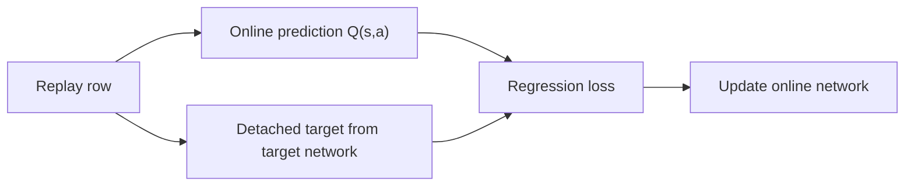

# Week 05 teaching guide — why a Q-network needs careful targets

**Course navigation:** [Week 04](../week-04-td-sarsa-q/teaching_guide.md) ← **Week 05 / 26** → [Week 06](../week-06-rainbow-bbf/teaching_guide.md)

[Routes](../docs/LEARNING_MAP.md) · [All weeks](../docs/STUDY_GUIDE.md#week-by-week-teaching-guides) · [Notation](../docs/GLOSSARY.md) · [Progress](../docs/PROGRESS.md)

[Lecture PDF](notes.pdf) · [Workbook](workbook.ipynb) · [Extended reading PDF](extended_reading.pdf)

**You are here:** Which network selects an action and which evaluates it?

**Recall first:** [Week 04](../week-04-td-sarsa-q/teaching_guide.md). If unfamiliar, use the [repair tasks](../docs/LEARNING_MAP.md#if-a-prerequisite-is-missing).

**Visual anchor:** [See the connected diagram](../docs/CONCEPT_ATLAS.md#where-dqn-sends-the-gradient). Use it to explain the mechanism before the derivation.

Use beside [the workbook](workbook.ipynb) and [the notes](notes.tex).
The main calculation is supervised regression with a deliberately frozen target.

**Statistics companion:** [Evaluation episodes do not replace independent DQN training runs](../docs/statistics/03-sampling-uncertainty.md) · [Related foundation](../docs/statistics/06-regression-validation.md) · [Textbook source map](../docs/statistics/SOURCES.md).

**Bounded first route:** Inspect the chosen-action Q shape, terminal target and target-network update, then run a small frozen-policy evaluation separately from training loss.

## Learning bridge

Follow [the staged learning path](../docs/LEARNING_PATH.md) when a topic is new.

- **Carry forward:** Retrieve [week 4’s](../week-04-td-sarsa-q/teaching_guide.md) Q-learning target and identify which part is treated as a fixed regression label.
- **Add one difficulty:** A Q-network shares parameters across states: fitting one courier transition can change predictions elsewhere. Replay and a target network manage this moving learning problem.
- **Try after the worked example:** Use [the existing DQN exercises](project/solutions.py) to build one batch target. If the target network predicts next values (5,3), reward is 0 and gamma is 0.9, predict the standard DQN target before running it. Use the browser courier only to recall the tabular target; it contains no neural network.

Check your prediction

Standard DQN takes the target-network maximum: 0+0.9×5=4.5. This is an estimated label, not a measured future return.

**Carry it onward:** [Week 6](../week-06-rainbow-bbf/teaching_guide.md) separates target selection from evaluation and changes replay sampling one component at a time.

## Mechanism at a glance

**Read the diagram:** The loss compares a current prediction with a detached target. The target network is refreshed separately; this regression step does not differentiate through it.

## Before you start

Recall Week 04's Q-learning target $r+\gamma\max_bQ(s',b)$.
You also need neural-network gradients, batched tensors, and gradient descent.
A network shares parameters across states; a tabular update changes one entry.
Week 06 will change target selection, replay sampling, and the network head.

## Analogy: a student copying a periodically revised answer sheet

| Story element | DQN object |
|---|---|
| Student's current predictions | Online network $Q_\theta$ |
| Current answer sheet | Target network $Q_{\theta^-}$ |
| Exercises from earlier lessons | Replay transitions |
| Revising the answer sheet | Hard copy or Polyak update |
| Error on a chosen exercise | TD error |

Holding the answer sheet fixed briefly gives the student a stable regression target.
**Limit:** the sheet is produced from the student's own estimates, not an oracle.
A frozen target can be wrong, and replay data can cover the state space poorly.
Neither mechanism proves neural Q-learning will converge.

## Derivation: what receives the gradient

A replay row is $(s_i,a_i,r_i,s'_i,d_i)$, where $d_i$ flags true termination.
The online network returns one value per action. Select the value for the
recorded action: $q_i=Q_\theta(s_i,a_i)$.
Treat the next-state target as constant during this optimisation step:

$$y_i=r_i+\gamma(1-d_i)\max_bQ_{\theta^-}(s'_i,b),
\qquad \delta_i=y_i-q_i.$$

For half squared error $L_i=\tfrac12(q_i-y_i)^2$,

$$\frac{\partial L_i}{\partial q_i}=q_i-y_i=-\delta_i,
\qquad \nabla_\theta L_i=-\delta_i\nabla_\theta Q_\theta(s_i,a_i).$$

1. Predict **all** action values for each recorded state.
2. Gather the column corresponding to its recorded action.
3. Build $y_i$ without autograd tracking.
4. Minimise the mean loss; a positive TD error increases the selected prediction.

For unit-threshold Huber loss, replace $q_i-y_i$ in the derivative with
$\operatorname{clip}(q_i-y_i,-1,1)$.
This bounds the derivative with respect to the prediction, not necessarily the
full parameter-gradient norm, since the network Jacobian can be large.
Gradient-norm clipping in the agent is a separate operation.

## Example 1: one batch, two very different targets

**Predict:** which row should have no dependence on the next-state network?

Take batch size $B=2$, three actions, and online predictions

$$q_{\rm all}=\begin{bmatrix}1&2&3\\4&5&6\end{bmatrix},
\qquad a=(2,0),$$

where actions use zero-based indices. Gathered predictions are $(3,4)$.
Rewards are $(1,-2)$; terminal flags are $(0,1)$; $\gamma=0.5$.
Target-network next values are $(0,4,2)$ and $(100,100,100)$.

First target: $y_1=1+0.5(4)=3$.
Second target: $y_2=-2+0.5(0)(100)=-2$.
Errors $\delta=(0,-6)$; unit Huber losses are $(0,6-0.5)=(0,5.5)$.
Mean loss is $2.75$; its derivatives with respect to gathered predictions
are $(0,0.5)$, including division by batch size.

**Interpretation:** descent pushes the second prediction down. The 100s have
no role on a terminal row. If `(B,1)` predictions are compared with `(B,)`
targets, broadcasting can create a `(B,B)` loss and compare the wrong rows.

## Example 2: a tiny linear network exposes the sign

**Predict:** if the target exceeds the prediction, should the weight increase?

Let $Q_\theta(s,a)=\theta x$, scalar feature $x=2$, initial $\theta=1$,
fixed target $y=3$, and learning rate $\eta=0.1$.
Prediction $q=2$; error $\delta=1$; half squared loss $0.5$.
Gradient $(q-y)x=(-1)(2)=-2$.
Descent gives $\theta'=1-0.1(-2)=1.2$, so $q'=2.4$ and loss $0.18$.

Now suppose the target itself were $y(\theta)=1+0.5\theta$.
At $\theta=1$, the residual is $q-y=0.5$.
The semi-gradient is $0.5(2)=1$;
the full sampled-residual gradient is $0.5(2-0.5)=0.75$.

**Interpretation:** stopping a target gradient changes the update mathematically.
Neither derivative is a typographical variant of the other. Optimising a sampled
squared residual is also different from squaring the expected Bellman residual.

## Example 3: how quickly does a target catch up?

**Predict:** does a soft update immediately copy the online network?

For one parameter, target $\theta^-=2$, online $\theta=10$, and $\tau=0.25$:
first soft update gives $0.75(2)+0.25(10)=4$;
second gives $0.75(4)+0.25(10)=5.5$.
With fixed online weights, the gap follows

$$\theta^-_k-10=(1-\tau)^k(2-10).$$

At $\tau=0$ the target never moves; at $\tau=1$ it copies immediately.
Periodic hard copies can be represented by a time-varying $\tau$ equal to
zero between copy times and one on a copy time. Constant-$\tau$ updates differ.

## Bridge to this week's code

- [agent.py](project/agent.py), `DQNAgent.learn`, uses `gather`, `torch.no_grad`,
  and `smooth_l1_loss` in exactly the sequence derived above.
- `DQNConfig.target_hard_every > 0` selects hard copies; otherwise
  `_soft_update` uses `target_tau` after learning.
- [solutions.py](project/solutions.py), exercises 1–3 and 6, isolate gather,
  target construction, target averaging, and Huber loss for hand comparisons.
- `exercise_7_baird_divergence` is a specific linear counterexample; one divergent
  example shows a guarantee fails, not that every combination must diverge.
- `exercise_9_action_value_trace` exposes model predictions. A large predicted
  best-versus-second-best gap is not measured causal lift over a uniform policy.
  Even exact immediate action lift over uniform would use best minus **mean**.

The original stabilisation mechanisms and their Atari setting appear in
[Mnih et al., Human-level control through deep reinforcement learning](https://www.nature.com/articles/nature14236).
The continuation mask should follow
[Gymnasium's termination/truncation semantics](https://gymnasium.farama.org/tutorials/gymnasium_basics/handling_time_limits/).

## Episode boundaries in the project

A true terminal ends the Bellman bootstrap. An external time limit ends
collection but retains the final state's continuation value. For example,
with reward 1, gamma 0.9, and final value 10, the truncated target is
$1+0.9(10)=10$; the terminal target is 1. The trainer uses the termination
flag for this mask and either flag to reset the environment.
See [Gymnasium's time-limit guidance](https://gymnasium.farama.org/tutorials/gymnasium_basics/handling_time_limits/).

## Choose your explanation depth: Why a DQN target is held fixed during its update

Open the first layer for the idea, the second to calculate, and the third to check the assumptions. The worked examples above and investigation below provide the longer route.

1 · Intuition

The online network is being asked to predict a target. If the optimiser also moves the target through the same gradient, it is solving a different problem. Replay selects the examples; the target network supplies a slower-moving continuation estimate.

2 · Work a numerical case

For reward 1, discount 0.9 and maximum target-network value 4, a nonterminal target is 4.6. If the online selected-action prediction is 2, the prediction error is 2.6. For the same reward at a true terminal transition, the target is 1 regardless of the next-state network output.

3 · Derive it and state the limits

With $y=r+\gamma(1-d)\max_aQ_{\bar\theta}(s\prime,a)$ and half-squared loss $L=(Q_\theta(s,a)-y)^2/2$, the semi-gradient is $(Q_\theta-y)\nabla_\theta Q_\theta$ when $y$ is detached. The target parameters $\bar\theta$ are held fixed for that optimiser step. Huber loss changes the influence of large residuals. This setup does not turn nonlinear off-policy learning into a contraction theorem; replay and target updates are stabilising design choices with empirical limits.

**Try it in Jupyter:** jump to [`exercise_2_dqn_target` in the workbook](workbook.ipynb#cell-11), then run the setup cells above it. Expect 4.6 and 1 for nonterminal and terminal cases. Check selected Q has shape `[batch]`; broadcasting it against `[batch,1]` can produce an unintended pairwise loss.

## Notebook investigation: make a batch-shape bug visible

Open [the actual Jupyter workbook](workbook.ipynb) and find **Exercises 1, 2 and 6**.
The [GitHub week folder](https://github.com/samuel-zhang01/STUDY-RL/tree/main/week-05-dqn)
contains this notebook, its `project/` imports and tests. Follow the
[download and Jupyter workflow](../docs/LEARNING_MAP.md#download-and-open-the-jupyter-materials)
so the shared `common/` package is available.

Reproduce the guide's two-row example before training a network. Gather predictions `(3,4)`
and construct targets `(3,-2)`. Both arrays should have shape `(2,)`. The intended residuals are
`(0,6)` when written prediction minus target. Deliberately reshape only the predictions to `(2,1)`:
subtraction then makes a `(2,2)` matrix, comparing each prediction with both targets.

Show that wrong matrix as a small annotated heatmap; it reveals why a plausible scalar loss can
still be meaningless. Restore equal shapes and verify the unit-threshold mean Huber loss is 2.75.
Now change only the terminal row's next values from 100 to 1000: its target and loss must stay fixed.
This check isolates masking from optimisation. A training curve cannot explain a failed mask.

Check your interpretation: If the TD loss falls after this repair, has the policy been shown to improve?

Only regression agreement on the sampled targets improved. Policy return needs separate evaluation; shared parameters and inaccurate targets can make that relationship indirect.

## Statistics bridge: Evaluation episodes do not replace independent DQN training runs

**Model and unit.** Three independently trained agents have held-out episode-mean returns 50, 100 and 150. Each mean summarizes the same fixed evaluation budget of twenty episodes.

**Calculate before running.** The run-level mean is 100. Squared deviations sum to 5000, sample SD is $\sqrt{5000/2}=50$, and the estimated SE across training runs is $50/\sqrt3\approx28.868$. There are three independent training outcomes, even though sixty evaluation episodes were played.

**Interpret the result.** Episode repetitions help measure each fixed agent. Training-procedure uncertainty requires independent retraining. Replay transitions also share trajectories and evolving targets, so their count is not the independent-run denominator.

**Change one assumption.** If twelve independent training runs show the same SD, what SE results? Explain why a lower replay TD loss alone cannot establish a higher held-out return.

Check the changed assumption

The SE becomes $50/\sqrt{12}\approx14.434$. Replay loss measures agreement with sampled bootstrapped targets, while return measures outcomes of the policy on the evaluation distribution.

Work through the [foundation lesson](../docs/statistics/03-sampling-uncertainty.md) and the statistics investigation near the end of the [workbook](workbook.ipynb). Textbook grounding: Siegrist §§6.2, 6.5, PDF pp.817, 844; Ross §§9.2–9.4, PDF pp.421–429; [edition and page details](../docs/statistics/SOURCES.md). These are course-created numerical fixtures, not new benchmark measurements.

## Retrieve and transfer

1. Why does replay remain off-policy after shuffling?

Shuffling changes sample order. It does not change which historical behaviour
policy selected each action. Sampling distribution and temporal correlation differ.

2. Is a low TD loss proof of a good policy?

No. It may only show agreement with inaccurate targets on a narrow replay
set. Evaluate return separately and inspect coverage and target calibration.

3. Can a large Huber residual still produce a large parameter gradient?

Yes. The scalar residual derivative is bounded, but it multiplies the network
Jacobian. That is why parameter-gradient clipping is a separate control.

Arithmetic check: local Python reproduced gather/targets, Huber mean 2.75,
scalar loss decrease 0.5 → 0.18, and target updates 2 → 4 → 5.5.
