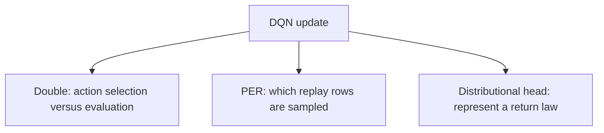

# Week 06 teaching guide — separate the reasons for each improvement

**Course navigation:** [Week 05](../week-05-dqn/teaching_guide.md) ← **Week 06 / 26** → [Week 07](../week-07-policy-gradients/teaching_guide.md)

[Routes](../docs/LEARNING_MAP.md) · [All weeks](../docs/STUDY_GUIDE.md#week-by-week-teaching-guides) · [Notation](../docs/GLOSSARY.md) · [Progress](../docs/PROGRESS.md)

[Lecture PDF](notes.pdf) · [Workbook](workbook.ipynb) · [Extended reading PDF](extended_reading.pdf)

**You are here:** What distinct failure does each component address?

**Recall first:** [Week 03](../week-03-monte-carlo/teaching_guide.md), [Week 05](../week-05-dqn/teaching_guide.md). If unfamiliar, use the [repair tasks](../docs/LEARNING_MAP.md#if-a-prerequisite-is-missing).

**Visual anchor:** [See the connected diagram](../docs/CONCEPT_ATLAS.md#where-dqn-sends-the-gradient). Use it to explain the mechanism before the derivation.

Use with [the workbook](workbook.ipynb) and [the notes](notes.tex).
For each Rainbow component, identify the mathematical object it changes.

## Learning bridge

Follow [the staged learning path](../docs/LEARNING_PATH.md) when a topic is new.

- **Carry forward:** Retrieve [week 5’s](../week-05-dqn/teaching_guide.md) online network, target network and replay rows.
- **Add one difficulty:** Ask which object an improvement changes: action selection, replay weights, value representation or parameter resets. Keep every other component fixed for an ablation.
- **Try after the worked example:** In [the Double-DQN exercise](project/solutions.py), let online next values be (2,4) and target next values be (5,3), with reward 0 and gamma 0.9. Predict the label. The browser courier is a target analogy; the weekly agent is scalar Rainbow-lite, not a complete BBF reproduction.

Check your prediction

The online network selects the second action, then the target network evaluates it: 0+0.9×3=2.7. Standard DQN’s target here would be 4.5.

**Carry it onward:** [Policy gradients](../week-07-policy-gradients/teaching_guide.md) will change the learned object from action values to action probabilities.

## Mechanism at a glance

**Read the diagram:** These components change different objects. An ablation should change one component while holding the comparison budget and evaluation protocol fixed.

## Before you start

You need Week 05's batched DQN target, stopped gradient, and replay buffer.
Importance sampling from Week 03 returns here, but it reweights **buffer rows**.
That is distinct from correcting which actions a behaviour policy logged.

## Analogy: revising with a stack of practice cards

| Revision choice | Algorithm component |
|---|---|
| Practise cards with large recent mistakes more often | PER |
| Compensate for overrepresented cards in the score | IS weight |
| Separate general topic difficulty from answer-specific differences | Dueling head |
| Use another estimate to grade the answer you selected | Double DQN |
| Track several possible scores rather than one mean | Distributional value head |

**Limit:** a large mistake may reflect irreducible reward noise, not a useful
learning opportunity. Repeatedly selecting it can waste the entire practice budget.
Also, two estimates derived from shared training are not independent graders.

## Derivation: PER weights from a change of measure

Fix a replay buffer with $N$ rows and per-row gradient vectors $g_i$.
The uniform-replay gradient is $g_U=(1/N)\sum_i g_i$.
Let priorities be $p_i=|\delta_i|+\epsilon>0$ and sampling probabilities

$$P(i)=\frac{p_i^\alpha}{\sum_jp_j^\alpha}.$$

1. Sampling from $P$ without correction estimates $\sum_iP(i)g_i$.
2. Multiply row $i$ by $w_i=1/[NP(i)]$.
3. Expand the corrected expectation:

$$\mathbb E_{i\sim P}[w_ig_i]
=\sum_iP(i)\frac{1}{NP(i)}g_i=\frac1N\sum_i g_i.$$

The identity assumes fixed positive probabilities and treats weights as constants
for this update. The tempered choice $w_i=[NP(i)]^{-\beta}$ is exact at
$\beta=1$ **before normalisation**; $\beta<1$ only partially corrects sampling.
Dividing by a fixed full-buffer maximum rescales the expected gradient.
Dividing by a random minibatch maximum can additionally change its expectation.

## Example 1: biased sampling, exact correction, and a normalisation trap

**Predict:** if the hardest card is sampled three times as often, does its gradient dominate?

Let $N=2$, priorities $(1,3)$, $\alpha=1$, hence $P=(0.25,0.75)$.
Take scalar gradients $g=(2,6)$. Uniform objective gradient is $(2+6)/2=4$.
Unweighted prioritised expectation is $0.25(2)+0.75(6)=5$.
At $\beta=1$, weights are $(2,2/3)$, giving

$$0.25(2)(2)+0.75(2/3)(6)=1+3=4.$$

Normalising both weights by their full-buffer maximum 2 yields $(1,1/3)$;
the expectation becomes 2, a common scalar rescaling.
But with batch size one and normalisation by that batch's maximum, the one
weight is always 1. The expectation reverts to 5.

**Interpretation:** distinguish exact importance correction from stabilising
normalisation. PER's correction is relative to uniform replay, not the online policy.
See [Schaul et al., Prioritized Experience Replay](https://arxiv.org/abs/1511.05952).

## Derivation: C51 projection preserves probability mass

Use equally spaced atoms $z_i=V_{\min}+i\Delta z$ and input masses $p_j$.
For reward $r$, terminal flag $d$, and discount $\gamma$, transform atom $j$:

$$\tilde z_j=\operatorname{clip}(r+\gamma(1-d)z_j,V_{\min},V_{\max}).$$

Let $b_j=(\tilde z_j-V_{\min})/\Delta z$, $l=\lfloor b_j\rfloor$,
and $u=\lceil b_j\rceil$. When $l<u$, send masses
$p_j(u-b_j)$ to $l$ and $p_j(b_j-l)$ to $u$.
Their sum is $p_j(u-l)=p_j$, because adjacent indices differ by one.
If $l=u$, put all of $p_j$ on that atom; naively applying both zero factors loses mass.
Without clipping, interpolation also preserves each transformed atom's mean.
Clipping can change the mean: the support range is a modelling choice.

## Example 2: project three atoms, then terminate

**Predict:** will the projection leave total probability equal to one?

Take support $z=(-1,0,1)$, masses $p=(0.2,0.3,0.5)$,
$r=0.5$, $\gamma=0.5$, and $d=0$.
Transformed atoms are $(0,0.5,1)$.

- Mass 0.2 lands exactly at 0.
- Mass 0.3 at 0.5 splits equally: 0.15 to 0 and 0.15 to 1.
- Mass 0.5 lands exactly at 1.

The projected masses are $(0,0.35,0.65)$, summing to 1.
The old mean is $-0.2+0+0.5=0.3$;
Bellman mean is $0.5+0.5(0.3)=0.65$, equal to the projected mean.

If $d=1$, every atom transforms to 0.5 regardless of the old distribution.
Projection becomes $(0,0.5,0.5)$. The true terminal return is deterministic
0.5; the two-bin representation is approximation caused by the fixed grid.
If terminal reward is 2, clipping gives $(0,0,1)$ with represented mean 1.

**Interpretation:** two occupied bins need not mean the environment is uncertain.
See [Bellemare, Dabney and Munos, A Distributional Perspective on RL](https://proceedings.mlr.press/v70/bellemare17a.html).

## Example 3: Double and Dueling are different operations

Online next values $(5,4)$ select action 0; target values $(3,6)$ evaluate it at 3.
With reward 1 and $\gamma=0.5$, Double DQN target is $1+0.5(3)=2.5$.
Vanilla DQN uses the target maximum and gives $1+0.5(6)=4$.
A lower target on this one example does not establish unbiasedness.

For a dueling head $V=5$ and raw advantages $(1,3)$, their mean is 2,
so $Q=(4,6)$ and the mean of Q is 5.
Adding 10 to both raw advantages gives $(11,13)$ and exactly the same Q.
Thus the **centred** residual is determined by Q, but the raw head offset
remains redundant. $V$ here is the action-uniform mean of Q, not generally $V^\pi$.
See [Wang et al., Dueling Network Architectures](https://proceedings.mlr.press/v48/wangf16.html).

## Bridge to this week's code

- [solutions.py](project/solutions.py), exercises 1, 2, 3, and 6 implement the
  Double target, dueling combination, normalised weights, and projection above.
- [agent.py](project/agent.py), `RainbowAgent.learn`, trains a **scalar**
  Rainbow-lite agent. C51 is a separate workbook component, not its trained head.
- `NoisyLinear.reset_noise` draws shared input/output noise factors; resulting
  weight entries are dependent, not independent Gaussian noises.
- `_shrink_and_perturb` is an educational reset mechanism. The full BBF method
  includes architecture, auxiliary prediction, replay, and schedule choices.
  It is not obtained by adding one reset line to this agent.
- In [train.py](project/train.py), `ablate` compares configurations; short runs
  diagnose wiring, while claims of performance improvement require repeated evaluation.

For the complete BBF experimental recipe, consult
[Schwarzer et al., Bigger, Better, Faster](https://proceedings.mlr.press/v202/schwarzer23a.html).

## Episode boundaries in the project

A true terminal ends the Bellman bootstrap. An external time limit ends
collection but retains the final state's continuation value. For example,
with reward 1, gamma 0.9, and final value 10, the truncated target is
$1+0.9(10)=10$; the terminal target is 1. The trainer uses the termination
flag for this mask and either flag to reset the environment.
See [Gymnasium's time-limit guidance](https://gymnasium.farama.org/tutorials/gymnasium_basics/handling_time_limits/).

## Choose your explanation depth: Why a categorical projection must conserve probability mass

Open the first layer for the idea, the second to calculate, and the third to check the assumptions. The worked examples above and investigation below provide the longer route.

1 · Intuition

A distributional target can land between the fixed atoms used by the network. Projection shares that probability between neighbouring atoms. It moves probability mass, rather than rounding every return to the nearest label.

2 · Work a numerical case

On atoms (0,1,2), a target return of 0.5 becomes masses (0.5,0.5,0). A return exactly 1 becomes (0,1,0). If an implementation applies only the usual lower/upper interpolation formula when both indices are equal, it can incorrectly assign zero mass to that exact atom.

3 · Derive it and state the limits

For support spacing $\Delta z$, clipped target $y$ has coordinate $b=(y-z_{\min})/\Delta z$, lower index $l=\lfloor b\rfloor$ and upper index $u=\lceil b\rceil$. If $l<u$, split mass $p$ as $p(u-b)$ and $p(b-l)$; they sum to $p$. If $l=u$, deposit all $p$ at that atom. Apply this to each transformed atom $r+\gamma(1-d)z_j$. Clipping conserves mass but can change the mean when targets lie outside the support. Return-distribution modelling does not alone guarantee a low-risk policy.

**Try it in Jupyter:** jump to [`exercise_6_categorical_project` in the workbook](workbook.ipynb#cell-23), then run the setup cells above it. Expect row sums of one and nonnegative entries, including exact-atom and terminal cases. Check both mass conservation and the mean; one passing invariant does not imply the other.

## Notebook investigation: distinguish a distribution from a confidence interval

Open [the actual Jupyter workbook](workbook.ipynb) and find **Exercises 3 and 6**.
The [GitHub week folder](https://github.com/samuel-zhang01/STUDY-RL/tree/main/week-06-rainbow-bbf)
contains this notebook, its `project/` imports and tests. Follow the
[download and Jupyter workflow](../docs/LEARNING_MAP.md#download-and-open-the-jupyter-materials)
so the shared `common/` package is available.

In C51 exercise 6, use atoms `(-1,0,1)`, masses `(0.2,0.3,0.5)`, reward 0.5 and gamma 0.5.
Draw vertical sticks at the **atom locations** rather than a smooth probability-density curve.
Before running, predict transformed locations `(0,0.5,1)` and projected masses `(0,0.35,0.65)`.
Check nonnegative mass, total mass one and represented mean 0.65.

Set the terminal flag. The return is the single number 0.5, yet the grid stores mass `(0,0.5,0.5)`:
spread across atoms is now discretisation, not outcome uncertainty or parameter uncertainty.
Set the terminal reward to 2 and explain why support clipping makes the represented mean 1.
In exercise 3, separately try a minibatch containing one PER weight: normalising by its own maximum
makes it one. That normalisation cannot preserve the unnormalised correction's expectation.

Check your interpretation: Can a narrow return distribution certify that the Q estimate is well supported by data?

No. A distributional head models returns under its fitted parameters. Epistemic uncertainty about those parameters and missing replay coverage require separate analysis.

## Retrieve and transfer

1. What does PER alpha = 0 do?

Every positive priority becomes $p_i^0=1$, so $P(i)=1/N$.
Unnormalised IS weights are all 1 for every beta.

2. Why must C51 treat an exact atom carefully?

Floor and ceiling coincide. Both naive interpolation coefficients become zero;
all mass must instead be assigned to that exact atom.

3. Does a copied target network provide independent noise?

No. Online and target weights share their training history and are identical
just after copying. Double DQN reduces coupled selection/evaluation error without
promising perfect independence or zero bias.

Arithmetic check: local Python reproduced all sampling expectations, both C51
projections and means, Double target 2.5, and dueling outputs (4, 6).
