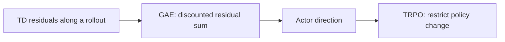

# Week 08 teaching guide — blending horizons and controlling policy change

**Course navigation:** [Week 07](../week-07-policy-gradients/teaching_guide.md) ← **Week 08 / 26** → [Week 09](../week-09-ppo/teaching_guide.md)

[Routes](../docs/LEARNING_MAP.md) · [All weeks](../docs/STUDY_GUIDE.md#week-by-week-teaching-guides) · [Notation](../docs/GLOSSARY.md) · [Progress](../docs/PROGRESS.md)

[Lecture PDF](notes.pdf) · [Workbook](workbook.ipynb) · [Extended reading PDF](extended_reading.pdf)

**You are here:** How do temporal residuals become an advantage estimate?

**Recall first:** [Week 04](../week-04-td-sarsa-q/teaching_guide.md), [Week 07](../week-07-policy-gradients/teaching_guide.md). If unfamiliar, use the [repair tasks](../docs/LEARNING_MAP.md#if-a-prerequisite-is-missing).

**Visual anchor:** [See the connected diagram](../docs/CONCEPT_ATLAS.md#the-actor-and-critic-answer-different-questions). Use it to explain the mechanism before the derivation.

Use with [the workbook](workbook.ipynb) and [the notes](notes.tex).
Keep three ideas separate: the advantage estimate, the update direction, and its size.

## Learning bridge

Follow [the staged learning path](../docs/LEARNING_PATH.md) when a topic is new.

- **Carry forward:** Retrieve [week 4’s](../week-04-td-sarsa-q/teaching_guide.md) TD residual and [week 7’s](../week-07-policy-gradients/teaching_guide.md) advantage-weighted actor direction.
- **Add one difficulty:** Use a critic to combine several future TD surprises; separately decide how large a policy-distribution change is acceptable. These are two decisions.
- **Try after the worked example:** In [the GAE exercise](project/solutions.py), combine residuals (1,2) with gamma 0.9 and lambda 0.5, stopping the trace after the second residual. Then compare lambda 0 and 1. In [the browser policy experiment](../interactive/index.html#policy), enable **Show GAE residual weights** to inspect the same rule using its separate three-residual fixture (1,−0.5,2). Neither toy is TRPO training.

Check your prediction

The first advantage is 1+(0.9×0.5)×2=1.9. Lambda 0 gives 1; lambda 1 gives 2.8 for these fixed residuals. This changes the estimator, not the observed rewards.

**Carry it onward:** [PPO](../week-09-ppo/teaching_guide.md) keeps an advantage estimate and changes the update objective’s incentives.

## Mechanism at a glance

**Read the diagram:** GAE specifies the advantage estimator. TRPO addresses the size of a policy update. A better estimator and a smaller policy change solve different problems.

## Before you start

Recall TD residuals from Week 04 and score-function actor updates from Week 07.
You need finite geometric sums, vector inner products, and basic matrix solves.
A2C uses a critic to estimate advantages. GAE controls how much future residuals
contribute. Natural gradients and TRPO control changes to action distributions.

## Analogy: checking a travel forecast at several checkpoints

| Forecast idea | Mathematical concept |
|---|---|
| Surprise after one road | TD residual $\delta_t$ |
| Combining surprises over several roads | n-step advantage |
| Giving distant checkpoints less influence | GAE factor $\gamma\lambda$ |
| Current forecast | Critic $V$ |
| Limiting how much route-choice frequencies change | Trust region in policy KL |

**Limit:** trust regions constrain probability distributions under specified state
weighting. They do not directly certify safe outcomes, and rare states can be
poorly controlled by a small average KL.

## Derivation: the telescoping identity behind GAE

Use rewards $r_t$ after action $a_t$, values $V_t=V(s_t)$, and discount $\gamma$.
For a continuing segment,

$$\delta_t=r_t+\gamma V_{t+1}-V_t.$$

Expand two successive terms explicitly:

$$\delta_t+\gamma\delta_{t+1}
=r_t+\gamma V_{t+1}-V_t
+\gamma r_{t+1}+\gamma^2V_{t+2}-\gamma V_{t+1}
=r_t+\gamma r_{t+1}+\gamma^2V_{t+2}-V_t.$$

The internal value terms cancel. Repeating this cancellation gives

$$\hat A_t^{(n)}=\sum_{k=0}^{n-1}\gamma^k\delta_{t+k}.$$

For $0\le\lambda<1$, average horizons with weights $(1-\lambda)\lambda^{n-1}$.
Assuming absolute convergence, the coefficient of residual $\delta_{t+k}$ is

$$(1-\lambda)\gamma^k\sum_{n=k+1}^{\infty}\lambda^{n-1}
=(1-\lambda)\gamma^k\frac{\lambda^k}{1-\lambda}
=(\gamma\lambda)^k.$$

Thus $\hat A_t=\sum_{k\ge0}(\gamma\lambda)^k\delta_{t+k}$, which gives the
backward recurrence $\hat A_t=\delta_t+\gamma\lambda\hat A_{t+1}$.
At $\lambda=1$, use the residual sum or a limit; direct substitution into
$(1-\lambda)\sum\lambda^{n-1}\hat A^{(n)}$ is not a valid $0\times\infty$ calculation.
See [Schulman et al., Generalized Advantage Estimation](https://arxiv.org/abs/1506.02438).

## Example 1: compute every GAE entry

**Predict:** at lambda zero, can a later residual influence the first advantage?

Rewards $(1,2,3)$, values $(0.5,1,1.5)$, $\gamma=0.5$;
the third transition truly terminates, so next value is zero.
Residuals are

$$\delta_0=1+0.5(1)-0.5=1,
\quad\delta_1=2+0.5(1.5)-1=1.75,
\quad\delta_2=3-1.5=1.5.$$

At $\lambda=0.8$, $\gamma\lambda=0.4$:
$\hat A_2=1.5$;
$\hat A_1=1.75+0.4(1.5)=2.35$;
$\hat A_0=1+0.4(2.35)=1.94$.
Critic targets $\hat R=\hat A+V$ are $(2.44,3.35,3)$.

At $\lambda=0$, advantages equal $(1,1.75,1.5)$.
At $\lambda=1$, they are $(2.25,2.5,1.5)$;
adding values gives $(2.75,3.5,3)$, exactly the full discounted returns.

**Interpretation:** lambda changes the target for early states; the final
terminal target remains the observed final reward.
These critic targets are estimates, not additional observed rewards.

## Example 2: lambda one does not remove an unfinished rollout's bootstrap

**Predict:** does lambda one always mean a pure Monte Carlo return?

Now the same three transitions end only because collection stopped.
Set $V(s_3)=4$, with no terminal flag.
The last residual becomes $3+0.5(4)-1.5=3.5$.
At $\lambda=1$, advantages become $(2.75,3.5,3.5)$ and targets
$(3.25,4.5,5)$.

For the first target, direct expansion gives

$$1+0.5(2)+0.5^2(3)+0.5^3(4)=3.25.$$

The extra 0.5 compared with terminal MC is the final bootstrap contribution.
**Interpretation:** lambda one removes intermediate bootstrap terms by cancellation;
it does not eliminate the surviving end-of-segment value.

A true terminal zeros both the bootstrap and propagation across the boundary.
At a time-limit truncation in a continuing task, bootstrap from the final
observation but stop propagation into the reset episode. Those need two masks
or an equivalent carefully implemented correction.

## Derivation: the natural-gradient trust-region step

Let $g$ be the gradient of a local improvement surrogate, $u$ a parameter change,
and $F$ a positive-definite Fisher matrix, with KL budget $\delta>0$.
The local constrained problem is

$$\max_u g^Tu\quad\text{subject to}\quad\tfrac12u^TFu\le\delta.$$

The Lagrangian condition is $g-\eta Fu=0$, giving $u=F^{-1}g/\eta$.
Substituting into the active constraint gives

$$u=\sqrt{\frac{2\delta}{g^TF^{-1}g}}F^{-1}g.$$

This is a local quadratic solution, not an exact solution to nonlinear TRPO.
In large networks, solve $Fx=g$ through matrix-vector products rather than
explicitly inverting F; damping handles near-singular empirical Fishers.

## Example 3: a complete two-dimensional trust-region step

Take $F=\operatorname{diag}(4,1)$, $g=(2,1)$, and $\delta=0.01$.
Solve $Fx=g$: $x=(0.5,1)$; then $g^Tx=2$.
Scale $\sqrt{2(0.01)/2}=0.1$, so $u=(0.05,0.1)$.
Quadratic KL is $\tfrac12[4(0.05)^2+(0.1)^2]=0.01$.
Predicted surrogate gain is $2(0.05)+1(0.1)=0.2$.

**Interpretation:** the first direction is more sensitive under F and receives
a smaller parameter displacement. Actual policy KL still needs measurement.
TRPO's theoretical guarantee uses a maximum over states; its practical
average-KL constraint is an approximation. See
[Schulman et al., Trust Region Policy Optimization](https://arxiv.org/abs/1502.05477).

For categorical distributions, Pinsker gives
$\mathrm{TV}(p,q)=\tfrac12\|p-q\|_1\le\sqrt{\mathrm{KL}(p\|q)/2}$.
At KL $\le0.001$, a single action/event probability changes by at most
$\sqrt{0.001/2}=0.022361$, or 2.24 percentage points; the L1 bound is 0.044721.
An average-KL bound yields an average event bound under the same fixed state law,
not a pointwise guarantee at every state or at a changed future state distribution.

## Bridge to this week's code

- [solutions.py](project/solutions.py), `compute_gae`, accepts one rollout and
  returns `(advantages, returns)`; reproduce Examples 1–2 with its `dones` array.
- `nstep_advantage` takes a separate final `bootstrap`; `conjugate_gradient`
  solves the matrix-vector system in Example 3.
- [train.py](project/train.py) collects `(time, environment, feature)` arrays
  and computes GAE separately for each environment before flattening.
- The training loop stores the original Gaussian sample and clips only the
  action sent to the environment. The score-function estimator differentiates
  the latent sample's density; clipping is part of the environment response.
- A true terminal removes the value bootstrap. A time-limit truncation keeps
  the final observation's value but ends the GAE trace, so rewards from the
  reset episode cannot leak backward. [common/rollouts.py](../common/rollouts.py)
  also makes vector autoreset explicit. See [Gymnasium's time-limit guidance](https://gymnasium.farama.org/tutorials/gymnasium_basics/handling_time_limits/).
- [agent.py](project/agent.py) trains A2C. The project supplies TRPO building
  blocks and notes, not a complete TRPO training implementation.

## Choose your explanation depth: Two masks serve two different purposes in GAE

Open the first layer for the idea, the second to calculate, and the third to check the assumptions. The worked examples above and investigation below provide the longer route.

1 · Intuition

At an episode boundary, the advantage trace must not run into the next reset episode. Yet a time limit on a continuing task can still have a valuable final state. One mask controls bootstrapping and another controls whether the trace crosses the boundary.

2 · Work a numerical case

Let the final observed reward be 1, current value 0.5, final-state value 2 and discount 0.9. At a time limit, the residual is 1+0.9×2−0.5 = 2.3. At true termination it is 1−0.5 = 0.5. In either case, do not add the following reset episode’s advantage to this trace.

3 · Derive it and state the limits

Use $\delta_t=r_t+\gamma(1-\mathrm{terminal}_t)V(s_{t+1})-V(s_t)$ and $A_t=\delta_t+\gamma\lambda(1-\mathrm{boundary}_t)A_{t+1}$. A boundary includes both termination and truncation; only genuine termination necessarily eliminates continuation. With same-step autoreset, $s_{t+1}$ in the bootstrap must be the final observation, not the reset observation. If the finite time horizon is part of the actual task, include remaining time in the state and treat its endpoint according to that task objective.

**Try it in Jupyter:** jump to [`compute_gae` in the workbook](workbook.ipynb#cell-7), then run the setup cells above it. Expect final advantages 2.3 and 0.5. Pass `terminals` and `next_values` when truncation matters; the short `dones` interface alone cannot represent both distinctions.

## Notebook investigation: see which boundary stops which signal

Open [the actual Jupyter workbook](workbook.ipynb) and find **Exercises 2 and 3**.
The [GitHub week folder](https://github.com/samuel-zhang01/STUDY-RL/tree/main/week-08-a2c-gae-trpo)
contains this notebook, its `project/` imports and tests. Follow the
[download and Jupyter workflow](../docs/LEARNING_MAP.md#download-and-open-the-jupyter-materials)
so the shared `common/` package is available.

Use rewards `(1,2,3)` and values `(0.5,1,1.5)` with gamma 0.5. Start with a true terminal boundary
and compare lambda 0, 0.8 and 1. Save advantages and `advantages + values` separately.
At lambda 1, the latter must equal returns `(2.75,3.5,3)`.
Then keep the rewards fixed and make the last boundary a collection cutoff with final value 4:
the lambda-1 targets become `(3.25,4.5,5)`.

Plot target at each time index using grouped bars; a line across a reset can misleadingly imply a
continuous trajectory. Explain the extra first-target value 0.5 as `gamma³ × 4`, not as a new reward.
The pure helper takes one segment; the training collector additionally needs a trace boundary at a
reset. A zero terminal mask and a zero trace-continuation mask serve different jobs.

Check your interpretation: At lambda 1, why does the final value prediction still affect a truncated segment?

Telescoping removes intermediate values but leaves the endpoint bootstrap. It disappears only when the segment reaches true termination or that endpoint value is zero.

## Retrieve and transfer

1. Why is a value added back to the advantage for critic training?

The advantage subtracts the current state's value. Adding it back constructs
the corresponding estimated return target; the critic predicts returns, not advantages.

2. Does average KL below 0.001 bound every state's action change?

No. A rare state can have large KL while its contribution to the average is
small. The 2.24-point event bound applies pointwise only with a pointwise KL bound.

3. Does a successful backtracking step prove higher real return?

No. It checks empirical surrogate and empirical KL. Sampling error, critic error,
and the average-versus-maximum constraint gap remain.

Arithmetic check: local Python reproduced all GAE vectors, endpoint bootstraps,
the Fisher solve and quadratic budget, and both numerical Pinsker bounds.
