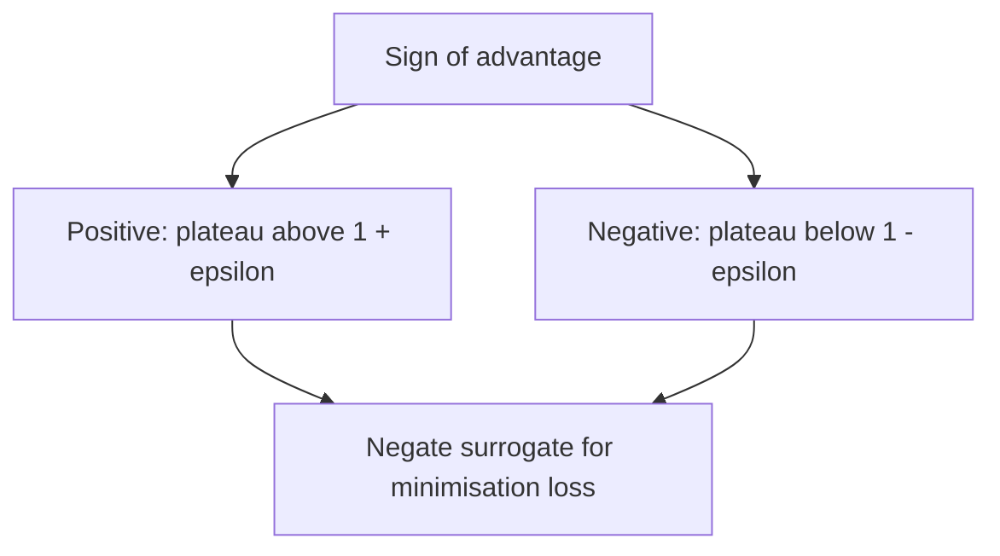

# Week 9 teaching guide — what PPO actually clips

**Course navigation:** [Week 08](../week-08-a2c-gae-trpo/teaching_guide.md) ← **Week 09 / 26** → [Week 10](../week-10-sac-td3/teaching_guide.md)

[Routes](../docs/LEARNING_MAP.md) · [All weeks](../docs/STUDY_GUIDE.md#week-by-week-teaching-guides) · [Notation](../docs/GLOSSARY.md) · [Progress](../docs/PROGRESS.md)

[Lecture PDF](notes.pdf) · [Workbook](workbook.ipynb) · [Extended reading PDF](extended_reading.pdf)

**You are here:** Which branch is clipped for each sign of advantage?

**Recall first:** [Week 07](../week-07-policy-gradients/teaching_guide.md), [Week 08](../week-08-a2c-gae-trpo/teaching_guide.md). If unfamiliar, use the [repair tasks](../docs/LEARNING_MAP.md#if-a-prerequisite-is-missing).

**Visual anchor:** [See the connected diagram](../docs/CONCEPT_ATLAS.md#ppo-the-sign-decides-the-plateau). Use it to explain the mechanism before the derivation.

Read this before workbook exercises 1–3; return to the code bridge before training.
The goal is to predict the direction of an update before trusting its loss curve.

**Statistics companion:** [A positive four-seed average need not resolve a PPO comparison](../docs/statistics/04-intervals-comparisons.md) · [Related foundation](../docs/statistics/06-regression-validation.md) · [Textbook source map](../docs/statistics/SOURCES.md).

**Bounded first route:** Predict the clipped objective for both advantage signs, then separate the objective shape from measured KL and held-out return.

## Learning bridge

Follow [the staged learning path](../docs/LEARNING_PATH.md) when a topic is new.

- **Carry forward:** Retrieve [week 7’s](../week-07-policy-gradients/teaching_guide.md) signed advantage and [week 8’s](../week-08-a2c-gae-trpo/teaching_guide.md) distinction between direction and update size.
- **Add one difficulty:** Compare each sampled action’s new and old probability. Clipping changes the objective; it does not put the whole policy inside a hard probability box.
- **Try after the worked example:** On paper and in [the weekly clipped-loss exercise](project/solutions.py), use ratio 1.5, clip radius 0.2 and advantage +2; predict the surrogate, then repeat with advantage −2. Next enable **Show PPO fixed-batch surrogate** in [the browser policy experiment](../interactive/index.html#policy) and inspect its per-action table. It aggregates its own fixed advantages (+1.2 and −0.4), using different numbers from this single-sample check.

Check your prediction

For +2, the minimum is min(3,2.4)=2.4. For −2, it is min(−3,−2.4)=−3; the harmful increase remains penalized.

**Carry it onward:** [SAC and TD3](../week-10-sac-td3/teaching_guide.md) return to replay and add continuous actions; SAC also changes the objective with entropy.

## Mechanism at a glance

**Read the diagram:** The positive and negative branches flatten on opposite sides. A probability change in the harmful direction remains penalised outside the interval.

## Connect to what you know

From weeks 7–8, recall the score-function gradient and an advantage baseline.
You should be able to explain why positive advantage increases a sampled action's probability.
PPO keeps that direction but limits the *incentive* for improving each sampled action too far.
It normally reuses a fresh rollout for several epochs, then collects another rollout.

## Analogy: a capped sales commission

Imagine a salesperson receives commission for increasing sales of a useful product.
Once the agreed increase is reached, extra sales earn no extra commission.
A harmful product has the reverse rule: enough reduction earns all available credit.

| Analogy | PPO quantity |
|---|---|
| Original sales level | Old action probability |
| New/original sales | Ratio $\rho$ |
| Product's usefulness | Signed advantage $\hat A$ |
| Commission cap | Clipped surrogate plateau |
| Shared sales effort | Shared neural-network parameters |

**Limit:** a commission cap cannot physically stop sales increasing.
Likewise, PPO does not project the policy into a probability box.
Other samples, shared parameters, or a large optimizer step can move an already-clipped ratio.
This is why a small clipping parameter is not a proof of small KL divergence.

## Derivation: keep the sign visible

Fix a rollout sample $(s,a)$, its old log probability, and its estimated advantage.
Treat the old policy and advantage as constants during optimization.
Assume the old policy assigns positive probability to the sampled action.

1. Define $\rho=\pi_\theta(a|s)/\pi_{old}(a|s)=\exp(\ell_\theta-\ell_{old})$.
2. The local surrogate is $\rho\hat A$.
3. At the old parameters, $\rho=1$ and

   $$\nabla_\theta(\rho\hat A)=\hat A\nabla_\theta\log\pi_\theta(a|s).$$

   This matches the sampled policy-gradient direction at that point.
4. Construct a pessimistic surrogate

   $$f(\rho,\hat A)=\min\{\rho\hat A,\operatorname{clip}(\rho,1-\epsilon,1+\epsilon)\hat A\}.$$

5. Multiplication by a negative number reverses inequalities. Consequently,

   $$f(\rho,\hat A)=
   \begin{cases}
   \hat A\min(\rho,1+\epsilon),&\hat A\ge0,\\
   \hat A\max(\rho,1-\epsilon),&\hat A<0.
   \end{cases}$$

6. The implementation minimizes $L_\pi=-\operatorname{mean}(f)$.
   In an active branch, $\partial L_\pi/\partial\ell_\theta=-\rho\hat A$ for one sample.
   On a plateau that sample contributes zero policy-loss gradient.

This derives the two branches, not a TRPO-style monotonic-improvement theorem.
The action ratio changes measure at a fixed state; it does not replace the old state distribution.
See the clipped objective and its motivation in the [original PPO paper](https://arxiv.org/abs/1707.06347).

## Worked example 1 — the same ratio, opposite advantages

**Predict:** with $\epsilon=0.2$ and $\rho=1.5$, which advantage sign is clipped?
Use old probability $0.2$ and new probability $0.3$.

**Calculate:** $\rho=0.3/0.2=1.5$ and the clipped ratio is $1.2$.

| Advantage | Raw surrogate | Clipped candidate | Minimum | Loss |
|---:|---:|---:|---:|---:|
| $+2$ | $3$ | $2.4$ | $2.4$ | $-2.4$ |
| $-2$ | $-3$ | $-2.4$ | $-3$ | $3$ |

For $\hat A=+2$, increasing the log probability further gives no direct benefit.
For $\hat A=-2$, $\partial L/\partial\ell=-(1.5)(-2)=+3$.
Gradient descent lowers the log probability, correcting the excessive increase.

**Interpret:** clipping removes further improvement incentives, but keeps penalties for harmful moves.
It does not mean “every sample outside the interval has zero gradient.”

## Worked example 2 — the lower threshold

**Predict:** an action was bad; has reducing its probability enough made the loss flat?
Keep $\hat A=-2$, set old probability $0.2$, new probability $0.1$.

**Calculate:** $\rho=0.5$, clipped ratio $0.8$.
The two candidates are $-1$ and $-1.6$; their minimum is $-1.6$.
The loss is $1.6$ and its local gradient is zero.
Now change only the advantage to $+2$: the candidates become $1$ and $1.6$.
The loss is $-1$ and $\partial L/\partial\ell=-1$.
Gradient descent increases the probability of this good action.

**Interpret:** the negative-advantage curve is flat *below* $1-\epsilon$.
A zero advantage makes the policy-loss contribution zero for every ratio.
At the active kink, an autodiff library chooses a valid branch/subgradient convention.

## Worked example 3 — value clipping is not always strictly worse

**Predict:** does leaving the value clipping interval always increase loss above MSE?
Let $V_{old}=0$, $V=1$, and the value clip radius be $0.2$.

**Calculate:** the clipped prediction is $0.2$.
For target $R=2$, raw squared error is $1$ and clipped squared error is $3.24$.
The helper returns $\tfrac12\max(1,3.24)=1.62$, above half-MSE $0.5$.
For target $R=0$, errors are $1$ and $0.04$.
The helper returns $0.5$, exactly the raw half-MSE.

**Interpret:** clipping is pessimistic about improvement; an already-worse prediction remains penalized.
Policy probability ratios and value predictions have different units, even if a codebase reuses a radius.

## Code bridge

- [solutions.py](project/solutions.py): `ppo_clip_loss` returns the negative mean surrogate;
  feed the four cases above as a batch and predict the individual contributions first.
- `ppo_value_clip_loss` includes a factor of $1/2$; account for it when comparing to notes.
- `approx_kl` computes the nonnegative sample expression $\rho-1-\log\rho$.
  Its average is an estimator, not a hard constraint or a guarantee about every state.
- [agent.py](project/agent.py): `PPOAgent.update_minibatch` combines actor, critic, entropy,
  and gradient clipping; a flat actor term does not imply all parameters stop moving.
- [train.py](project/train.py): `_compute_gae` connects this week to week 8.
  Termination removes bootstrapping; truncation retains the final observation's
  value and ends the trace before autoreset. The common rollout helper preserves
  final observations and requests same-step autoreset explicitly.
- `PPOAgent.act` returns the sampled Gaussian latent action. Training stores
  that sample for both old and new log densities and clips only the action
  sent to the environment. Thus an unchanged actor gives ratio 1 even for a
  sample outside the environment's bounds.
- `use_value_clip` and `use_advantage_norm` control the actual update losses.
  Their reported settings can now be used for an ablation.

Training improvement on a particular short run is an empirical result, not an algebraic invariant.
Separate “the loss matches these examples” from “three independent seeds improve.”

## Choose your explanation depth: Why clipping treats advantage signs differently

Open the first layer for the idea, the second to calculate, and the third to check the assumptions. The worked examples above and investigation below provide the longer route.

1 · Intuition

PPO limits the reward for making a good sampled action more likely, and for making a bad sampled action less likely. It can still penalise movement in the harmful direction. The clip is part of the objective; it is not a command that clamps every policy probability.

2 · Work a numerical case

With epsilon 0.2, advantage +2 and ratio 1.4, the two candidate terms are 2.8 and 2.4, so the surrogate is 2.4. With advantage −2 and ratio 1.4, they are −2.8 and −2.4, so it is −2.8. The second case continues penalising an increased probability for a bad sampled action.

3 · Derive it and state the limits

For $L=\min(rA,\operatorname{clip}(r,1-\epsilon,1+\epsilon)A)$, positive $A$ has a flat incentive beyond $r=1+\epsilon$; negative $A$ has a flat incentive below $r=1-\epsilon$. Taking a minimum makes this surrogate no larger than the unclipped sampled surrogate, not a lower bound on true return. Old rollout log probabilities stay fixed through repeated optimisation epochs. Shared parameters, unsampled actions and other losses can still move probability ratios beyond the clip interval.

**Try it in Jupyter:** jump to [`ppo_clip_loss` in the workbook](workbook.ipynb#cell-6), then run the setup cells above it. Expect surrogates 2.4 and −2.8; a minimised implementation returns their negatives. Keep `old_logp` detached and unchanged while re-evaluating the current policy.

## Notebook investigation: read a ppo plot in the optimiser’s direction

Open [the actual Jupyter workbook](workbook.ipynb) and find **Exercises 1, 2, 3 and 6**.
The [GitHub week folder](https://github.com/samuel-zhang01/STUDY-RL/tree/main/week-09-ppo)
contains this notebook, its `project/` imports and tests. Follow the
[download and Jupyter workflow](../docs/LEARNING_MAP.md#download-and-open-the-jupyter-materials)
so the shared `common/` package is available.

Sweep a ratio from 0.4 to 1.6 for advantages +2 and -2 with epsilon 0.2.
Plot the surrogate to maximise and label its vertical axis explicitly; the helper returns the
negative mean, so negate it for that plot. Mark 0.8, 1 and 1.2 on the horizontal axis.
Predict which side is flat for each advantage sign before calling the helper.

Now inspect the slope using nearby points away from either kink. At ratio 1.5 with advantage -2,
the surrogate still slopes downward: a bad action becoming more likely must remain penalised.
Change epsilon to zero and explain why this does not freeze all possible policy updates.
Finally compare approximate KL and clip fraction as separate diagnostics; neither tells you that
all actual ratios were kept inside the drawn vertical boundaries.

Check your interpretation: If every sampled actor contribution is on a plateau, can the network still change?

Yes. Critic and entropy losses, shared parameters, optimiser state, and other samples can still move it. A plateau concerns that sample’s policy-surrogate derivative.

## Statistics bridge: A positive four-seed average need not resolve a PPO comparison

**Model and unit.** Suppose a prespecified paired comparison produces independent run-pair return differences -2, 1, 2 and 3. Assume a normal model for differences only for the interval illustration.

**Calculate before running.** The mean difference is 1. Squared deviations sum to $9+0+1+4=14$, so sample variance is $14/3$ and SE is $\sqrt{(14/3)/4}\approx1.0801$. With $t_{3,0.975}\approx3.182$, a 95% paired t interval is approximately $1\pm3.437=[-2.44,4.44]$.

**Interpret the result.** The fixture does not resolve even the sign of the mean difference under its model. Pairing requires a justified matched design. Choosing the best checkpoint on these same outcomes would make the stated prespecified interval a different analysis.

**Change one assumption.** Define a practically meaningful gain before another run. Why should increasing minibatch epochs on the same rollout not count as more independent training seeds?

Check the changed assumption

Optimization epochs reuse sampled data. Independent training repetitions change the independent-run evidence count; extra epochs may change the procedure being compared but do not create independent outcomes.

Work through the [foundation lesson](../docs/statistics/04-intervals-comparisons.md) and the statistics investigation near the end of the [workbook](workbook.ipynb). Textbook grounding: Siegrist §8.2, PDF p.966; Ross §7.3, PDF p.309; [edition and page details](../docs/statistics/SOURCES.md). These are course-created numerical fixtures, not new benchmark measurements.

## Retrieval and transfer

1. If epsilon is 0.2, must every new/old probability ratio lie below 1.2?

No. The objective changes beyond the threshold; the policy is not projected or constrained there.
Other gradient terms and optimizer steps can move ratios further.

2. A bad action has ratio 1.4. Should the negative-advantage loss be flat?

No. Its probability increased, which is harmful. The raw branch remains active and gradient descent reduces its probability.

3. Why are old-policy KL and reference-policy KL different in RLHF?

The old rollout policy changes each collection cycle. The reference policy is usually a fixed anchor.
Small changes from many successive old policies can still produce a large total change from the reference.

Arithmetic checks: both signs at ratios 0.5 and 1.5, and both value-loss targets above,
were recomputed with Python during this teaching review.
