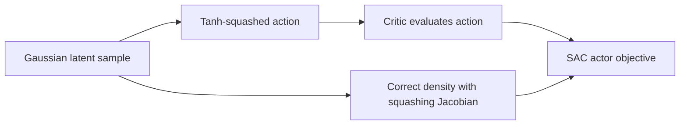

# Week 10 teaching guide — SAC from density to update direction

**Course navigation:** [Week 09](../week-09-ppo/teaching_guide.md) ← **Week 10 / 26** → [Week 11](../week-11-contextual-bandits-ope/teaching_guide.md)

[Routes](../docs/LEARNING_MAP.md) · [All weeks](../docs/STUDY_GUIDE.md#week-by-week-teaching-guides) · [Notation](../docs/GLOSSARY.md) · [Progress](../docs/PROGRESS.md)

[Lecture PDF](notes.pdf) · [Workbook](workbook.ipynb) · [Extended reading PDF](extended_reading.pdf)

**You are here:** How does entropy change the objective and its gradient?

**Recall first:** [Week 04](../week-04-td-sarsa-q/teaching_guide.md), [Week 05](../week-05-dqn/teaching_guide.md), [Week 07](../week-07-policy-gradients/teaching_guide.md). If unfamiliar, use the [repair tasks](../docs/LEARNING_MAP.md#if-a-prerequisite-is-missing).

**Visual anchor:** [See the connected diagram](../docs/CONCEPT_ATLAS.md#the-actor-and-critic-answer-different-questions). Use it to explain the mechanism before the derivation.

Use this guide for exercises 1–5 before running a continuous-control experiment.

## Learning bridge

Follow [the staged learning path](../docs/LEARNING_PATH.md) when a topic is new.

- **Carry forward:** Retrieve Bellman bootstrapping, replay and target networks from weeks 4–5, plus policy gradients from week 7.
- **Add one difficulty:** A continuous action has a density, not a discrete action probability. SAC rewards entropy; TD3 takes a different deterministic-policy route.
- **Try after the worked example:** Use [the weekly density exercises](project/solutions.py). If an action is rescaled from a to 2a, predict how its density and differential entropy change. The browser policy toy is discrete and does not implement SAC or TD3.

Check your prediction

The new density at 2a is half the old density at a; differential entropy increases by log(2). Always include the change-of-variables term when comparing continuous action coordinates.

**Carry it onward:** [Week 11](../week-11-contextual-bandits-ope/teaching_guide.md) deliberately returns to a one-step decision so you can study logged evidence without continuous-control complexity.

## Mechanism at a glance

**Read the diagram:** The squashed action and its probability density must describe the same distribution. The actor balances expected value against an entropy term using that corrected density.

## Connect to what you know

Recall Bellman bootstrapping, a target network, and the chain rule.
PPO uses a sampled log-probability gradient; SAC can differentiate through a sampled continuous action.
The new ingredient is an entropy term, whose value depends on using the correct action density.

## Analogy: choosing several commuting routes

A commuter prefers short journeys but keeps some variation among good routes.
The route cost maps to negative $Q$; willingness to vary maps to temperature $\alpha$.
Two skeptical journey-time forecasts map to the twin critics.
A reusable travel diary maps to the replay buffer.

**Limit:** entropy rewards distributional spread, not knowledge acquisition or fairness.
Randomizing equally between two dangerous routes is still dangerous.
Continuous entropy also changes with the units of the action coordinates.
A density can exceed one even though the probability of any measurable event is at most one.

## Derivation: why a softmax appears

First use finitely many actions so every operation is visible.
Fix a state, values $Q_a$, and $\alpha>0$.
Let $p_a\ge0$, $\sum_a p_a=1$, and use natural logarithms.

1. Maximize expected value plus entropy:

   $$F(p)=\sum_a p_aQ_a-\alpha\sum_a p_a\log p_a.$$

2. Add the normalization constraint with multiplier $\nu$:

   $$\mathcal L=F(p)-\nu(\sum_a p_a-1).$$

3. Differentiate: $Q_a-\alpha(\log p_a+1)-\nu=0$.
4. Rearrange: $p_a=\exp(Q_a/\alpha)\exp(-1-\nu/\alpha)$.
5. Normalize using $Z=\sum_a\exp(Q_a/\alpha)$:

   $$p_a^*=\frac{\exp(Q_a/\alpha)}{Z},\qquad V^*=\alpha\log Z.$$

6. The negative entropy is strictly convex, so the objective is strictly concave;
   the stationary point is the unique maximizer for finite values.

For continuous actions replace sums with integrals and require a finite partition function.
The practical Gaussian actor only approximates the unrestricted optimal distribution.
The soft Bellman target uses a sampled next action:

$$y=r+\gamma(1-d)\left[\min(Q'_1,Q'_2)-\alpha\log\pi(a'|s')\right].$$

Here $d=1$ denotes a true terminal transition; a time-limit truncation needs separate treatment.
See the [SAC paper](https://arxiv.org/abs/1801.01290) and [temperature-tuning formulation](https://arxiv.org/abs/1812.05905).

## Worked example 1 — temperature is a scale

**Predict:** with values $Q=(0,\log3)$ and $\alpha=1$, should the better action be deterministic?

**Calculate:** exponentiated values are $(1,3)$, so $p=(0.25,0.75)$.
Expected value is $0.75\log3=0.823959$.
Entropy is $-0.25\log0.25-0.75\log0.75=0.562335$.
Their sum is $1.386294=\log4=V^*$.

If $\alpha=0.5$, exponentiated values are $(1,9)$ and $p=(0.1,0.9)$.
If both $Q$ values and $\alpha$ double, the probabilities do not change.

**Interpret:** temperature is relative to reward/value scale.
In a finite action set, $\alpha\to0$ concentrates on maximum-value actions;
ties can remain shared, so “zero temperature selects a unique action” needs a unique maximum.

## Derivation bridge — squashing changes density

Let $u\sim\mathcal N(\mu,\sigma^2)$ and $a=\tanh u$.
Conservation of probability gives $p_A(a)\,da=p_U(u)\,du$.
Since $da/du=1-a^2$,

$$\log p_A(a)=\log p_U(u)-\log(1-a^2).$$

For independent action coordinates, sum the log-density and log-Jacobian terms.
If the environment action is $b+ca$ with $c>0$, subtract an additional $\log c$ per dimension.
Normalize the **density**: $\int p_A(a)\,da=1$.
There is no identity saying $\int\log p_A(a)\,da=0$.

## Worked example 2 — density at a concrete action

**Predict:** squashing compresses a neighborhood near the boundary; does its density rise or fall?
Take $\mu=0$, $\sigma=1$, and $u=\operatorname{atanh}(0.5)=0.549306$.

**Calculate:** $a=0.5$ and the Jacobian is $1-a^2=0.75$.
The Gaussian log density is
$-\tfrac12u^2-\tfrac12\log(2\pi)=-1.069807$.
The corrected log density is $-1.069807-\log0.75=-0.782125$.
Thus the action density is $0.457433$, versus Gaussian density $0.343075$.
Scaling the action to $2a$ changes the log density to $-1.475272$.

**Interpret:** the correction divides density by the local compression factor.
Use a stable log-Jacobian near $|a|=1$; directly computing $1-a^2$ may round to zero.

## Worked example 3 — terminal targets and actor-gradient sign

**Predict:** can entropy make a terminal transition bootstrap?
Take $r=1$, $\gamma=0.9$, next critics $(4,6)$, $\log\pi=-2$, and $\alpha=0.2$.

**Calculate:** the soft next value is $4-0.2(-2)=4.4$.
For $d=0$, $y=1+0.9(4.4)=4.96$.
For $d=1$, $y=1$, regardless of either critic or entropy.

Now take a deterministic toy actor $a=\tanh\mu$, $Q(a)=-a^2$, and no entropy.
The minimized actor loss is $L=-Q=\tanh^2\mu$.
At $\mu=\operatorname{atanh}(0.5)$,
$\partial L/\partial\mu=2(0.5)(1-0.25)=0.75>0$.
A step of size $0.1$ gives $\mu_{new}=0.474306$, closer to zero.

**Interpret:** a **positive** loss gradient at positive $\mu$ produces the desired decrease.
The sign of a loss gradient differs from the direction of the gradient-descent step.

## Code bridge

- [solutions.py](project/solutions.py): `tanh_gaussian_log_prob` sums over action dimensions;
  `soft_bellman_target` applies the terminal mask after constructing the soft value.
- `auto_temperature_loss` detaches `logp` because this step optimizes temperature.
  Its gradient in $\log\alpha$ is $\alpha(H-H_{target})$ using sampled $H=-\log\pi$.
  Entropy below target therefore increases $\alpha$ under gradient descent.
- [agent.py](project/agent.py): `TanhGaussianPolicy.sample` reparameterizes the action;
  `SACAgent.update` separates frozen critic targets from differentiable actor evaluations.
- [train.py](project/train.py): inspect action scaling before comparing reported entropy.

The twin minimum reduces one overestimation mechanism; it is not a calibrated lower confidence bound.
Purely offline SAC can exploit unsupported actions even with twin critics; week 14 addresses that problem.

## Choose your explanation depth: A bounded action needs a changed probability density

Open the first layer for the idea, the second to calculate, and the third to check the assumptions. The worked examples above and investigation below provide the longer route.

1 · Intuition

A Gaussian draw can be any real number, while a tanh-transformed action lies between −1 and 1. Squashing many nearby unbounded values into a narrow action interval changes density. SAC needs the probability density in the action coordinates for its entropy term.

2 · Work a numerical case

At pre-squash value u=0, tanh(u)=0 and the absolute Jacobian is 1, so its log correction is zero. At u=1, the action is about 0.7616 and the Jacobian about 0.4200. The action log density is therefore the Gaussian log density plus about 0.8676.

3 · Derive it and state the limits

For $a=\tanh u$, change of variables gives $\log\pi_A(a)=\log\pi_U(u)-\sum_j\log(1-\tanh^2u_j)$. For additional scale $c_j>0$, subtract $\sum_j\log c_j$ as well. Sum over action dimensions, not over batch rows. The transform is bijective on the open interval; exact endpoints arise only through numerical saturation, which motivates stable evaluation of the log-Jacobian. Differential entropy depends on these coordinates, so a target entropy must use the same convention.

**Try it in Jupyter:** jump to [`tanh_gaussian_log_prob` in the workbook](workbook.ipynb#cell-6), then run the setup cells above it. Check the correction at u=0 and u=1 before a training run. Passing an already squashed action as though it were the Gaussian sample changes the density calculation.

## Notebook investigation: track action density through a change of coordinates

Open [the actual Jupyter workbook](workbook.ipynb) and find **Exercises 1, 3 and 5**.
The [GitHub week folder](https://github.com/samuel-zhang01/STUDY-RL/tree/main/week-10-sac-td3)
contains this notebook, its `project/` imports and tests. Follow the
[download and Jupyter workflow](../docs/LEARNING_MAP.md#download-and-open-the-jupyter-materials)
so the shared `common/` package is available.

In exercise 1, evaluate the Gaussian sample `u=atanh(0.5)` and its squashed action 0.5.
Record the Gaussian log density, log Jacobian and corrected action log density in separate columns:
approximately `-1.069807`, `log(0.75)`, and `-0.782125`.
For a visual extension, draw `a=tanh(u)` with selected points; tightly packed action coordinates
explain why density is divided by the local Jacobian.

Change the environment action scale to `2a`. The log density decreases by log 2, while the sampled
physical action doubles. A density curve and its horizontal units must change together.
In exercise 3, flip only the terminal flag to confirm the entropy term cannot resurrect a terminal
bootstrap. In exercise 5, predict that sampled entropy below the target increases temperature
under the stated loss convention; verify the sign of the actual update, not only its loss value.

Check your interpretation: Is a continuous density greater than one invalid?

No. Probability is an integral of density over an interval. Coordinate scale changes density and differential entropy; it does not make event probabilities exceed one.

## Retrieval and transfer

1. The action space doubles in width. Does differential entropy stay the same?

No. In one dimension, scaling by two adds log 2 to entropy and subtracts log 2 from log density.
The temperature target must be interpreted in the same action coordinates.

2. Why does a terminal SAC target ignore a huge next-state Q?

There is no future return after true termination; multiplying the full bootstrap term by 1-d makes the target equal the immediate reward.

3. Is off-policy replay itself evidence that the environment changed?

No. Replay intentionally contains data from older policies. Nonstationary transitions/rewards and inadequate coverage are separate problems requiring separate diagnostics.

Arithmetic checks: Gibbs probabilities, density transformation, both terminal masks,
and the analytic toy gradient were independently recomputed with Python.
