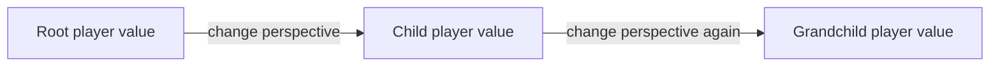

# Week 13 teaching guide — keep the player's perspective explicit

**Course navigation:** [Week 12](../week-12-rl-ranking-matching/teaching_guide.md) ← **Week 13 / 26** → [Week 14](../week-14-offline-rl-1/teaching_guide.md)

[Routes](../docs/LEARNING_MAP.md) · [All weeks](../docs/STUDY_GUIDE.md#week-by-week-teaching-guides) · [Notation](../docs/GLOSSARY.md) · [Progress](../docs/PROGRESS.md)

[Lecture PDF](notes.pdf) · [Workbook](workbook.ipynb) · [Extended reading PDF](extended_reading.pdf)

**You are here:** Whose perspective does a search value use?

**Recall first:** [Week 09](../week-09-ppo/teaching_guide.md). If unfamiliar, use the [repair tasks](../docs/LEARNING_MAP.md#if-a-prerequisite-is-missing).

**Visual anchor:** [See the connected diagram](../docs/CONCEPT_ATLAS.md#the-actor-and-critic-answer-different-questions). Use it to explain the mechanism before the derivation.

Use this guide before exercises 1–4, then connect its second example to MAPPO.

## Learning bridge

Follow [the staged learning path](../docs/LEARNING_PATH.md) when a topic is new.

- **Carry forward:** Retrieve [week 2’s](../week-02-bellman-dp/teaching_guide.md) future-value backup and [week 9’s](../week-09-ppo/teaching_guide.md) actor–critic ingredients.
- **Add one difficulty:** Decide whose value is being propagated. Alternating zero-sum games reverse the player’s perspective; cooperative teams do not.
- **Try after the worked example:** Use [the tic-tac-toe game](project/tictactoe.py) and [search exercises](project/solutions.py). If a child is a win worth +1 from the next player’s perspective, predict its backed-up value for the current player. The single-player browser courier does not implement AlphaZero or multi-agent training.

<details><summary>Check your prediction</summary>

It is −1 for the current player in the alternating zero-sum convention. A cooperative shared-reward task would retain +1 instead.

</details>

**Carry it onward:** [Offline RL](../week-14-offline-rl-1/teaching_guide.md) freezes the source of experience and asks which choices the existing evidence supports.


## Mechanism at a glance



**Read the diagram:** In this alternating zero-sum game, each edge changes the player to move, so each value backup changes sign. Two edges restore the original sign.

## Connect to what you know

MCTS improves decisions by searching a game tree; the policy network learns from search visit counts.
A value network estimates the eventual game result, while a policy network provides a search prior.
From PPO, you already know how an actor can use a baseline during training.
Multi-agent learning adds a question: whose observations and whose reward does that baseline represent?

## Analogy: alternating chess commentators

Imagine two commentators, each describing the position from their own player's side.
“A win worth +1” to one commentator is “a loss worth -1” to the other.
A tree edge switches the commentator; a backup must translate the sign.
The policy prior is the commentator's first suggestion, while visit counts record the search's investigation.

**Limit:** sign negation applies to alternating, two-player, zero-sum games with these value conventions.
It does not apply to a cooperative team where both players receive the same reward.
It also needs adjustment for extra turns, nonzero-sum rewards, or player-indexed value vectors.

## Derivation: PUCT and value backup

Assume an alternating zero-sum game and canonical boards where +1 is the player to move.
Let $v(s)$ always mean the result for the player to move at state $s$.
The child state is written from the opponent's perspective.

1. A child with estimated value $Q(c)$ therefore has value $-Q(c)$ to its parent.
2. The exploration bonus uses prior $P(c)$ and visit counts:

   $$U(c)=c_{puct}P(c)\frac{\sqrt{N(parent)}}{1+N(c)}.$$

3. Select the child maximizing $-Q(c)+U(c)$ under this storage convention.
   Some implementations store edge values from the parent perspective and use $+Q$ instead.
4. If a leaf evaluation returns $v_L$, store $+v_L$ at the leaf itself.
5. Its parent receives $-v_L$, its grandparent receives $+v_L$, and so on.

   $$W_j\leftarrow W_j+(-1)^{L-j}v_L,\quad N_j\leftarrow N_j+1,\quad Q_j=W_j/N_j.$$

6. At the root, normalize child visits to form a target policy.
   With temperature 1, $\pi_{search}(a)=N(a)/\sum_bN(b)$.

These identities establish a consistent convention; they are not a proof that finite search is optimal.
Self-play plus search and policy/value fitting is described in the [AlphaZero paper](https://arxiv.org/abs/1712.01815).

## Worked example 1 — an immediate winning move

**Predict:** should a move producing an opponent-loss leaf be attractive to the parent?
Consider this canonical board, with X the player to move:

```text
X X .
O O .
. . .
```

X places a mark in top-right, completing its row.
`apply_action` then flips the board to the next player's perspective.
That leaf contains an opponent winning line, so its value is $v_L=-1$.

**Calculate:** after one visit the leaf stores $W=-1$, $N=1$, $Q=-1$.
The root receives $+1$.
On its next consideration, the exploitation term for this child is $-Q=+1$.
If $c_{puct}=1$, prior $P=0.2$, and parent visits 4,
its bonus is $0.2\sqrt4/(1+1)=0.2$, making total score $1.2$.

**Interpret:** the leaf's loss is the root's win.
Starting backup with a negative sign at the leaf would store $+1$ there,
then selection would negate it again and treat the immediate win as a loss.
The project backup has been corrected to start with the leaf's own sign.

## Worked example 2 — exploration can override the current value estimate

**Predict:** should search ever prefer a less certain action with a worse estimated value?
Take parent visits 16 and $c_{puct}=1$.
Child A has $(P,N,Q)=(0.6,3,-0.4)$.
Child B has $(P,N,Q)=(0.4,0,0)$.

**Calculate:** A's score is $0.4+0.6(4)/4=1.0$.
B's score is $0+0.4(4)/1=1.6$, so search visits B.
After more search, suppose root child counts are $(6,3,1)$.
The temperature-1 target is $(0.6,0.3,0.1)$.
If the network currently predicts $(0.5,0.25,0.25)$, its policy cross-entropy is

$$-[0.6\log0.5+0.3\log0.25+0.1\log0.25]=0.970406.$$

**Interpret:** a search prior influences exploration; it does not dictate final visits.
An untrained network does not mathematically guarantee that the center gets the most visits.

## Worked example 3 — cooperation uses a different reward convention

**Predict:** two agents independently choose among three actions uniformly.
How often do they coordinate, and what is the expected five-step team return?
Assume each agent receives +1 if their actions match and 0 otherwise.

**Calculate:** match probability is $3(1/3)(1/3)=1/3$.
Expected reward per agent per step is $1/3$.
The sum across two agents over five steps is $2(5)(1/3)=10/3$.
If both always choose action 0, the summed team return is $2(5)=10$.
The per-agent episode return would instead be 5.

**Interpret:** a reported return of 10 and another of 5 may describe identical coordination.
Always state whether a curve sums or averages agents' rewards.
Shared reward alone does not tell which agent's action caused an improvement.

## Code bridge

- [tictactoe.py](project/tictactoe.py): `apply_action` flips board signs;
  `terminal_value` returns the value for the player to move on the supplied board.
- [alphazero.py](project/alphazero.py): `MCTS._simulate` alternates backup signs;
  `_select_child` negates a child's stored value when choosing for its parent.
- `MCTS.run` returns normalized root visits, not raw policy-network probabilities.
  `self_play_episode` associates each saved position with the outcome for its player.
- [coord_game.py](project/coord_game.py): read the per-agent reward construction before summing it.
- [mappo.py](project/mappo.py): `CentralisedCritic` uses global training information;
  all agents share actor parameters and each receives its own local observation.
  Verify that execution does not accidentally depend on the critic input.
- Root Dirichlet noise is sampled only over legal actions before mixing with
  the masked prior. Network inference puts observations on the network's device.
- Exercise 9 compares a self-play-trained network with an untrained network,
  both using MCTS. It does not train a second agent against a fixed opponent,
  and a win over random is not an Elo rating.

A short self-play run beating a random opponent is one measurement, not evidence of a Nash strategy.
Fixed weak opponents can reveal improvement while missing exploitable weaknesses against stronger policies.
The no-noise forced-win regression checks sign correctness directly.
`evaluate_vs_random` now counts positive agent outcomes as wins; its legacy `winrate` field is a score rate with draws worth 0.5.
A second regression checks that a forced agent win is reported as a win.

## Notebook investigation: label every search value with its player

Open [the actual Jupyter workbook](workbook.ipynb) and find **Exercises 1, 2 and 4**.
The [GitHub week folder](https://github.com/samuel-zhang01/STUDY-RL/tree/main/week-13-multi-agent-alphazero)
contains this notebook, its `project/` imports and tests. Follow the
[download and Jupyter workflow](../docs/LEARNING_MAP.md#download-and-open-the-jupyter-materials)
so the shared `common/` package is available.

Draw the guide's forced-win board, then its child after applying the winning move. Write “player
to move” beside both boards: the identities differ. The child stores -1 while the root receives +1.
Use exercise 2 to verify terminal evaluation and exercise 1 to verify the parent's negation.
A correct local sign with an inconsistent backup convention still breaks search.

In exercise 4, compare the network prior with normalised root visits using paired bars over legal
actions. They are different objects; more visits are evidence about this finite search, not a
calibrated probability that the move wins. Set illegal-action probabilities to zero and check the
remaining visits sum to one. Leave training exercises until this convention is clear; a short
random-opponent benchmark is too weak to diagnose a perspective error reliably.

<details>
<summary>Check your interpretation: When should a child value not simply be negated?</summary>

When the game is not alternating two-player zero-sum under this storage convention—for example an extra turn, cooperative rewards, or player-indexed values. Track whose payoff each number represents.

</details>

## Retrieval and transfer

<details>
<summary>1. A leaf is two plies below the root and evaluates to +0.7. What reaches the root?</summary>

+0.7. Two perspective changes multiply by (-1) squared. One ply would give -0.7.
</details>

<details>
<summary>2. Could a correct MCTS implementation use +Q in selection?</summary>

Yes, if its edge Q is stored from the parent player's perspective. Check storage and backup together; copying a sign in isolation can break an otherwise consistent implementation.
</details>

<details>
<summary>3. Does a centralized critic violate decentralized execution?</summary>

Not when the critic is only used during training and each deployed actor uses its permitted local observations. Passing global information to the actor at execution would violate that setup.
</details>

Arithmetic checks: PUCT scores, visit-policy cross-entropy, and coordination returns were recomputed in Python.
The forced immediate-win board also checks the corrected search behavior without training a network.
