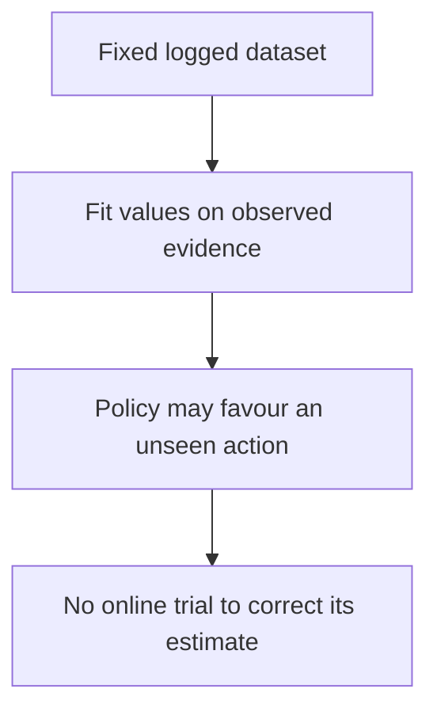

# Week 14 teaching guide — learn from support without inventing it

**Course navigation:** [Week 13](../week-13-multi-agent-alphazero/teaching_guide.md) ← **Week 14 / 26** → [Week 15](../week-15-decision-transformer-diffusion/teaching_guide.md)

[Routes](../docs/LEARNING_MAP.md) · [All weeks](../docs/STUDY_GUIDE.md#week-by-week-teaching-guides) · [Notation](../docs/GLOSSARY.md) · [Progress](../docs/PROGRESS.md)

[Lecture PDF](notes.pdf) · [Workbook](workbook.ipynb) · [Extended reading PDF](extended_reading.pdf)

**You are here:** What happens when the maximisation chooses an unsupported action?

**Recall first:** [Week 05](../week-05-dqn/teaching_guide.md), [Week 11](../week-11-contextual-bandits-ope/teaching_guide.md). If unfamiliar, use the [repair tasks](../docs/LEARNING_MAP.md#if-a-prerequisite-is-missing).

**Visual anchor:** [See the connected diagram](../docs/CONCEPT_ATLAS.md#logged-data-and-support). Use it to explain the mechanism before the derivation.

Use this guide before expectile, AWR, and CQL exercises; inspect coverage before interpreting returns.

## Learning bridge

Follow [the staged learning path](../docs/LEARNING_PATH.md) when a topic is new.

- **Carry forward:** Retrieve [week 11’s](../week-11-contextual-bandits-ope/teaching_guide.md) missing-support example and week 4’s maximization over next actions.
- **Add one difficulty:** Freeze the logs: the learner cannot try a suspiciously high-valued action to correct its estimate. Policy improvement now depends on which actions the data support.
- **Try after the worked example:** In [the support experiment](../interactive/index.html#ope), remove evidence for one action. Then inspect [the offline value exercises](project/solutions.py): if a logged action has Q=2 and an unlogged action is predicted Q=10, what does a naive maximum choose, and what evidence validates it?

Check your prediction

It chooses the unlogged action with predicted value 10. No logged outcome validates that prediction; conservative penalties or imitation restrictions express additional learning choices, not recovered evidence.

**Carry it onward:** [Sequence policies](../week-15-decision-transformer-diffusion/teaching_guide.md) learn from the same fixed-data limitation with a different training target.

## Mechanism at a glance

**Read the diagram:** Offline learning cannot collect new evidence for unsupported actions. A conservative penalty or restricted policy extraction addresses aspects of this risk under assumptions.

## Connect to what you know

Off-policy learning can reuse old experience while collecting more data.
Offline learning fixes the dataset: unsupported actions cannot be tried to correct optimistic estimates.
Week 11's overlap problem therefore affects both evaluation and policy improvement.
IQL reduces one source of extrapolation by fitting its value from logged actions.

## Analogy: learning recipes from a fixed kitchen notebook

You have records of meals actually cooked, with ingredients, steps, and ratings.
A naive optimizer invents an untried ingredient combination because its score model guesses it is excellent.
IQL emphasizes the better recorded choices; CQL penalizes unsupported optimistic scores.

| Kitchen concept | Offline RL concept |
|---|---|
| Recorded recipes | Dataset action support |
| Ratings conditional on the situation | $Q(s,a)$ estimates |
| Emphasizing better recorded dishes | Upper expectile / weighted imitation |
| Skepticism toward invented recipes | Conservative value penalty |

**Limit:** being in the notebook does not make a recipe good or safe.
Historical selection bias, omitted state, and poor coverage remain.
An upper expectile of estimated values is not an uncertainty bound or a guarantee about real outcomes.

## Derivation: why an upper expectile moves upward

Fix a state and a distribution of logged-action values $Y=Q(s,A)$.
Assume $Q$ is held fixed and the scalar value $v$ is optimized exactly.
Define residual $u=Y-v$, $0<\tau<1$:

$$\ell_\tau(u)=\begin{cases}\tau u^2,&u\ge0,\\(1-\tau)u^2,&u<0.\end{cases}$$

1. Positive residual means the value predictor is **too low**.
2. When $\tau>1/2$, those residuals get greater weight than equally large overpredictions.
3. Differentiate with respect to $v$, not $u$:

   $$\frac{d}{dv}\mathbb E[\ell_\tau(Y-v)]=-2\mathbb E[w(Y-v)(Y-v)].$$

4. Set it to zero: weighted positive and negative residuals balance.
5. For $Y=y_L$ with probability $1-p$ and $Y=y_H>y_L$ with probability $p$,
   the minimizer lies between them and obeys

   $$(1-p)(1-\tau)(v-y_L)=p\tau(y_H-v).$$

6. Solve explicitly:

   $$v=\frac{(1-p)(1-\tau)y_L+p\tau y_H}{(1-p)(1-\tau)+p\tau}.$$

At $\tau=1/2$ this is the mean. For finite supported actions and $\tau\to1$,
it approaches the largest supported value; unsupported actions never enter this regression.
See [Implicit Q-Learning](https://arxiv.org/abs/2110.06169) for the value and actor objectives.

## Worked example 1 — probabilities and expectile weights are separate

**Predict:** should an upper expectile exceed the ordinary logger-weighted average?
Take values $(0.8,1.0)$ with logger probabilities $(0.3,0.7)$ and $\tau=0.7$.

**Calculate:** the mean is $0.3(0.8)+0.7(1)=0.94$.
The two objective coefficients are $0.3(1-0.7)=0.09$ and $0.7(0.7)=0.49$.
Thus $v=(0.09(0.8)+0.49(1))/(0.09+0.49)=0.562/0.58=0.968966$.
Residuals are $(-0.168966,0.031034)$.
Weighted residual magnitudes agree:
$0.09(0.168966)=0.49(0.031034)=0.015207$.

**Interpret:** the logger's action frequency and the expectile's asymmetry both matter.
Using only $(0.3,0.7)$ as squared-error coefficients recovers the mean, not this expectile.
This holds the supplied Q-values fixed; it does not solve the full coupled IQL fixed point.

## Derivation bridge — AWR includes behavior frequency

At a fixed state, maximize $\sum_a p_aA_a-\beta^{-1}\sum_ap_a\log(p_a/b_a)$.
Here $b_a$ is the behavior distribution and $\beta>0$ is an inverse temperature.
Differentiation plus normalization gives

$$p_a^*=\frac{b_a\exp(\beta A_a)}{\sum_j b_j\exp(\beta A_j)}.$$

Weighted maximum likelihood on logged actions includes $b_a$ through sample frequencies.
The baseline cancels between actions at a fixed state because it multiplies all weights equally.
A fixed $\beta$ determines a KL penalty, not a checked numerical KL budget.

## Worked example 2 — a missing behavior factor changes the policy

**Predict:** should equal Q-values change unequal behavior frequencies?
First reuse example 1 with $\beta=3$.

**Calculate:** better/worse advantage-weight ratio is $\exp[3(1-0.8)]=e^{0.6}=1.822119$.
The **policy odds** multiply the behavior odds: $(0.7/0.3)e^{0.6}=4.251611$.
The better-action probability is $4.251611/(1+4.251611)=0.809582$.
Softmax of Q alone gives $e^{0.6}/(1+e^{0.6})=0.645656$, a different result.

For the edge case $Q_A=Q_B$, AWR returns $p=b=(0.3,0.7)$.
Softmax of Q alone returns $(0.5,0.5)$.
If $b_B=0$, exact behavior-weighted AWR assigns B probability zero.

**Interpret:** the empirical behavior distribution is part of the update, not an optional constant.
A learned neural behavior model can still generalize beyond observed samples; support needs auditing.

## Worked example 3 — CQL penalty and the zero limit

**Predict:** which direction does the conservative penalty push an unsupported high value?
For one logged action A, let $Q_A=0$, $Q_B=\log3$.

**Calculate:** penalty $=\log(e^0+e^{\log3})-Q_A=\log4=1.386294$.
Its gradient is softmax$(Q)$ minus the logged-action one-hot:
$(0.25,0.75)-(1,0)=(-0.75,0.75)$.
A gradient step of size $0.1$ with penalty coefficient 1 gives
$Q_A=0.075$ and $Q_B=\log3-0.075=1.023612$, considering only the penalty.

With two finite values, $\log\sum_ae^{Q_a}-Q_A>0$.
For $(Q_A,Q_B)=(10,0)$ it is $\log(1+e^{-10})=0.000045399$.
It tends to zero as A dominates; it does not equal zero at finite logits.

**Interpret:** the penalty discourages unsupported optimism.
CQL's formal policy-value bounds require specific assumptions and algorithm variants;
the gradient calculation is not a proof that every learned Q-value lower-bounds truth.
See [Conservative Q-Learning](https://arxiv.org/abs/2006.04779).

## Code bridge and limits of this toy project

- [agent.py](project/agent.py): `expectile_loss_grad` returns $w(Q-V)$,
  which is negative one-half of the actual derivative with respect to V; the caller adds it.
- `IQLAgent.update_value` and `update_q` illustrate the two backups.
  `fit_behavior` counts logged state/action pairs; `policy_probs` multiplies those
  frequencies by exponentiated advantage. `policy` takes that fitted policy's argmax.
  Unsupported actions receive zero mass at observed states. Unobserved states use
  a documented uniform fallback and carry no support guarantee.
  Repeated minibatch samples are averaged per tabular parameter, so duplicates
  do not multiply its learning rate.
- `CQLAgent.update` combines sampled Bellman and penalty steps; it is a teaching implementation,
  not a certificate satisfying every condition of a CQL lower-bound theorem.
- [solutions.py](project/solutions.py): `exercise_2_awr_weights` normalizes sample weights;
  its argument named `clip` caps raw weights before mean normalisation.
- `exercise_7_off_policy_evaluation_is` multiplies ratios across each episode.
  Its $10^{-3}$ target smoothing changes the evaluated policy; it cannot create missing logger support.
  `episode_end` splits terminal and time-limited episodes; `done` alone masks
  absorbing terminals in Bellman backups. Log-domain trajectory weights prevent
  arithmetic underflow but do not cure weight concentration.

## Notebook investigation: make unsupported optimism visible

Open [the actual Jupyter workbook](workbook.ipynb) and find **Exercises 1, 2 and 3**.
The [GitHub week folder](https://github.com/samuel-zhang01/STUDY-RL/tree/main/week-14-offline-rl-1)
contains this notebook, its `project/` imports and tests. Follow the
[download and Jupyter workflow](../docs/LEARNING_MAP.md#download-and-open-the-jupyter-materials)
so the shared `common/` package is available.

For the expectile exercise, use values `(0,1)` with equal frequency. Sweep tau from 0.1 to 0.9:
the exact scalar minimiser is tau. Plot value against tau and mark the ordinary mean at 0.5.
This is a curve through **supported values**, not a confidence band and not a maximum over unseen actions.

For CQL, use logged action A, `Q_A=0`, `Q_B=log 3`. Draw arrows for the penalty-only gradient step:
A increases by 0.075 and B decreases by 0.075 at step size 0.1. Add the Bellman-loss component only
after inspecting this isolated effect. In AWR, compare unequal behaviour frequencies with a softmax
of Q alone; equal Q should preserve those unequal frequencies. Check whether the helper normalises
sample weights or constructs an action policy—the two normalisations answer different questions.

Check your interpretation: If the conservative penalty lowers an unseen action value, is its true return now known?

No. The penalty changes an estimate or preference for extrapolation. It does not collect the missing outcome, and formal bounds require additional assumptions.

## Retrieval and transfer

1. With residual Q-V=-2 and tau=0.8, what is the loss and update direction?

The weight is 0.2, loss is 0.2 times 4 = 0.8, and the gradient in V is +0.8.
Gradient descent lowers V. The helper returns -0.4, which the caller adds with its learning rate.

2. Why does the AWR baseline cancel at a fixed state?

Every action weight includes the same factor exp(-beta V(s)); normalization divides it out.
Behavior action frequencies do not cancel because they differ by action.

3. Can FQE or SNIPS always validate a policy that chooses unseen actions?

No. Importance sampling needs logger support. FQE uses a fitted value model and depends on coverage and approximation assumptions; it cannot turn absent evidence into a verified counterfactual.

Arithmetic checks: expectile stationarity, AWR odds, and CQL values/gradients were recomputed in Python.
