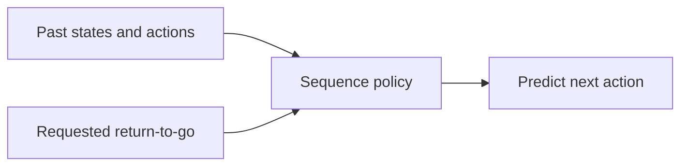

# Week 15 teaching guide — conditioning is not a promise

**Course navigation:** [Week 14](../week-14-offline-rl-1/teaching_guide.md) ← **Week 15 / 26** → [Week 16](../week-16-model-based/teaching_guide.md)

[Routes](../docs/LEARNING_MAP.md) · [All weeks](../docs/STUDY_GUIDE.md#week-by-week-teaching-guides) · [Notation](../docs/GLOSSARY.md) · [Progress](../docs/PROGRESS.md)

[Lecture PDF](notes.pdf) · [Workbook](workbook.ipynb) · [Extended reading PDF](extended_reading.pdf)

**You are here:** Why is a requested return not a guaranteed outcome?

**Recall first:** [Week 14](../week-14-offline-rl-1/teaching_guide.md). If unfamiliar, use the [repair tasks](../docs/LEARNING_MAP.md#if-a-prerequisite-is-missing).

**Visual anchor:** [See the connected diagram](../docs/CONCEPT_ATLAS.md#logged-data-and-support). Use it to explain the mechanism before the derivation.

Use this guide for returns-to-go, causal masking, and the diffusion noising exercise.

## Learning bridge

Follow [the staged learning path](../docs/LEARNING_PATH.md) when a topic is new.

- **Carry forward:** Retrieve [week 14’s](../week-14-offline-rl-1/teaching_guide.md) fixed-data support and supervised imitation.
- **Add one difficulty:** Condition a predicted action on a history and desired return, rather than a Bellman target. A desired outcome token is a request, not an environmental guarantee.
- **Try after the worked example:** Use [the return-to-go and masking exercises](project/solutions.py). If every logged episode returns at most 4, predict whether setting the desired-return token to 10 proves the generated policy will earn 10. The browser OPE toy explains coverage only; it trains no transformer or diffusion policy.

Check your prediction

It proves nothing about achieving 10. The conditional model must extrapolate beyond the logged return range, and luck in a high-return diary may not be reproducible by changing actions.

**Carry it onward:** [Model-based RL](../week-16-model-based/teaching_guide.md) explicitly learns predicted consequences and lets a planner question them.

## Choose your explanation depth

How a desired return changes after a reward. Open the layer you need, then continue to the complete derivation and examples below.

1 · Intuition

Return conditioning is a request to the action model. The request must update consistently with the definition used during training. It does not give the model control over luck, missing actions or an impossible goal.

2 · A numerical case

For rewards `[1, 2, 4]`, the shipped undiscounted helper returns **[7, 6, 4]**. If you instead define discounted returns with γ = 0.5, the values are **[3, 4, 4]**: 3 = 1 + 0.5 × 4. After the first reward, the remaining discounted target is (3 − 1) / 0.5 = **4**, not 2.

3 · Derivation and assumptions

Define $G_t=\sum_{j=t}^{T-1}\gamma^{j-t}r_j$. Splitting off the first term gives $G_t=r_t+\gamma G_{t+1}$ and, for $\gamma>0$, $G_{t+1}=(G_t-r_t)/\gamma$. This is bookkeeping, not a performance theorem. The policy additionally needs appropriate conditional data support; a requested return that was only achieved through favourable noise can be misleading.

**Investigate in Jupyter.** Open [Exercise 1: `rtg`](workbook.ipynb#cell-6), whose reference is `exercise_1_returns_to_go`; verify `[7, 6, 4]`. Add a **separate** discounted helper for the second calculation so the project convention stays explicit. Then open [Exercise 2: `mask`](workbook.ipynb#cell-9) and check which earlier tokens can influence each predicted action. The common failure is updating a discounted target with the undiscounted subtraction rule, or accidentally letting an action token reveal the action being predicted.

## Mechanism at a glance

**Read the diagram:** A requested return conditions a prediction learned from logged sequences. It is not a constraint forcing the environment to deliver that return.

## Connect to what you know

Behavior cloning predicts an action from a state using supervised learning.
Decision Transformer (DT) also sees a history and a desired remaining return.
Its training target is still a recorded action; it does not use a Bellman backup.
The dataset splits at the logger's `episode_end`, including collection time limits.
Left-padded windows pass an explicit attention mask; padded tokens cannot affect
the valid action predictions. The separate loss mask excludes padded targets.
From week 14, retain the distinction between examples present in a dataset and unsupported extrapolation.

## Analogy: following a travel diary with a remaining budget

A travel diary records daily location, choices, and eventual satisfaction.
DT predicts what choice appeared next in diaries with a specified remaining satisfaction total.
History maps to the itinerary prefix; the return token maps to the remaining target.
The causal mask prevents looking at tomorrow's recorded choice while predicting today's.

**Limit:** successful trips may have benefited from good weather rather than good decisions.
Choosing actions associated with high satisfaction does not cause the weather to repeat.
A desired-return token is a conditioning input, not a guarantee that the target is attainable.
This distinction is particularly important for recommendations based on historical human outcomes.

## Derivation: returns and the supervised loss

Consider an episode with rewards $r_0,\ldots,r_{T-1}$.
Use undiscounted returns, as in this project's dataset, and terminal $R_T=0$.

1. Define the remaining return $R_t=\sum_{k=t}^{T-1}r_k$.
2. Split off the first reward: $R_t=r_t+R_{t+1}$.
3. Therefore update a deployment target by

   $$R_{t+1}^{target}=R_t^{target}-r_t.$$

4. Interleave tokens $(R_0,s_0,a_0,R_1,s_1,a_1,\ldots)$.
5. Predict $a_t$ from the hidden representation at the **state** token $s_t$.
   It can attend to earlier tokens and itself, but not to $a_t$ or future states.
6. For discrete actions, maximize conditional log likelihood, equivalently minimize

   $$L=-\frac{\sum_t m_t\log p_\theta(a_t|R_{\le t},s_{\le t},a_{<t})}{\sum_tm_t},$$

   where $m_t$ masks padded timesteps and the denominator must be positive.

This derives an action-prediction loss; it does not prove optimality or causal sufficiency of return.
For discounted $G_t=r_t+\gamma G_{t+1}$, the corresponding update is $(G_t-r_t)/\gamma$.
Do not mix discounted targets with a dataset built using ordinary reverse cumulative sums.
See the [Decision Transformer paper](https://arxiv.org/abs/2106.01345).

## Worked example 1 — a negative reward raises remaining demand

**Predict:** if the goal is total return 10 and the first reward is -1, should the remaining target rise?

**Calculate:** for recorded rewards $(-1,-1,10)$,
$R_2=10$, $R_1=-1+10=9$, and $R_0=-1+9=8$.
These tokens therefore describe a trajectory achieving total return 8.
For a requested deployment total of 10, after $r_0=-1$ the next target is
$R_1^{target}=10-(-1)=11$.
After another reward -1 it becomes 12.
To achieve the original total 10 in this three-step episode, the last reward would need to be 12.

**Interpret:** the remaining target is a balance to be achieved, not a countdown that always decreases.
Updating 10 to 9 after observing -1 changes the intended total and is a sign error.
If the dataset's best final reward is 10, asking for 12 may be unsupported.

## Worked example 2 — a six-token attention audit

**Predict:** can the model see the answer token while predicting the first action?
For two timesteps, token indices are

| Index | 0 | 1 | 2 | 3 | 4 | 5 |
|---|---|---|---|---|---|---|
| Token | $R_0$ | $s_0$ | $a_0$ | $R_1$ | $s_1$ | $a_1$ |

**Calculate:** the first action predictor reads index 1 and may see only indices 0–1.
The second reads index 4 and may see indices 0–4, including the previous action at index 2.
The Boolean upper-triangular mask contains $6(6-1)/2=15$ blocked query/key pairs.
There are $6(6+1)/2=21$ allowed pairs, including self-attention.
If the first predicted probabilities are $(0.7,0.2,0.1)$ and the label is action 0,
its cross-entropy is $-\log0.7=0.356675$.
If the second label has predicted probability 0.25, the two-step mean loss is
$(0.356675-\log0.25)/2=0.871485$.

**Interpret:** predicting from index 2 would expose the current action embedding through self-attention.
A triangular causal mask alone does not prevent that leakage if prediction positions are wrong.
Padding also needs separate attention/loss handling; causal masking does not identify padding by itself.

## Derivation bridge — diffusion's forward process

Let $\alpha_t=1-\beta_t$, with independent standard-normal noises at each forward step.
Repeated substitution in $x_t=\sqrt{\alpha_t}x_{t-1}+\sqrt{1-\alpha_t}\epsilon_t$
gives a signal coefficient $\sqrt{\bar\alpha_t}$, where $\bar\alpha_t=\prod_{j=1}^t\alpha_j$.
The independent Gaussian noise terms have total variance $1-\bar\alpha_t$.
Thus a direct sample at time t is

$$x_t=\sqrt{\bar\alpha_t}x_0+\sqrt{1-\bar\alpha_t}\epsilon,\qquad\epsilon\sim\mathcal N(0,I).$$

A denoising model learns to predict noise conditional on this corrupted sample and the timestep.
The common unweighted noise MSE drops timestep-dependent weights from the variational objective;
it is not generally the exact ELBO plus a constant.
See [Ho, Jain, and Abbeel](https://arxiv.org/abs/2006.11239).

## Worked example 3 — noise scale and its limits

**Predict:** does the coefficient on noise equal its variance?
Take $x_0=(2,-1)$, $\bar\alpha=0.36$, and one noise draw $\epsilon=(1,-2)$.

**Calculate:** signal coefficient is $\sqrt{0.36}=0.6$ and noise coefficient is $\sqrt{0.64}=0.8$.
Therefore $x_t=0.6(2,-1)+0.8(1,-2)=(2,-2.2)$.
Conditioned on $x_0$, the distribution has mean $(1.2,-0.6)$ and variance 0.64 per coordinate.
At $\bar\alpha=1$, $x_t=x_0$; at $\bar\alpha=0$, $x_t=\epsilon$.
If the noise predictor returns $(0.5,-1.5)$, squared error is $0.25+0.25=0.5$
or coordinate-mean MSE 0.25, depending on the reduction convention.

**Interpret:** the forward noising identity does not itself implement a diffusion policy.
A policy also needs denoising training, conditioning, reverse sampling, and action execution.

## Code bridge

- [solutions.py](project/solutions.py): `exercise_1_returns_to_go` is a reverse cumulative sum;
  `exercise_2_causal_mask` constructs future-token masking; `exercise_7_diffusion_noising` is the forward step only.
- [model.py](project/model.py): `DecisionTransformer.forward` interleaves three token streams
  and selects `h[:, 1::3, :]`, the state positions, for action logits.
- [data.py](project/data.py): `sample_minibatch` builds windows with padding.
  Follow the validity mask to [train.py](project/train.py) and the loss.
- `train._rollout` updates the desired return using the observed reward;
  a high target changes the conditional action distribution but does not certify success.

The project trains a tiny DT; its diffusion exercise is an algebra demonstration, not a trained diffusion controller.
Compare target-return effects over multiple rollouts, including attainable and unsupported targets.
Return conditioning can select environmental luck as well as useful behavior;
see [Brandfonbrener et al.](https://arxiv.org/abs/2206.01079) for conditions and limitations.

## Notebook investigation: audit what the action predictor is allowed to see

Open [the actual Jupyter workbook](workbook.ipynb) and find **Exercises 1, 2 and 3**.
The [GitHub week folder](https://github.com/samuel-zhang01/STUDY-RL/tree/main/week-15-decision-transformer-diffusion)
contains this notebook, its `project/` imports and tests. Follow the
[download and Jupyter workflow](../docs/LEARNING_MAP.md#download-and-open-the-jupyter-materials)
so the shared `common/` package is available.

Write the six tokens `(R0,s0,a0,R1,s1,a1)` along both axes of an attention matrix.
Use exercise 2 to shade forbidden query/key pairs. Mark prediction rows at indices 1 and 4;
row 1 cannot read action token 2. Reading the prediction at row 2 instead would leak the answer
through self-attention despite the triangular mask.

In exercise 3, use a window longer than a short episode so padding appears. Inspect both the
attention mask and the loss mask: hiding padded labels from the loss does not by itself prevent
attention to padded inputs. For exercise 1, calculate returns `(8,9,10)` from rewards `(-1,-1,10)`.
Compare with a requested target 10 after observing reward -1: its next target is 11.
Label requested and achieved returns as separate quantities in any later rollout plot.

Check your interpretation: If requested return rises but achieved return plateaus, has the model ignored its input?

Not necessarily. Its conditional action distribution can change while attainable returns or dataset coverage limit performance. Inspect actions and support as well as the final scalar return.

## Retrieval and transfer

1. Why does requesting return 100 not imply that DT plans a path worth 100?

DT predicts actions from historical conditional patterns. The target may be outside the dataset, physically impossible, or associated with lucky outcomes the policy cannot control.

2. Does the action at time t receive its own embedding during prediction?

Its embedding exists in the training sequence, but the prediction is read at the preceding state position, which cannot attend forward to that action under the causal mask.

3. With discounted target 5, observed reward 1, and gamma 0.8, what is next target?

(5-1)/0.8 = 5. Using 4 would apply the undiscounted update to discounted data.

Arithmetic checks: returns, target updates, mask-pair counts, cross-entropy, and noising values were recomputed in Python.
