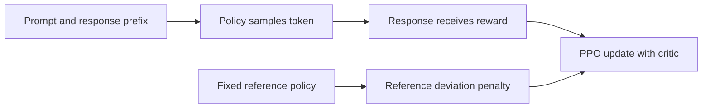

# Week 18 teaching guide: from a response probability to a PPO update

**Course navigation:** [Week 17](../week-17-exploration-meta/teaching_guide.md) ← **Week 18 / 26** → [Week 19](../week-19-dpo-zoo/teaching_guide.md)

[Routes](../docs/LEARNING_MAP.md) · [All weeks](../docs/STUDY_GUIDE.md#week-by-week-teaching-guides) · [Notation](../docs/GLOSSARY.md) · [Progress](../docs/PROGRESS.md)

[Lecture PDF](notes.pdf) · [Workbook](workbook.ipynb) · [Extended reading PDF](extended_reading.pdf)

**You are here:** Which policy supplies each log-probability and each sample?

**Recall first:** [Week 07](../week-07-policy-gradients/teaching_guide.md), [Week 08](../week-08-a2c-gae-trpo/teaching_guide.md), [Week 09](../week-09-ppo/teaching_guide.md). If unfamiliar, use the [repair tasks](../docs/LEARNING_MAP.md#if-a-prerequisite-is-missing).

**Visual anchor:** [See the connected diagram](../docs/CONCEPT_ATLAS.md#llm-training-keep-four-roles-separate). Use it to explain the mechanism before the derivation.

Use with [the notes](notes.tex) and [the workbook](workbook.ipynb).
These calculations are illustrative fixtures, not claims about a trained language model.

**Practical companion:** [LLM post-training lab, lessons 1–3](../llm-lab/README.md)
adds real pretrained-model LoRA SFT, completion masks, save/reload, and NVIDIA QLoRA.

## Learning bridge

Follow [the staged learning path](../docs/LEARNING_PATH.md) when a topic is new.

- **Carry forward:** Retrieve [week 9’s](../week-09-ppo/teaching_guide.md) old-policy ratio and week 7’s action probability; a prefix now acts as the state.
- **Add one difficulty:** Keep the changing rollout policy separate from a usually fixed reference policy. A learned response reward and reference penalty are two different signals.
- **Try after the worked example:** Use [the preference/reward experiment](../interactive/index.html#preferences) for the pair-probability intuition, then [the practical LLM lab](../llm-lab/README.md) for actual pretrained-model training. If policy and reference give one sampled action probabilities 0.5 and 0.25, calculate its log ratio; is this one sample the full KL?

Check your prediction

The sample log ratio is log(0.5/0.25)=log(2). KL is the policy expectation over all actions at that state, so this one log ratio is not itself the full KL.

**Carry it onward:** [DPO](../week-19-dpo-zoo/teaching_guide.md) uses chosen/rejected pairs to train relative odds directly.

## Mechanism at a glance

**Read the diagram:** Tokens are actions and prefixes are states. The fixed reference anchors the objective; the old rollout policy supplies PPO denominators and changes between rollout cycles.

## The connection to earlier weeks

Week 7's action becomes a token; week 8's state becomes the prompt plus response prefix.
Week 9's PPO old policy is the policy that collected the rollout.
The **reference** policy has a different job: it anchors training to a chosen distribution.
An old policy can change every rollout while the reference remains frozen.
You need logarithms, conditional probability, and the backward GAE recursion.

## Analogy: writing with two kinds of feedback

A writing tutor gives one score for a whole paragraph.
A style guide describes which continuations are usual after each prefix.

| Analogy | RLHF quantity |
|---|---|
| Paragraph written so far | State `s_t = (x,y_<t)` |
| Next word choice | Token action `y_t` |
| Tutor's final score | Terminal reward-model score `r_phi(x,y)` |
| Style guide | Frozen reference `q` |
| Writer who produced the draft | Rollout policy `p_old` |
| Expected remaining score | Value estimate `V(s_t)` |

The tutor's score is a learned proxy, not an objective measure of truth.
The reference need not be correct or harmless; it is simply a regularisation anchor.
A sampled continuation can be **less** likely under the current policy than under the guide.
Its log-ratio is then negative, even though the distributional KL is nonnegative.

## Derivation: chain rule, sampled penalty, expected KL

Fix prompt `x` and a finite vocabulary.
Let a completion include its EOS token, or use a common fixed truncation rule.
Let `p` be the policy and `q` the reference, with `q(y)>0` wherever `p(y)>0`.
Use natural logarithms, so KL is measured in nats.

1. Autoregressive sequence probability multiplies conditional token probabilities:

   $$p(y\mid x)=\prod_{t=1}^{T}p(y_t\mid x,y_{<t}).$$

2. Therefore the **sampled sequence log-ratio** is

   $$k(y)=\log\frac{p(y\mid x)}{q(y\mid x)}
   =\sum_t\left[\log p(y_t\mid s_t)-\log q(y_t\mid s_t)\right].$$

3. Only after expectation under `p` do we obtain KL:

   $$D_{KL}(p\|q)=\mathbb E_{y\sim p}[k(y)]\ge0.$$

4. Put `−beta k_t` at each response token and the reward-model score at EOS.
   With discount `gamma=1`, the expected total is

   $$J(p)=\mathbb E_{y\sim p}[r_\phi(x,y)]-\beta D_{KL}(p\|q).$$

This is a soft regularisation objective. It is not a hard KL constraint.
A vocabulary sum at a fixed prefix computes an exact conditional KL;
a selected token contributes one sample of a log-ratio.
[InstructGPT](https://arxiv.org/abs/2203.02155) uses reward-model optimisation with a reference-policy penalty;
[PPO](https://arxiv.org/abs/1707.06347) supplies the clipped optimisation surrogate.

## Worked example 1: a negative sample and a positive KL

**Predict.** If `p=(0.8,0.2)` and `q=(0.5,0.5)`, one action is overrepresented
and the other is underrepresented under `p`.

1. First action: `k_1=log(0.8/0.5)=log(1.6)=0.470004`.
2. Second action: `k_2=log(0.2/0.5)=log(0.4)=−0.916291`.
3. Expected KL: `0.8×0.470004 + 0.2×(−0.916291)=0.192745`.
4. At `beta=0.1`, the sampled shaped rewards are `−0.0470004` and `+0.0916291`.
5. Their expected reward adjustment is `−0.0192745 = −beta KL`.

**Interpret.** The rare underrepresented action earns a positive sampled adjustment.
That is compatible with a negative expected regularisation reward.
Swapping KL direction gives
`KL(q||p)=0.5 log(0.5/0.8)+0.5 log(0.5/0.2)=0.223144`.
Direction changes both the sampling law and the numerical answer.

For a separate two-token response, suppose selected probabilities are `(0.8,0.5)`
under `p` and `(0.5,0.8)` under `q`.
Both sequence probabilities are `0.4`, so their sampled sequence log-ratio is `0`.
The two token contributions cancel: `log(1.6)+log(0.625)=0`.
This does not imply the full sequence distributions are identical.

## Worked example 2: three tokens, shaped rewards, GAE, clipping

**Predict.** A final positive score should propagate to earlier actions through GAE,
but not every advantage equals the terminal reward.

Take sampled log-ratios `(0.2,−0.1,0.3)`, terminal score `1`, and `beta=0.1`.
Let values before each action be `(0.4,0.5,0.6)`, with terminal value `0`.
Use `gamma=1`, GAE `lambda=0.9`, and PPO clip `epsilon=0.2`.

1. Shaped rewards: `R=(−0.02,+0.01,0.97)`.
2. TD residuals:
   `delta_1=−0.02+0.5−0.4=0.08`,
   `delta_2=0.01+0.6−0.5=0.11`,
   `delta_3=0.97+0−0.6=0.37`.
3. Work backward: `A_3=0.37`;
   `A_2=0.11+0.9×0.37=0.443`;
   `A_1=0.08+0.9×0.443=0.4787`.
4. Value targets `A+V` are `(0.8787,0.943,0.97)`.
5. Suppose the new/old probability ratio for token 1 is `1.3`.
   Its unclipped objective is `1.3×0.4787=0.62231`.
   The clipped objective is `1.2×0.4787=0.57444`; the minimum chooses `0.57444`.
   This token contributes `−0.57444` to the minimised policy loss.

**Edge case.** If instead `A=−0.4` and the ratio is `1.3`, the two objectives are
`−0.52` and `−0.48`; the minimum is `−0.52`, so the corrective gradient remains.
Clipping only removes incentive in the direction already improving that sample's objective.
It does not clamp every actual probability ratio to `[0.8,1.2]`.
A perfect value function also does not remove action or reward randomness from a TD sample.

## Bridge to the actual project

- [project/ppo.py](project/ppo.py): `_gather_logprobs` selects token log probabilities
  from a vocabulary distribution; `sample_rollouts` constructs shaped rewards.
- `compute_gae` implements the backward recursion above; check its terminal convention.
- `ppo_step` uses old rollout log probabilities in its ratio denominator.
- `AdaptiveKLController` changes `beta` using the rollout's mean per-token log-ratio
  to the frozen reference. `history['kl']` records that signed Monte Carlo estimate.
  `ppo_step['approx_kl']` instead compares old and updated policies, as a PPO diagnostic.
  The update reuses the rollout's sampling temperature in its new log probabilities.
- [project/rm.py](project/rm.py): `reward_loss` fits pairwise score differences.
- [project/solutions.py](project/solutions.py): exercise 2 returns an exact categorical
  KL; it should not be confused with one selected token's signed log-ratio.

A prompt mask excludes prompt tokens from completion loss; an EOS/padding mask excludes
positions after the response ended. Neither mask should discard the actual EOS action.
Inspect whether reported KL is a mean **per token** or a sum **per response** before
choosing a controller target. Different aggregation conventions have different units.

## Notebook investigation: trace one response through all four probability roles

Open [the actual Jupyter workbook](workbook.ipynb) and find **Exercises 2, 3, 4 and 5**.
The [GitHub week folder](https://github.com/samuel-zhang01/STUDY-RL/tree/main/week-18-rlhf-ppo-llm)
contains this notebook, its `project/` imports and tests. Follow the
[download and Jupyter workflow](../docs/LEARNING_MAP.md#download-and-open-the-jupyter-materials)
so the shared `common/` package is available.

Make a token table with columns for token, response mask, old rollout log probability, current
log probability, reference log probability, reward and advantage. Use the guide's three-token
fixture first; every column then has an explanation before a model is involved.
The PPO ratio uses current minus old; the reference penalty uses policy minus reference.
An unchanged actor should have PPO ratio one under the same sampling temperature and token mask.

Exercise 2 calculates a vocabulary expectation; compare it with a single signed token log-ratio
without calling both the same measurement. For exercise 4, verify that the final shaped score
propagates backward to advantages `(0.4787,0.443,0.37)`. Draw token contributions as bars and
mark EOS. A completion mask excludes padding after EOS while retaining the EOS action itself.
Before exercise 5, state whether its controller target is per token or per response.

Check your interpretation: Could reference KL grow while every individual PPO update remains small?

Yes. Each old policy is a new local comparison, while the reference remains fixed. Many small moves can accumulate into a large departure from that fixed anchor.

## Retrieve and transfer

1. Why do sequence log probabilities use a sum, not an average?

The log of a product is a sum. Dividing by response length produces a different score,
related to geometric mean token probability, not the probability of that response.

2. A controller uses beta=0.1, observed KL=0.2, target=0.1, horizon=10. What changes?

Relative error is `1`, clipped to `0.2`; the multiplicative update is
`0.1(1+0.2/10)=0.102`. The penalty strengthens. The formula assumes matched KL units.

3. Does adding 100 to every response reward for one prompt change its ideal optimum?

No. Every policy gains the same 100, and the common factor `exp(100/beta)` cancels
in the normalisation of `p_star(y) ∝ q(y) exp(r(y)/beta)`.
It can change an uncentred estimator's variance, but not the ideal response preference.

