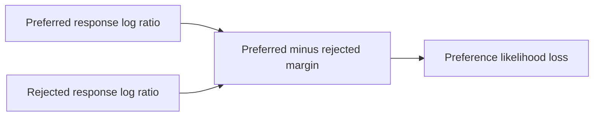

# Week 19 teaching guide: track the margin before comparing the losses

**Course navigation:** [Week 18](../week-18-rlhf-ppo-llm/teaching_guide.md) ← **Week 19 / 26** → [Week 20](../week-20-grpo-rloo-rlvr/teaching_guide.md)

[Routes](../docs/LEARNING_MAP.md) · [All weeks](../docs/STUDY_GUIDE.md#week-by-week-teaching-guides) · [Notation](../docs/GLOSSARY.md) · [Progress](../docs/PROGRESS.md)

[Lecture PDF](notes.pdf) · [Workbook](workbook.ipynb) · [Extended reading PDF](extended_reading.pdf)

**You are here:** Why does the normalising constant disappear in a preference pair?

**Recall first:** [Week 18](../week-18-rlhf-ppo-llm/teaching_guide.md). If unfamiliar, use the [repair tasks](../docs/LEARNING_MAP.md#if-a-prerequisite-is-missing).

**Visual anchor:** [See the connected diagram](../docs/CONCEPT_ATLAS.md#llm-training-keep-four-roles-separate). Use it to explain the mechanism before the derivation.

Pair this with [the notes](notes.tex) and [the workbook](workbook.ipynb).
The examples use supplied sequence log probabilities; they are not measured model results.

**Practical companion:** [the LLM lab](../llm-lab/README.md#run-the-full-small-experiment)
trains DPO on a real pretrained model, starting from a saved SFT adapter and caching
the complete initial policy as its fixed reference.

**Statistics companion:** [A preference probability depends on the label-noise model](../docs/statistics/01-probability-conditioning.md) · [Related foundation](../docs/statistics/06-regression-validation.md) · [Textbook source map](../docs/statistics/SOURCES.md).

**Bounded first route:** Compute a pairwise log-ratio margin and its gradient, then state the label mechanism and evaluate held-out preferences separately from task outcomes.

## Learning bridge

Follow [the staged learning path](../docs/LEARNING_PATH.md) when a topic is new.

- **Carry forward:** Retrieve [week 18’s](../week-18-rlhf-ppo-llm/teaching_guide.md) fixed reference and complete-response log probabilities.
- **Add one difficulty:** Subtract the chosen and rejected changes in log probability relative to the reference. This pair margin is different from rewarding a generated rollout online.
- **Try after the worked example:** Use [the preference margin experiment](../interactive/index.html#preferences). If the policy exactly equals its reference, predict the margin and Bradley–Terry pair probability before changing either response’s log probability. Then follow [the real DPO lab](../llm-lab/README.md).

Check your prediction

The relative margin is 0, so the pair probability is sigmoid(0)=0.5. A supplied chosen label does not mean the current policy already assigns it a positive relative margin.

**Carry it onward:** [Group-baseline methods](../week-20-grpo-rloo-rlvr/teaching_guide.md) return to sampled responses and an online reward or verifier.

## Choose your explanation depth

Why a better preference margin can hide a worse chosen likelihood. Open the layer you need, then continue to the complete derivation and examples below.

1 · Intuition

DPO compares the chosen response with a rejected response, relative to a reference. The comparison can improve because the chosen response becomes more likely, because the rejected response becomes less likely, or both. Track the absolute likelihoods as well as the margin.

2 · A numerical case

If both policy log probabilities initially equal their reference values, the DPO logit is **0** and the loss is **log(2) ≈ 0.693147**. Now change chosen log probability by **−0.2** and rejected by **−1.2**. The relative margin improves by **1**, despite the chosen response becoming less likely. At β = 0.1 the loss falls to **0.644397**.

3 · Derivation and assumptions

Let $h=(\ell_w-\ell_{\mathrm{ref},w})-(\ell_l-\ell_{\mathrm{ref},l})$. DPO is $-\log\sigma(\beta h)$, with derivative $-\beta\sigma(-\beta h)$ with respect to $h$. Hence larger $h$ decreases the loss, regardless of which likelihood moved. Inputs must use the same token/sequence convention; apply $\beta$ exactly once. The derivation below explains the supported-reference assumptions behind the policy interpretation.

**Investigate in Jupyter.** Open [Exercise 2: `my_dpo`](workbook.ipynb#cell-11) and [Exercise 8: `my_margin`](workbook.ipynb#cell-35). Compare `exercise_2_dpo` and `exercise_8_margin` on the initial and shifted arrays. Expect losses **0.693147 → 0.644397** and implicit reward margin **0 → 0.1**. Save chosen and rejected log probabilities beside them. A common failure is reporting only a rising margin as evidence that chosen-response likelihood or response quality improved.

## Mechanism at a glance

**Read the diagram:** Each log ratio compares the trainable policy with a reference on the same response. Their difference forms a pairwise margin; the normaliser cancels within a prompt.

## What you need from week 18

Know the KL-regularised optimum `p_star(y|x) ∝ q(y|x) exp(r(x,y)/beta)`.
Know the Bradley–Terry model `P(w preferred to l)=sigmoid(r_w−r_l)`.
Keep complete-response log probability separate from average token log probability.
The same Greek letter in two algorithms need not have the same scale or operational meaning.

## Analogy: judging progress relative to a starting level

Two musicians compete after training. A judge compares how their odds have changed
relative to their starting recordings.

| Analogy | DPO quantity |
|---|---|
| Starting performance distribution | Frozen reference `q` |
| Current performance distribution | Policy `p_theta` |
| Change relative to the starting odds | `log(p_theta(y)/q(y))` |
| Chosen and rejected recordings of the same piece | Responses `y_w,y_l` to one prompt |
| Difference in relative progress | Raw log-ratio margin `h` |

The analogy explains why absolute likelihood is insufficient: a chosen response
can still be less likely than the rejected one while improving relative to the reference.
It does not explain whether the judge's preference is good; noisy or biased labels remain possible.
Nor does a larger relative margin guarantee the chosen response's probability increased.

## Derivation: DPO without counting beta twice

Fix one prompt `x`, a reference with positive support, and `beta>0`.
Assume the reward-induced partition function is finite.
The ideal derivation uses an expressive policy class and Bradley–Terry preferences
with their noise scale absorbed into the reward.

1. Take logs of the ideal optimum:

   $$\log p^*(y|x)=\log q(y|x)+r(x,y)/\beta-\log Z(x).$$

2. Rearrange and define implicit reward:

   $$r(x,y)=\beta\log[p^*(y|x)/q(y|x)]+\beta\log Z(x),
   \quad \hat r_\theta(x,y)=\beta\log[p_\theta(y|x)/q(y|x)].$$

3. Compare two responses to the **same prompt**. Their `beta log Z(x)` terms cancel.
   Define a raw margin `h` and a scaled margin `z`:

   $$h=(\log p_w-\log q_w)-(\log p_l-\log q_l),\qquad z=\beta h.$$

4. Fit the observed preference:

   $$L_{DPO}=-\log\sigma(z)=\log(1+e^{-z}).$$

5. Differentiate the scalar margin:

   $$\frac{\partial L}{\partial h}=-\beta\sigma(-\beta h).$$

Because `r_hat` already includes `beta`, writing `sigmoid(beta(r_hat_w−r_hat_l))`
would accidentally square that coefficient.
At `h=0`, the gradient magnitude is `beta/2`; a smaller beta does not itself mean faster updates.
[Rafailov et al.](https://arxiv.org/html/2305.18290v3) derive the reward-policy reparameterisation.
It connects ideal objectives; it does not make finite DPO and PPO training trajectories identical.

## Worked example 1: a DPO loss and a likelihood-displacement trap

**Predict.** A policy that improves the chosen response's likelihood relative to the
reference more than the rejected response should have loss below `log 2`.

Let policy log probabilities be `log p_w=−3`, `log p_l=−5`.
Let reference log probabilities both equal `−3.5`; set `beta=0.1`.

1. Relative log probabilities: `ell_w=0.5`, `ell_l=−1.5`.
2. Raw margin: `h=0.5−(−1.5)=2`.
3. Implicit rewards: `r_hat_w=0.05`, `r_hat_l=−0.15`; scaled margin `z=0.2`.
4. Preference probability: `sigmoid(0.2)=0.549834`.
5. Loss: `log(1+exp(−0.2))=0.598139`, below `0.693147`.
6. Margin derivative: `−0.1 sigmoid(−0.2)=−0.0450166`.

**Edge case.** Start from the reference and instead move policy log probabilities
to `−4.5` for the chosen and `−6.5` for the rejected response.
Now relative log probabilities are `−1` and `−3`, so `h=2` and the loss is **identical**.
Yet the chosen response's probability fell from `exp(−3.5)=0.0301974`
to `exp(−4.5)=0.0111090`.
The remaining probability mass can move to other responses.
Pairwise margin improvement alone is not evidence of improving chosen-response likelihood.

## Worked example 2: DPO, IPO, and SimPO measure different things

Use the original pair `log p_w=−3`, `log p_l=−5`, with lengths `10` and `30`.
The reference remains `−3.5` for each response.

**Predict.** The chosen response has higher sequence probability, but the rejected
response can have higher average token probability.

1. Mean token log probabilities: `−3/10=−0.3`, `−5/30=−1/6≈−0.166667`.
2. For SimPO `beta=2`, margin offset `gamma=1`:
   `z_simpo=2(−0.3+1/6)−1=−1.266667`.
3. Its preference probability is `0.219828`; its loss is `1.514908`.
4. DPO with `beta=0.1` still gives `h=2`, `z=0.2`, loss `0.598139`.
5. The project's IPO with `beta=0.1` targets raw margin `1/(2 beta)=5`:
   loss `(2−5)²=9`; derivative in `h` is `2(2−5)=−6`.
6. If the raw margin reaches `7`, IPO loss is `(7−5)²=4` and derivative `+4`:
   gradient descent now pushes the margin **down** toward its finite target.

**Interpret.** Loss magnitudes are not comparable measures of response quality.
The variants differ in scaling, normalisation, and objective.
An average token log probability is the logarithm of a geometric mean;
it is not the normalised probability of a full response.
A finite scalar IPO target does not imply every pair in a shared model can attain it:
contradictory or cyclic preferences may force compromises.
[SimPO](https://arxiv.org/abs/2405.14734) explicitly uses length-normalised scores;
[IPO](https://arxiv.org/abs/2310.12036) studies a different preference objective.

## Bridge to the actual project

- [project/losses.py](project/losses.py): `dpo_loss` subtracts reference log probabilities
  before multiplying the pairwise difference by `beta`.
- `ipo_loss` uses the raw log-ratio difference; `simpo_loss` divides by lengths.
- `implicit_reward_margin` returns the **scaled** margin, not `h`.
- `_log1mexp` supports the odds transformation in `orpo_loss`; its input must be nonpositive.
- [project/solutions.py](project/solutions.py) isolates the implicit reward, stable
  logarithm, and loss variants before the workbook's bake-off.

Read the caller as well as the loss: DPO uses summed completion log probabilities,
while the ORPO branch passes mean completion log probabilities (`-nll`) into its odds
transformation, following [Hong et al., Eq. 1](https://aclanthology.org/2024.emnlp-main.626/).
KTO's branch still uses an in-batch reference-point proxy; it omits the separate
unpaired KL-estimation batch, so the bake-off is not a reproduction of the full recipe.
Keep the reference frozen and check completion masking before diagnosing optimiser behaviour.
Report held-out preferences, length distributions, and chosen/rejected likelihoods separately.

## Notebook investigation: use a preference margin without losing absolute likelihood

Open [the actual Jupyter workbook](workbook.ipynb) and find **Exercises 2, 3, 4 and 8**.
The [GitHub week folder](https://github.com/samuel-zhang01/STUDY-RL/tree/main/week-19-dpo-zoo)
contains this notebook, its `project/` imports and tests. Follow the
[download and Jupyter workflow](../docs/LEARNING_MAP.md#download-and-open-the-jupyter-materials)
so the shared `common/` package is available.

Reproduce DPO's raw margin h=2 and beta=0.1, giving loss about 0.598139.
Then subtract one from both current log probabilities without changing the reference.
The margin and loss stay fixed while both response probabilities fall by a factor of e.
Plot chosen and rejected log probability alongside the margin; the margin alone hides this movement.

For IPO, sweep h across its target `1/(2 beta)=5`; the squared-loss curve turns upward beyond 5,
whereas the DPO curve keeps decreasing. These vertical loss values have different meanings, so
compare update direction and held-out behaviour rather than declaring the smaller loss better.
In SimPO, keep sequence log probabilities fixed and change completion lengths. Predict the changed
mean-token margin before running. A length-normalised score is not a full-response probability.

Check your interpretation: Why can both log probabilities move down in a normalised language model?

Other responses can receive the freed probability mass. A preference pair covers only two responses, so an improved relative margin does not fix either absolute probability.

## Statistics bridge: A preference probability depends on the label-noise model

**Model and unit.** A latent preference favors an answer with probability 0.8. Independently, an annotator flips the intended binary label with probability 0.2. This simple symmetric-noise model is a teaching assumption.

**Calculate before running.** The observed positive-label probability is $0.8(0.8)+0.2(0.2)=0.68$. Its log odds are $\log(0.68/0.32)\approx0.75377$, whereas the latent preference log odds are $\log(0.8/0.2)\approx1.38629$.

**Interpret the result.** Even infinite data from these annotators estimate the observed-label mechanism, not the unobserved noiseless preference without extra assumptions. A preference-loss margin does not automatically become a calibrated task reward or a universal measure of human preference.

**Change one assumption.** Set the flip probability to 0.5, then to zero. What observed probabilities result? Can more pairs identify an unknown latent preference and unknown flip rate from one observed probability?

Check the changed assumption

They become 0.5 and 0.8. With both latent probability and flip rate unknown, one observed probability cannot identify both; more of the same observations only refine that probability.

Work through the [foundation lesson](../docs/statistics/01-probability-conditioning.md) and the statistics investigation near the end of the [workbook](workbook.ipynb). Textbook grounding: Siegrist §§2.4, 4.7, 7.3, PDF pp.181, 507, 917; [edition and page details](../docs/statistics/SOURCES.md). These are course-created numerical fixtures, not new benchmark measurements.

## Retrieve and transfer

1. What is DPO loss when the current policy equals the reference?

Both relative log probabilities are zero, so `h=z=0` and loss is `log 2≈0.693147`,
regardless of the individual response probabilities or beta.

2. Why must the pair share a prompt for partition-function cancellation?

For different prompts the terms are `beta log Z(x_1)` and `beta log Z(x_2)`.
They need not match. Within-prompt comparisons do not identify an absolute cross-prompt reward scale.

3. Does multiplying every completion length by two leave SimPO unchanged?

Not if log probabilities stay fixed: each mean log probability halves, shrinking their difference.
If both the summed log probabilities and lengths double, the means and SimPO margin stay fixed.
This is an algebraic invariance, not a guarantee about duplicating real text under an autoregressive model.

