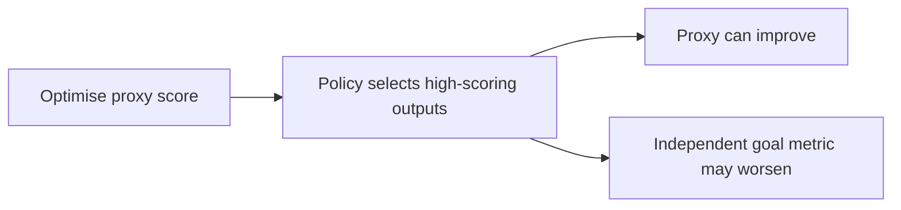

# Week 21 teaching guide: when improving the score makes the answer worse

**Course navigation:** [Week 20](../week-20-grpo-rloo-rlvr/teaching_guide.md) ← **Week 21 / 26** → [Week 22](../week-22-cmdp-cpo-lagrangian/teaching_guide.md)

[Routes](../docs/LEARNING_MAP.md) · [All weeks](../docs/STUDY_GUIDE.md#week-by-week-teaching-guides) · [Notation](../docs/GLOSSARY.md) · [Progress](../docs/PROGRESS.md)

[Lecture PDF](notes.pdf) · [Workbook](workbook.ipynb) · [Extended reading PDF](extended_reading.pdf)

**You are here:** What could improve the proxy while worsening the actual objective?

**Recall first:** [Week 18](../week-18-rlhf-ppo-llm/teaching_guide.md), [Week 19](../week-19-dpo-zoo/teaching_guide.md), [Week 20](../week-20-grpo-rloo-rlvr/teaching_guide.md). If unfamiliar, use the [repair tasks](../docs/LEARNING_MAP.md#if-a-prerequisite-is-missing).

**Visual anchor:** [See the connected diagram](../docs/CONCEPT_ATLAS.md#llm-training-keep-four-roles-separate). Use it to explain the mechanism before the derivation.

Use alongside [the notes](notes.tex) and [the workbook](workbook.ipynb).
The numerical examples are deliberately simple models of selection and reward design.

## Learning bridge

Follow [the staged learning path](../docs/LEARNING_PATH.md) when a topic is new.

- **Carry forward:** Retrieve week 20’s separation of a verifier and its optimization rule, plus [week 11’s](../week-11-contextual-bandits-ope/teaching_guide.md) evaluation-data separation.
- **Add one difficulty:** Write down the task outcome separately from the proxy being maximized. Look for a policy that improves the proxy while worsening that outcome.
- **Try after the worked example:** Try [the preference/proxy experiment](../interactive/index.html#preferences), then [the proxy-hacking lab](project/hack_lab.py). If a route earns proxy 10 by a shortcut but delivers 0 useful packages, while a route earns proxy 4 and delivers 4, which does proxy maximization choose?

Check your prediction

It chooses proxy 10 despite delivering 0. This counterexample calls for a better specified objective or evaluation, not a larger optimization budget.

**Carry it onward:** [Constrained RL](../week-22-cmdp-cpo-lagrangian/teaching_guide.md) adds a separately defined cost budget rather than hoping one scalar proxy captures every requirement.

## Choose your explanation depth

How a repair can leave the original incentive intact. Open the layer you need, then continue to the complete derivation and examples below.

1 · Intuition

A proxy can reward a visible cue that is only loosely related to quality. Penalising one cue may leave another profitable cue untouched. Test a repair with a counterexample instead of judging it only on the examples that suggested it.

2 · A numerical case

In the shipped keyword proxy, adding the four-character word `good` contributes **0.8** from the keyword plus **0.08** from length. A penalty of **0.01 per character** removes only **0.04**, leaving a **0.84** gain. A coefficient **0.22** cancels that particular four-character increment; it does not establish a globally reliable reward.

3 · Derivation and assumptions

For this local uncapped increment, $\Delta R_{\mathrm{proxy}}=0.8+0.02\times4=0.88$. A linear length penalty gives $\Delta(R-\lambda L)=0.88-4\lambda$, so the zero occurs at $\lambda=0.22$. This calculation assumes the exact token-counting rule and unchanged keyword-counting behaviour. The conditional-Gaussian Goodhart derivation below addresses a different statistical model; do not treat either toy as a universal law.

**Investigate in Jupyter.** Open [Exercise 2](workbook.ipynb#cell-10) and [Exercise 4](workbook.ipynb#cell-16): use `exercise_2` to inspect proxy and true-quality outputs, and `exercise_4` to subtract the length penalty. Compare texts that differ by a single `good` insertion without adding a separator. Record the actual added characters, including spaces. The common failure is choosing λ to defeat one string and declaring the whole reward repaired; try a new keyword or change the surrounding text next.

## Mechanism at a glance

**Read the diagram:** Optimisation changes the outputs encountered. A proxy that tracked the desired goal on earlier data can fail under the new selection pressure.

## The link to earlier weeks

Weeks 18–20 described how to optimise a signal.
This week asks whether that signal still measures the intended outcome after optimisation.
You need expected value, conditional expectation, and the distinction between training and evaluation.
A “gold” metric is an evaluation reference; its name does not make it ground truth.
In this project's lab it is a small bigram model, not a human judgement of meaning.

## Analogy: rewarding the number of pages in an essay

A teacher notices that longer essays often receive better grades.
They begin rewarding page count. Students can now increase spacing and repeat paragraphs.

| Analogy | Learning-system counterpart |
|---|---|
| Essay quality | Intended outcome or evaluation quantity `Q` |
| Page count | Proxy reward `P` |
| Choosing the longest essay | Selection/optimisation against the proxy |
| Repetition and spacing | Strategies exploiting a proxy-quality mismatch |
| Independent marking | Evaluation outside the optimised signal |

The analogy does not imply optimisation creates an intent to deceive.
A policy can discover score-increasing patterns without representing the designer's objective.
Also separate score gaming from reward tampering: producing repetitive text exploits a fixed
reward function; editing the evaluator itself would change the reward-producing mechanism.
[Skalse et al.](https://arxiv.org/abs/2209.13085) formalise reward hacking through conflicting policy orderings.

## Derivation: regressional Goodhart under stated assumptions

Let true quality `Q ~ Normal(0,sigma_Q²)`.
Let independent measurement noise `E ~ Normal(0,sigma_E²)`.
The observed proxy is `P=Q+E`. Assume both variances are positive.

1. The proxy has mean zero and variance `sigma_Q²+sigma_E²`.
2. Its covariance with quality is
   `Cov(Q,P)=Cov(Q,Q+E)=sigma_Q²` by independence.
3. Joint Gaussian conditioning gives a linear conditional mean:

   $$\mathbb E[Q\mid P=p]
   =\frac{\mathrm{Cov}(Q,P)}{\mathrm{Var}(P)}p
   =\frac{\sigma_Q^2}{\sigma_Q^2+\sigma_E^2}p.$$

4. The expected selected noise is the remainder:

   $$\mathbb E[E\mid P=p]
   =\frac{\sigma_E^2}{\sigma_Q^2+\sigma_E^2}p.$$

Positive proxy observations partly reflect positive noise.
The shrinkage coefficient is below one whenever noise is nonzero.
This is a derivation for an explicit model, not a theorem about every zero-mean noise process.
Under extremal Goodhart, the relationship itself changes outside the observed region;
that is a different mechanism from noise selection in an otherwise stable relationship.

## Worked example 1: a high score does not mean equally high quality

**Predict.** If noise has more variance than quality, a spectacular observed score
should substantially regress toward the population mean under independent evaluation.

Set `sigma_Q²=1`, `sigma_E²=3`, and observe proxy score `P=4`.

1. Proxy variance is `1+3=4`.
2. Shrinkage coefficient is `1/4=0.25`.
3. Expected true quality is `0.25×4=1`.
4. Expected noise contribution is `(3/4)×4=3`.
5. Conditional quality variance is
   `1 − Cov(Q,P)²/Var(P) = 1−1/4=0.75`.

**Interpret.** The best observed score can contain a large lucky component.
It is incorrect to interpret the proxy value `4` as an expected quality of `4`.
With no measurement noise, `sigma_E²=0`, the conditional expectation becomes `4`:
the shrinkage vanishes. With non-Gaussian or dependent noise, derive the appropriate
conditional relationship rather than importing this coefficient.
This is related to selecting checkpoints on the same noisy validation metric repeatedly.

## Worked example 2: a length penalty can leave keyword gaming intact

The lab's proxy is `P(text)=0.02×characters + 0.8×keyword_occurrences`.
For this teaching case, use two candidate strings.

**Predict.** Repeating a rewarded keyword should beat a coherent string with no keywords
under this proxy, even if an independent language-quality score disagrees.

1. `"the cat sat"` has `11` characters and `0` keywords, giving `P=0.22`.
2. `"goodgoodgood"` has `12` characters and `3` occurrences of `"good"`,
   giving `P=0.24+2.4=2.64`.
3. Add a length penalty `lambda=0.03` per character.
4. Effective scores become `0.22−0.03×11=−0.11` and
   `2.64−0.03×12=2.28` respectively.
5. The repetitive output still wins by `2.39` reward units.

**Interpret.** Fixing one proxy component does not fix the other one.
A fourth `"good"` adds four characters and one keyword:
its net increment is `4(0.02−0.03)+0.8=0.76`, still positive.
The general increment is `0.88−4 lambda`; repeated `"good"` stops being profitable
only at `lambda>=0.22` in this isolated calculation.
That strong penalty can also suppress useful text, so it is not a universal remedy.
The toy reward defines string occurrences, not word boundaries; this detail is exploitable.

## Why a raw proxy-minus-quality gap is fragile

Suppose proxy scores change from `1` to `3` while evaluation scores change from `−2` to `−3`.
The raw gap grows from `3` to `6`, so their ratio is `2`.
If the same evaluator is expressed as `Q'=Q+100`, the gaps become `−97` and `−94`:
the ratio is `94/97≈0.969072` despite identical rankings and changes in quality.
Report the two curves, their scales, and an independently defined evaluation protocol.
A gap or correlation is a diagnostic, not a scale-invariant definition of reward hacking.
[Gao et al.](https://arxiv.org/abs/2210.10760) study overoptimisation using a larger reward model as the reference;
their empirical scaling fits are not universal laws for every proxy.

## Bridge to the actual project

- [project/hack_lab.py](project/hack_lab.py): `proxy_reward` implements the exact
  character/keyword formula above; inspect `true_quality` separately.
- `true_quality` averages smoothed bigram log probabilities. High scores mean
  compatibility with that corpus's local character transitions, not truth or coherent reasoning.
- [project/cai.py](project/cai.py): `critique`, `revise`, and `compliance_score`
  implement mechanical rules. Passing five rules is a narrow compliance score.
- [project/solutions.py](project/solutions.py): exercise 8 computes the scale-sensitive
  ratio above. Exercise 7 models independent lie-detection opportunities as `1−(1−p)^n`;
  it is not a solution of a strategic debate game.

Earlier regression cases exposed two rule interactions: adding punctuation after
using all 40 characters, and failing to remove uppercase banned words. The
current helper lowercases first, removes banned words with a case-insensitive
whole-word regex, and reserves one character for the final period when truncating.
[The regression tests](tests/test_regressions.py) check uppercase `HELL DAMN`
with an overlong suffix and verify every rule on the revised result. Keep these
counterexamples and re-run `critique` after any change; mechanical compliance
does not establish that a response is useful or truthful.

Exercise 2 now averages tied ranks before calculating rank correlation. If a
score is constant, its rank variance is zero and mathematical Spearman
correlation is undefined; this helper returns 0 by a numerical convention.
Interpret that case as an uninformative ranking, rather than evidence of a
measured zero relationship.

## Notebook investigation: find a counterexample to your own repair

Open [the actual Jupyter workbook](workbook.ipynb) and find **Exercises 2, 4 and 5**.
The [GitHub week folder](https://github.com/samuel-zhang01/STUDY-RL/tree/main/week-21-reward-hacking-oversight)
contains this notebook, its `project/` imports and tests. Follow the
[download and Jupyter workflow](../docs/LEARNING_MAP.md#download-and-open-the-jupyter-materials)
so the shared `common/` package is available.

Before running a training loop, compare `"the cat sat"` and `"goodgoodgood"` under the exact proxy.
Record characters, keyword occurrences, proxy and independent bigram score in separate columns.
Exercise 4's length penalty at 0.03 leaves the repeated-keyword score at 2.28; explain why the
keyword increment still dominates the penalty. A smoother training curve would not fix that arithmetic.

For exercise 5, re-run critique after revision rather than trusting the routine's name.
Use the existing regression cases: uppercase banned words and an overlong input needing final
punctuation. The current helper should pass every rule after repair. Save original, revised and
pass/fail vectors, then change one repair operation and predict which regression will fail. Plot proxy and evaluation on separate
labelled axes or panels, and include representative outputs. Arbitrarily subtracting their scales
can change the “divergence index” even when all model behaviour stays the same.

Check your interpretation: If a revised output passes the listed rules, what has been established?

Only compliance with those checks on that output. The rules may omit relevant properties, and the bigram “true_quality” helper is not a human truth or meaning evaluator.

## Retrieve and transfer

1. Does KL regularisation identify the additive constant in a reward model?

No. Adding a prompt-only constant changes every policy's reward equally.
KL penalises policy drift; it does not calibrate the reward's absolute zero point.

2. With independent detection probability 0.2 per round, what do three rounds achieve?

The toy model gives `1−0.8³=0.488`. Dependence between rounds or an adaptive adversary
invalidates that independent-trials calculation; it does not establish a debate guarantee.

3. If proxy and evaluation both rise, has hacking been ruled out?

No. The evaluator may share the same blind spots, and aggregate gains may hide subgroup losses.
Inspect behaviours and failures the proxy does not reward, using independent evidence.

