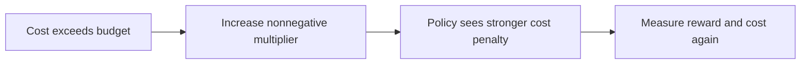

# Week 22 teaching guide: derive the constraint price and check its sign

**Course navigation:** [Week 21](../week-21-reward-hacking-oversight/teaching_guide.md) ← **Week 22 / 26** → [Week 23](../week-23-safe-exploration-shielding-robust/teaching_guide.md)

[Routes](../docs/LEARNING_MAP.md) · [All weeks](../docs/STUDY_GUIDE.md#week-by-week-teaching-guides) · [Notation](../docs/GLOSSARY.md) · [Progress](../docs/PROGRESS.md)

[Lecture PDF](notes.pdf) · [Workbook](workbook.ipynb) · [Extended reading PDF](extended_reading.pdf)

**You are here:** Why does excess cost increase the penalty multiplier?

**Recall first:** [Week 07](../week-07-policy-gradients/teaching_guide.md), [Week 08](../week-08-a2c-gae-trpo/teaching_guide.md), [Week 09](../week-09-ppo/teaching_guide.md). If unfamiliar, use the [repair tasks](../docs/LEARNING_MAP.md#if-a-prerequisite-is-missing).

**Visual anchor:** [See the connected diagram](../docs/CONCEPT_ATLAS.md#a-budget-and-a-shield-act-in-different-places). Use it to explain the mechanism before the derivation.

Read with [the notes](notes.tex) and [the workbook](workbook.ipynb).
The examples are small constrained optimisation problems, not safety certificates for trained agents.

## Learning bridge

Follow [the staged learning path](../docs/LEARNING_PATH.md) when a topic is new.

- **Carry forward:** Retrieve [week 21’s](../week-21-reward-hacking-oversight/teaching_guide.md) distinct task metrics and week 9’s actor update.
- **Add one difficulty:** Specify an expected cost budget with units and a time horizon. The multiplier raises the penalty when cost exceeds that budget; an expected limit is not a per-episode guarantee.
- **Try after the worked example:** Use [the safety experiment](../interactive/index.html#safety) and [the courier’s hazard-cost extension](../learning_projects/courier.py). For lambda 0.5, step size 0.2, observed cost 3 and budget 1, predict the projected multiplier update.

Check your prediction

The update is max(0,0.5+0.2×(3−1))=0.9. Excess cost increases its price; this numerical step alone does not prove the resulting policy is feasible.

**Carry it onward:** [Shielding](../week-23-safe-exploration-shielding-robust/teaching_guide.md) limits executed actions using a safety model, addressing a different requirement.

## Choose your explanation depth

Why the budget and discount must use the same units. Open the layer you need, then continue to the complete derivation and examples below.

1 · Intuition

The multiplier raises the price of cost when the policy overspends. To decide whether it overspends, you must compare like quantities: a discounted episode total is different from an average per-step cost.

2 · A numerical case

In a one-state continuing task, action 1 costs one and is chosen with probability p. At γ = 0.9, expected discounted cost is **10p**. A budget d = 0.5 therefore allows **p ≤ 0.05**. At p = 0.5 the cost is 5; starting λ = 0 with step size 0.1 gives **λ′ = 0.45**.

3 · Derivation and assumptions

The geometric series gives $J_c=\sum_{t\ge0}\gamma^tE[c_t]=p/(1-\gamma)$ for a stationary choice probability and $0\le\gamma<1$. For $L=J_r-\lambda(J_c-d)$, descent in $\lambda$ gives $[\lambda+\eta(J_c-d)]_+$. This sign check does not prove neural training converges. If scaling costs by $s$, scale the budget by $s$ and the equivalent multiplier by $s$ in the opposite coordinate convention: $c'=c/s,d'=d/s,\lambda'=s\lambda$.

**Investigate in Jupyter.** Open [Exercise 1](workbook.ipynb#cell-6), backed by `project.solutions.exercise_1`; call `(0, 0.1, 5, 0.5)` and expect **0.45**. Then open [Exercise 5](workbook.ipynb#cell-18): lower-tail CVaR of `[0, 10, 20]` at mass 0.5 is **10/3**, because the tail includes one full observation and half of the next. A common failure is averaging only the samples below a quantile and discarding the fractional boundary mass.

## Mechanism at a glance

**Read the diagram:** The multiplier update responds to a cost-budget gap. It changes incentives; independent cost evaluation is still needed to assess feasibility.

## Connection and prerequisites

Recall expected discounted return, policy gradients, and PPO from weeks 7–9.
Add a second signal: nonnegative cost `c`, with its own return `J_c` and budget `d`.
A reward is something to maximise; a cost limit is a constraint on what is acceptable.
Before using a budget, decide whether it measures discounted cost per episode,
undiscounted cost per episode, average cost per step, or a probability of failure.
These are different quantities even when all use the word “cost”.

## Analogy: a warehouse with an energy budget

A warehouse earns money from orders and consumes energy to fulfil them.
An internal energy price rises when the warehouse exceeds its allocation.

| Analogy | CMDP quantity |
|---|---|
| Income | Reward return `J_r(pi)` |
| Energy consumed | Cost return `J_c(pi)` |
| Energy allowance | Constraint budget `d` |
| Internal price per unit of energy | Nonnegative multiplier `lambda` |
| Profit after charging for energy | `J_r − lambda J_c` |

The price can guide behaviour toward the budget, but a noisy controller may overshoot.
A budget on expected energy does not guarantee every shift consumes less than the allowance.
If no feasible schedule exists, increasing the price indefinitely does not create one.
The analogy also explains complementary slackness: a nonbinding resource can have zero price.

## Derivation: ascent for the policy, descent for the multiplier

Consider `max_pi J_r(pi)` subject to `J_c(pi)<=d`.
Use the reward-maximisation convention throughout:

$$L(\pi,\lambda)=J_r(\pi)-\lambda[J_c(\pi)-d],\qquad\lambda\ge0.$$

1. For a violating policy, `J_c−d>0`, minimising over `lambda` sends `L` downward.
   Thus `max_pi min_lambda L` excludes violating policies in the ideal problem.
2. At fixed multiplier, the policy ascends:

   $$\theta' = \theta + \eta_\theta(\nabla J_r-\lambda\nabla J_c).$$

3. For a policy-gradient implementation, the combined advantage is
   `A_total=A_r−lambda A_c` before any additional normalisation.
4. The multiplier derivative is `partial L/partial lambda=−(J_c−d)`.
   Gradient **descent** therefore gives

   $$\lambda'=[\lambda-\eta_\lambda(-(\hat J_c-d))]_+
   =[\lambda+\eta_\lambda(\hat J_c-d)]_+.$$

5. At an appropriate optimum, feasibility and complementary slackness require
   `J_c<=d`, `lambda>=0`, and `lambda(J_c−d)=0`.

An increasing multiplier under a violation is still a descent step on this `L`.
Do not call it ascent on the displayed Lagrangian.
Finite discounted CMDPs have a linear occupancy formulation; neural parameterisations
and approximate alternating updates do not inherit an unconditional convergence guarantee.
[CPO](https://proceedings.mlr.press/v70/achiam17a.html) studies constrained policy updates and their approximation bounds.

## Worked example 1: the optimal constrained policy may mix actions

One state and one decision. The safe action has reward `2`, cost `0`.
The risky action has reward `6`, cost `2`. Budget is `d=0.5`.
Let `p` be the probability of selecting the risky action.

**Predict.** Always taking the risky action is infeasible, but occasionally taking it
may improve expected reward while respecting the expectation constraint.

1. Reward: `J_r(p)=2(1−p)+6p=2+4p`.
2. Cost: `J_c(p)=0(1−p)+2p=2p`.
3. Feasibility gives `2p<=0.5`, so `p<=0.25`.
4. Reward increases with `p`; the optimum is `p*=0.25`.
5. Optimal return is `2+4×0.25=3`; cost is `2×0.25=0.5`.
6. Lagrangian is `2+4p−lambda(2p−0.5)`.
   Its slope in `p` is `4−2 lambda`; indifference occurs at `lambda*=2`.
7. Complementary slackness holds: `2(0.5−0.5)=0`.

**Interpret.** Randomisation increases reward from the safe deterministic policy's `2` to `3`.
But 25% of individual decisions still incur cost `2`, above the numerical budget `0.5`.
An expected-cost constraint is not a per-decision bound.
If `d=0`, only `p=0` is feasible. If `d>=2`, the risky deterministic optimum is feasible.
Tight constraints do not universally require randomisation; this example does.

## Worked example 2: follow one multiplier and advantage calculation

**Predict.** A measured violation should raise the price of cost and make costly
advantages less attractive on the next policy update.

Take `lambda=0.5`, multiplier rate `eta=0.2`, observed cost `J_c=1.5`, and budget `d=1`.

1. Violation: `1.5−1=0.5`.
2. New multiplier: `lambda'=max(0,0.5+0.2×0.5)=0.6`.
3. For reward advantage `A_r=0.8` and cost advantage `A_c=1.5`,
   the unnormalised combined advantage changes from
   `0.8−0.5×1.5=0.05` to `0.8−0.6×1.5=−0.1`.
4. At ratio `1`, that action changes from weakly encouraged to discouraged.
5. If the next observed cost is `0`, the multiplier becomes
   `max(0,0.6+0.2(0−1))=0.4`.
6. From `lambda=0.05` with the same underspend it projects to `0`, never a negative price.

**Interpret.** The multiplier reacts to sampled cost and can oscillate.
A penalty coefficient that is updated only on positive violations cannot fall after underspending;
that is a different feedback law, as illustrated in the week 25 toy.

## A one-dimensional CPO feasibility check

Let proposed parameter change be `v`, cost constraint `v+0.2<=0`,
and trust region `v²/2<=0.02`.
The trust region is `−0.2<=v<=0.2`; only `v=−0.2` is feasible.
If current violation becomes `0.3`, the same region contains no feasible point.
This is why a recovery step differs from solving a feasible reward-maximisation problem.
For positive-definite `H`, `s=b^T H^(-1)b>0`, feasibility is `c<=sqrt(2 delta s)`.
The minimised QP dual has terms `+lambda delta−nu c`; reversing these signs changes the problem.

## Bridge to the actual project

- [project/agent.py](project/agent.py): `compute_gae` is called for reward and cost
  separately. `PPOLagrangian.update` combines the advantages with a minus sign.
- The implementation standardises reward advantages and divides the combination by
  `1+lambda`; its multiplier scale therefore differs from the raw derivation.
- [project/train.py](project/train.py): `_collect` accumulates episode costs for
  the multiplier with the same per-episode discount convention as the cost critic.
  If a rollout completes no episodes, the multiplier is unchanged; the history's
  cost value 0 is a placeholder for that missing estimate, not measured zero cost.
- [project/solutions.py](project/solutions.py): exercise 1 isolates the projected update;
  exercise 4 uses `lam` for a KL temperature and `nu` for the cost multiplier.

Name those quantities by role rather than assuming `lambda` always means the same thing.
The exercise 5 CVaR helper sorts returns and uses exactly `alpha N` observations'
worth of probability mass, fractionally weighting the cutoff observation when
needed. For returns `(-4,2,10)` and `alpha=0.5`, it averages all of `-4` and half
of `2`: `(-4+0.5×2)/1.5=-2`, as checked in
[the regression test](tests/test_regressions.py). For costs use the **upper**
tail; for undesirable low returns use this lower tail.

## Notebook investigation: draw the feasible reward–cost tradeoff

Open [the actual Jupyter workbook](workbook.ipynb) and find **Exercises 1, 3 and 5**.
The [GitHub week folder](https://github.com/samuel-zhang01/STUDY-RL/tree/main/week-22-cmdp-cpo-lagrangian)
contains this notebook, its `project/` imports and tests. Follow the
[download and Jupyter workflow](../docs/LEARNING_MAP.md#download-and-open-the-jupyter-materials)
so the shared `common/` package is available.

Parameterise the guide's two-action mixture by risky probability p. Plot cost `2p` horizontally
and reward `2+4p` vertically for p from 0 to 1. Mark budget 0.5 as a vertical line: the best feasible
point has p=0.25 and reward 3. The shaded feasible region concerns expected cost; a risky individual
decision still costs 2.

Use exercise 1 to follow the multiplier through one overspend and one underspend. Show its value
on a time axis rather than treating a large multiplier as evidence of feasibility. Exercise 3's
cost advantage can be negative even with nonnegative immediate costs; explain which action is
less costly than its policy average. For exercise 5, state whether the tail concerns low returns
or high costs and whether the requested tail fraction lands between sample counts.

Check your interpretation: What would changing the unit of cost do to a meaningful multiplier?

The multiplier has reward-per-cost units. If every cost and budget is scaled by a positive factor, the corresponding penalty coefficient must be inversely scaled to represent the same tradeoff.

## Retrieve and transfer

1. In example 1, what is the marginal reward value of a slightly larger budget?

For `0<d<2`, `p=d/2`, so optimal reward is `2+2d` and its derivative in `d` is `2`.
That matches the active multiplier's units: reward per extra unit of cost budget.

2. Can a large multiplier certify that the final policy is feasible?

No. It indicates costly behaviour was penalised. Measure the policy's cost independently
with uncertainty and the correct cost definition; infeasibility or failed optimisation may persist.

3. Must a cost advantage be nonnegative because costs are nonnegative?

No. `A_c=Q_c−V_c` is relative cost. A less costly-than-average action can have negative
cost advantage; subtracting `lambda A_c` then encourages it.

