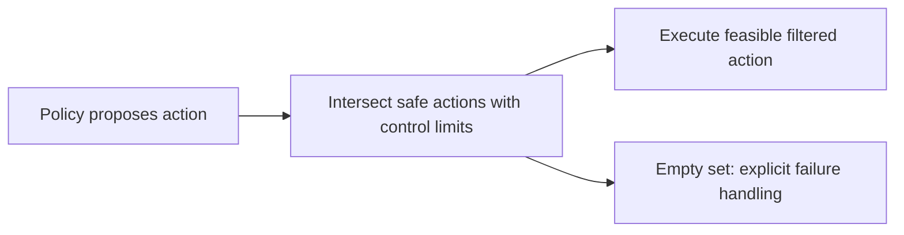

# Week 23 teaching guide: a shield needs a safe future, not just a safe next step

**Course navigation:** [Week 22](../week-22-cmdp-cpo-lagrangian/teaching_guide.md) ← **Week 23 / 26** → [Week 24](../week-24-capstone-safe-matching/teaching_guide.md)

[Routes](../docs/LEARNING_MAP.md) · [All weeks](../docs/STUDY_GUIDE.md#week-by-week-teaching-guides) · [Notation](../docs/GLOSSARY.md) · [Progress](../docs/PROGRESS.md)

[Lecture PDF](notes.pdf) · [Workbook](workbook.ipynb) · [Extended reading PDF](extended_reading.pdf)

**You are here:** Under which dynamics and safe-set assumptions does the filter protect you?

**Recall first:** [Week 22](../week-22-cmdp-cpo-lagrangian/teaching_guide.md). If unfamiliar, use the [repair tasks](../docs/LEARNING_MAP.md#if-a-prerequisite-is-missing).

**Visual anchor:** [See the connected diagram](../docs/CONCEPT_ATLAS.md#a-budget-and-a-shield-act-in-different-places). Use it to explain the mechanism before the derivation.

Use with [the notes](notes.tex) and [the workbook](workbook.ipynb).
The examples distinguish mathematical guarantees from finite empirical checks.

## Learning bridge

Follow [the staged learning path](../docs/LEARNING_PATH.md) when a topic is new.

- **Carry forward:** Retrieve [week 22’s](../week-22-cmdp-cpo-lagrangian/teaching_guide.md) expected-cost versus individual-violation distinction and week 2’s transition model.
- **Add one difficulty:** A shield filters proposed actions according to a stated safe set and dynamics. Check whether a permitted next state also has a safe continuation.
- **Try after the worked example:** Try [the one-decision browser shield](../interactive/index.html#safety), then compare it with [the Python grid courier](../learning_projects/courier.py) and implement `shield` in [the coding exercises](../learning_projects/exercises.py). If action left enters a marked hazard and right reaches a safe state, predict the filtered action set. Then change the map to challenge the model.

Check your prediction

Only right remains under the stated one-step hazard model. A guarantee for all future steps additionally needs a controlled-invariant safe set and correct dynamics; a newly changed map can invalidate the old filter.

**Carry it onward:** [The matching capstone](../week-24-capstone-safe-matching/teaching_guide.md) combines learning, evaluation and a cost constraint while keeping their claims separate.

## Mechanism at a glance

**Read the diagram:** A shield checks actions against a model and safety property. If the feasible set is empty, returning an arbitrary proposed action cannot establish the promised protection.

## What this adds to week 22

An expected-cost budget can permit individual violations.
A shield instead restricts executed actions according to a specified safety property.
Robustness asks a separate question: how does performance change when dynamics change?
A policy can be robustly low-performing, safe but ineffective, or high-performing but unsafe.
You need deterministic state transitions, basic induction, and projection onto an interval.

## Analogy: a railway interlock

A train driver proposes a route. An interlock rejects routes that conflict with the track state.

| Railway concept | Mathematical counterpart |
|---|---|
| Proposed route | Policy action `a_pi` |
| Track map and occupancy model | Dynamics model `M` and state labels |
| Rule “never enter an occupied segment” | Safety property `G not danger` |
| Routes allowed by the interlock | Safe action set |
| Controlled stop or designated recovery | Response to an empty feasible set |

The guarantee depends on correct track information and an actually available safe action.
A perfectly implemented interlock can fail if its occupancy sensor is wrong.
Likewise, a one-step model can be exact while a short-sighted action enters a future dead end.
A shield enforces its stated property; it does not decide whether the property captures every harm.
[Alshiekh et al.](https://arxiv.org/abs/1708.08611) construct shields using safety specifications and environment abstractions.

## Derivation: from immediate safety to an invariant set

Let `S_safe` be safe states, `M(s,a)` deterministic dynamics, and `A` the action set.
Start with `W_0=S_safe`, then repeatedly remove states that cannot remain in the current set:

$$W_{k+1}=\{s\in W_k:\exists a\in A,\ M(s,a)\in W_k\}.$$

1. In a finite state space, this decreasing sequence eventually stabilises at `W*`.
2. Define allowed actions as `A_safe(s)={a:M(s,a)∈W*}`.
3. Assume the initial state is in `W*` and every executed action is allowed.
4. Base case: `s_0∈W*⊆S_safe`.
5. Induction: if `s_t∈W*`, an allowed action keeps `s_(t+1)∈W*`.
6. Therefore all visited states remain safe.

The phrase “a safe action exists at every reachable state” is doing real work.
For stochastic dynamics and a worst-case guarantee, replace one successor with **all** successors
in the known transition support. A likely safe next state is insufficient for an absolute guarantee.
For a temporal automaton, carry its state alongside the environment state in this construction.

## Worked example 1: the one-step-safe trap

Consider states `start`, `trap`, and `danger`.
At `start`, action `wait` returns to `start`; action `go` enters `trap`.
At `trap`, every action enters `danger`. Only `danger` is labelled unsafe.

**Predict.** A filter checking only the next state's danger label will allow `go`,
but an invariant-set shield will reject it.

1. Initially `W_0={start,trap}`: neither state is currently dangerous.
2. `trap` has no action returning to `W_0`, so `W_1={start}`.
3. `start` has `wait` returning to `start`, so `W_2={start}=W*`.
4. At `start`, the invariant action set is `{wait}`.
5. Suppose the raw policy chooses `go` with probability `0.8` and `wait` with `0.2`.
   The one-step filter leaves those probabilities unchanged.
6. Within two transitions, that filter reaches danger with probability `0.8`.
   The invariant filter chooses `wait` with probability `1` and has violation probability `0`.

**Interpret.** At `trap` the safe set is empty before danger has been entered.
Thus “empty safe set means the property was already violated” is false.
A post-proposal fallback that simply returns the original action does not restore soundness.
Stopping is only a safe solution if stopping is physically available and modelled as safe.

## Derivation: a one-dimensional barrier projection

For a drift-free continuous system, suppose the barrier constraint at the current state is
`b a >= −alpha h`, where `h>=0` is the current safety margin, `alpha>0`, and `b` is the
coefficient of control in the barrier derivative.
The minimum-change filter solves

$$\min_a\frac12(a-a_0)^2\quad\text{subject to}\quad b a\ge-\alpha h.$$

If the proposed `a_0` satisfies the inequality, return it.
If it violates the inequality and `b≠0`, the nearest feasible action lies on the boundary:
`a*=−alpha h/b`.
If `b=0`, the constraint is either satisfied for every action or infeasible for every action.
With drift, include its contribution on the right-hand side; with actuator limits,
intersect the half-space with those limits before projecting.

## Worked example 2: the direction of the inequality matters

**Predict.** A controller moving too quickly toward a boundary should be slowed just
enough to meet the derivative condition.

Let `h=0.2`, `alpha=1`, coefficient `b=−2`, and proposed action `a_0=0.5`.

1. Constraint: `−2a>=−0.2`; dividing by `−2` reverses it, so `a<=0.1`.
2. Proposed derivative contribution: `−2×0.5=−1`, which violates `−1>=−0.2`.
3. Projection: `a*=−0.2/(−2)=0.1`.
4. Change is `0.1−0.5=−0.4`; squared displacement is `0.16`.
5. The filtered derivative is `−2×0.1=−0.2`, exactly the boundary.

**Edge case.** If allowed controls were instead `[0.2,1]`, even the smallest control
would give `−0.4<−0.2`: no feasible control exists.
If `b=0` and the required lower bound is `+0.2`, returning the proposed action cannot satisfy it.
A continuous-time barrier theorem also needs the inequality to hold along the trajectory;
a single discrete sample without a discretisation argument is not such a theorem.

## Robustness calculation: average and worst case can disagree

Under two environment variants with probabilities `(0.9,0.1)`, policy A earns `(10,−20)`
and policy B earns `(7,5)`.
A's average return is `0.9×10+0.1×(−20)=7`; B's is `0.9×7+0.1×5=6.8`.
Average-return training prefers A, while worst-case evaluation prefers B (`5` versus `−20`).
Domain randomisation optimises performance under a distribution; it need not solve a minimax problem.

## Bridge to the actual project

- [project/shield.py](project/shield.py): `DFAShield.filter` returns the first preferred
  safe action, then tries fallbacks. This preference filter is not identical to
  renormalising a stochastic policy over its safe action set.
- If every action is unsafe, it raises `NoSafeActionError` before execution. The
  caller must handle the infeasible situation; the filter cannot invent a safe action.
- [project/env_grid.py](project/env_grid.py): `adjacent_dangerous` supplies the one-step
  predicate. Inspect that model and its transition assumptions before claiming soundness.
- [project/solutions.py](project/solutions.py): exercise 7 projects a simplified 1D
  constraint; the `dh_da==0` branch raises when the half-space is infeasible.
- [project/pendulum_train.py](project/pendulum_train.py): compare `train_pendulum_dr`
  under its training-length distribution and separately at held-out lengths.
  Its angle zero is upright: gravity increases a small displacement from zero.
  Average performance under randomised lengths does not imply a worst-case bound.

Zero violations in a finite rollout is an empirical observation.
An induction proof is conditional on the model, invariant set, initial state, and action execution.
Neither substitutes for the other.

## Notebook investigation: test an empty safe set before a long rollout

Open [the actual Jupyter workbook](workbook.ipynb) and find **Exercises 2, 3 and 7**.
The [GitHub week folder](https://github.com/samuel-zhang01/STUDY-RL/tree/main/week-23-safe-exploration-shielding-robust)
contains this notebook, its `project/` imports and tests. Follow the
[download and Jupyter workflow](../docs/LEARNING_MAP.md#download-and-open-the-jupyter-materials)
so the shared `common/` package is available.

Draw start→trap→danger from the guide and keep the wait self-loop at start.
Colour currently safe states separately from states that can remain safe forever.
The trap begins safe under the immediate label but disappears on the first invariant-set sweep.
Explain why merely checking the next state's danger flag allows a future dead end.

Use exercise 3 to inspect how preferences are filtered, including an empty feasible set; the filter
must report failure instead of returning an unchecked action. In exercise 7, use proposed 0.5,
h=0.2 and derivative coefficient -2: projection gives 0.1. Then make the coefficient zero with a
positive required lower bound; the constraint is infeasible. Record that outcome explicitly.
Only after these checks compare finite-rollout violation counts. Zero observed violations and a
conditional induction proof answer different questions.

Check your interpretation: Why does domain randomisation not automatically establish worst-case robustness?

It optimises an average under the chosen training distribution. A rare or unsupported dynamics setting can still fail; inspect the evaluation grid and the worst measured return separately.

## Retrieve and transfer

1. Does no violation in 100 episodes prove violation probability is zero?

No. Rare failures may not appear. The formal guarantee must follow from assumptions
about all relevant transitions, not only the transitions sampled in those episodes.

2. Why carry the automaton state along with the physical state?

Temporal rules can depend on earlier events. The same physical state can permit different
actions depending on that history; the automaton state summarises the relevant history.

3. If the safe action set has zero probability under the policy, can you renormalise?

No: the normalising denominator is zero. Specify a fallback distribution over safe actions
or another feasible controller. A formula using proportionality alone is incomplete in this case.

