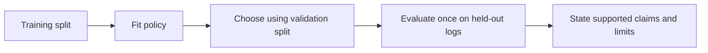

# Week 24 teaching guide: separate learning, evaluation, and the decision claim

**Course navigation:** [Week 23](../week-23-safe-exploration-shielding-robust/teaching_guide.md) ← **Week 24 / 26** → [Week 25](../week-25-synthetic-ats-rl-audit/teaching_guide.md)

[Routes](../docs/LEARNING_MAP.md) · [All weeks](../docs/STUDY_GUIDE.md#week-by-week-teaching-guides) · [Notation](../docs/GLOSSARY.md) · [Progress](../docs/PROGRESS.md)

[Lecture PDF](notes.pdf) · [Workbook](workbook.ipynb) · [Extended reading PDF](extended_reading.pdf)

**You are here:** Which evidence supports each claim in the audit?

**Recall first:** [Week 11](../week-11-contextual-bandits-ope/teaching_guide.md), [Week 14](../week-14-offline-rl-1/teaching_guide.md), [Week 22](../week-22-cmdp-cpo-lagrangian/teaching_guide.md). If unfamiliar, use the [repair tasks](../docs/LEARNING_MAP.md#if-a-prerequisite-is-missing).

**Visual anchor:** [See the connected diagram](../docs/CONCEPT_ATLAS.md#a-budget-and-a-shield-act-in-different-places). Use it to explain the mechanism before the derivation.

Use alongside [the notes](notes.tex) and [the workbook](workbook.ipynb).
This is a synthetic educational matching problem, not a validated production hiring system.

## Learning bridge

Follow [the staged learning path](../docs/LEARNING_PATH.md) when a topic is new.

- **Carry forward:** Retrieve [week 11’s](../week-11-contextual-bandits-ope/teaching_guide.md) support/evaluation conditions, [week 14’s](../week-14-offline-rl-1/teaching_guide.md) offline learning and [week 22’s](../week-22-cmdp-cpo-lagrangian/teaching_guide.md) cost units.
- **Add one difficulty:** Write three separate statements: how the policy was learned, how it was evaluated and which constraint was measured. One successful test cannot validate all three.
- **Try after the worked example:** Use [the synthetic capstone audit](project/audit.py). Draft a results table that includes reward estimate, support/ESS, cost estimate, budget units and held-out split; compare it with your [OPE experiment](../interactive/index.html#ope).

Check your prediction

A supported reward estimate still needs valid logging assumptions; measured average cost does not ensure zero individual violations; fitting and evaluating on the same rows can introduce selection bias. Each column answers its own question.

**Carry it onward:** [Week 25](../week-25-synthetic-ats-rl-audit/teaching_guide.md) turns this evidence table into a bounded application audit.

## Choose your explanation depth

Why a fairness number needs a denominator and an owner. Open the layer you need, then continue to the complete derivation and examples below.

1 · Intuition

A batch probability gap measures what the policy expects to recommend on those contexts. A realised window gap measures sampled decisions. A share among selected applicants measures something else again. Their differences are part of the interpretation, not rounding errors.

2 · A numerical case

Suppose group 0 has **50** eligible people and group 1 has **100**. Selecting **40 from each** creates equal selected counts, but conditional selection rates are **0.8** and **0.4**, a parity gap of **0.4**. The equal 50/50 shares among selected people conceal that difference.

3 · Derivation and assumptions

For batch recommendation probabilities $p_i=\pi_\theta(1\mid x_i)$ and positive group counts $n_g$, define $\bar p_g=\sum_{i:g_i=g}p_i/n_g$ and $C(\theta)=|\bar p_0-\bar p_1|$. Its gradient away from equality differentiates these probabilities, not sampled actions. The shipped actor penalty and dual update use this same batch surrogate. Missing a group makes a conditional rate unidentifiable in that batch; a finite-batch gap is not a population guarantee.

**Investigate in Jupyter.** Open [Exercise 6: end-to-end audit](workbook.ipynb#cell-21) and `project.solutions.exercise_6`. Before running it, hand-check the **0.4** rate gap above and label every returned metric by policy, population and denominator. Inspect `expected_parity_gap` in `project/online_ppo_lag.py` and compare it with the realised window statistic. [Exercise 7](workbook.ipynb#cell-24) is a protected-feature sensitivity probe; flipping a feature is not automatically a valid causal intervention or a proof of fairness.

## Mechanism at a glance

**Read the diagram:** Policy fitting, policy selection and final evaluation consume different evidence. Reusing evaluation rewards for selection undermines the final comparison.

## The connections that matter

Week 14's offline learning uses actions that already have observed outcomes.
Week 11's off-policy evaluation asks how a different policy would perform under those logs.
Week 22's multiplier attempts to trade reward against a specified cost constraint.
These steps use related data, but their conclusions require different assumptions.
The project's action is binary recommend/skip, not a complete ranking or sequential hiring process.

## Analogy: learning from a restaurant's old menu choices

Suppose a restaurant logged which meal it offered and whether the customer enjoyed it.

| Restaurant concept | Matching quantity |
|---|---|
| Customer and available meal | Context: job and candidate features |
| Offer or skip | Binary action |
| Whether an offered meal was enjoyed | Observed action-dependent reward |
| Probability the old restaurant offered it | Logging propensity |
| New offering rule | Target policy |
| Budget on unequal offering rates | Chosen population constraint |

A skipped meal's missing enjoyment outcome is not evidence that the meal was bad.
In this simulator, skipping has reward zero by definition, while latent relevance is separately available.
Real unobserved outcomes cannot be filled in merely because the simulator supplies them.
The analogy also stops at causality: changing a group field is a sensitivity probe,
not automatically a realistic counterfactual intervention on a person.

## Derivation: IQL in a one-step bandit

Let a record be `(x,a,r)` from the logger `mu`.
A one-step episode has no future reward, so the Q regression target is simply `r`.
Let `tau∈(0,1)` be the expectile parameter and `beta>0` the AWR inverse temperature.

1. Fit action values on logged actions:

   $$L_Q=\mathbb E_D[(Q(x,a)-r)^2].$$

2. Fit a state value through asymmetric squared residuals:

   $$L_V=\mathbb E_D[|\tau-\mathbf1\{Q-V<0\}|(Q(x,a)-V(x))^2].$$

3. Give high-advantage logged actions larger cloning weights:

   $$w(x,a)=\exp(\beta[Q(x,a)-V(x)]),\qquad
   L_\pi=-\mathbb E_D[w(x,a)\log\pi(a|x)].$$

4. At one fixed context, with an unrestricted categorical policy and unclipped weights,
   the optimum normalises weighted behaviour frequencies:

   $$\pi^*(a|x)=\frac{\mu(a|x)w(x,a)}{\sum_b\mu(b|x)w(x,b)}.$$

The last result follows by a Lagrange multiplier for `sum_a pi(a|x)=1`.
It makes the support limit visible: a zero behaviour frequency remains zero.
Function approximation may generalise elsewhere, but that is not observed support.
[IQL](https://arxiv.org/abs/2110.06169) uses expectile value learning and advantage-weighted policy extraction.

## Worked example 1: compute an expectile and weighted policy

**Predict.** An upper expectile should lie above the ordinary mean of action values,
and weighted regression should move probability toward the higher-value logged action.

At one context, let `mu(skip)=mu(recommend)=0.5`, values `(0,1)`, `tau=0.75`, and `beta=2`.

1. For `0<V<1`, the weighted value loss is
   `0.5×0.25 V² + 0.5×0.75(1−V)²`.
2. Set its derivative to zero:
   `0.25V−0.75(1−V)=0`, giving `V=0.75`.
3. Advantages are `−0.75` and `+0.25`.
4. Weights are `exp(−1.5)=0.223130` and `exp(0.5)=1.648721`.
5. Recommend probability is
   `1.648721/(0.223130+1.648721)=0.880797`.
6. Expected reward under the supplied values rises from `0.5` to `0.880797`.

**Interpret.** This exact one-context result assumes values and frequencies are known.
With `mu(recommend)=0`, the policy extraction has no positive-action evidence to weight.
Also, because `V(x)` is common to both actions, its exponential factor cancels in the
ideal categorical normalisation; it still affects finite optimisation and clipped weights.

## Worked example 2: SNIPS with the propensity of the action actually taken

Let four logged decisions have rewards `(1,0,1,0)`.
Their recorded action propensities are `(0.5,0.25,0.5,0.75)`.
The fixed target assigns the same recorded actions probabilities `(0.75,0.5,0.25,0.25)`.

**Predict.** The target upweights some records and downweights others;
the unweighted reward mean `0.5` need not remain the estimated target value.

1. Importance weights are `(1.5,2,0.5,1/3)`.
2. Weighted reward sum is `1.5×1+2×0+0.5×1+(1/3)×0=2`.
3. Weight sum is `1.5+2+0.5+1/3=13/3`.
4. SNIPS is `2/(13/3)=6/13≈0.461538`.
5. IPS is `2/4=0.5`; the difference is the random normalising denominator.
6. Effective sample size is
   `(13/3)²/(1.5²+2²+0.5²+(1/3)²)=338/119≈2.840336`.

**Interpret.** Four records contain less than four equally weighted records' worth of
information by this weight-concentration diagnostic. ESS is not an exact confidence interval.
If a target action has positive probability where the logger had zero probability,
no denominator clipping can create the missing counterfactual evidence.
The support requirement comes from the importance-sampling change of measure;
[counterfactual risk minimisation](https://proceedings.mlr.press/v37/swaminathan15.html) builds on logged-policy correction.

## The logger's bias: check the threshold before telling the story

In [project/data.py](project/data.py), group 0 gets score `relevance+0.1`
and group 1 gets `relevance−0.1` (the default bias parameter is `0.6`).
With relevance `0.3`, scores are `0.4` and `0.2`: both are below threshold `0.5`.
At epsilon `0.1`, each gets recommendation probability `epsilon/2=0.05`, not `0.1`.
With relevance `0.5`, scores are `0.6` and `0.4`:
recommendation probabilities now differ, `0.95` versus `0.05`.
This demonstrates uneven coverage without assuming every different score changes the action.

## Bridge to the actual project and audit claims

- [project/offline_iql.py](project/offline_iql.py): `_expectile_loss` weights residual signs;
  `iql_pretrain` clips the AWR weight at `100` and uses terminal Q targets.
- [project/online_ppo_lag.py](project/online_ppo_lag.py): `_sample_rollout` records
  moving-window and sampled selection gaps. The policy update differentiates a
  full-batch gap in expected recommendation probabilities and updates the dual
  using that same surrogate. This is an empirical constraint, with no population
  feasibility guarantee. Fine-tuning copies the offline checkpoint.
- [project/audit.py](project/audit.py): `snips_ope` expects target probability for the
  **logged action**, not always the recommend action.
- `full_audit` uses a prefix of the supplied list and reports the actual number of rows.
  The shipped pipeline creates an independent synthetic evaluation population and
  log stream; neither is used for fitting. `--no-finetune` skips the online stage
  and ranks/audits the preserved offline policy.
- `calibration_curve` receives policy recommendation probabilities versus relevance labels.
  Decision probabilities are not predicted outcome probabilities; a diagonal is not required by RL.

For 40 recommendations among 100 group-0 contexts and 20 among 50 group-1 contexts,
DP gap is `|0.4−0.4|=0`. Raw recommendation counts differ but conditional rates agree.
If no qualified examples from a group are observed, its equal-opportunity rate is undefined;
a numerical fallback of zero should not be reported as measured zero performance.

## Notebook investigation: build an audit in which every number has an owner

Open [the actual Jupyter workbook](workbook.ipynb) and find **Exercises 2, 4, 6 and 7**.
The [GitHub week folder](https://github.com/samuel-zhang01/STUDY-RL/tree/main/week-24-capstone-safe-matching)
contains this notebook, its `project/` imports and tests. Follow the
[download and Jupyter workflow](../docs/LEARNING_MAP.md#download-and-open-the-jupyter-materials)
so the shared `common/` package is available.

Before the full pipeline, make a table with rows for logger, offline policy and fine-tuned policy;
columns should name fitting data, evaluation data, action probability and metric denominator.
Exercise 2 describes the logger. Exercise 4 evaluates a uniform target. Neither is automatically
the final learned policy's result, even if all numbers appear in the same notebook.

Recompute SNIPS weights for the **action actually logged**, using probability of skip on skip rows.
For exercise 6, present before/after reward and group rates with common axes and the actual row count.
Report empty qualified-group cells as undefined, not measured zero. Exercise 7 flips one attribute
while holding the rest fixed: call its result feature sensitivity. It does not specify the causal
changes required for a person-level counterfactual. Explain one failure that the aggregate parity
gap would miss before choosing an operating point.

Check your interpretation: Could a zero parity gap be achieved by a useless policy?

Yes. Recommending everyone or nobody makes both groups’ recommendation rates equal. Capacity, relevance, qualification and utility metrics are necessary to interpret that number.

## Retrieve and transfer

1. Why split data before fitting and choosing a target policy?

A target chosen using evaluation rewards can exploit evaluation noise.
Holding out data before fitting and selection gives evidence about that fixed policy's generalisation.

2. If everyone is recommended, what happens to demographic parity?

Both group rates are one, so DP gap is zero. That says nothing about selectivity,
capacity, qualification, or whether recommendations are useful. Include decision-relevant metrics.

3. Does flipping only the group feature prove counterfactual fairness?

No. It probes direct model sensitivity while holding all other features fixed.
A causal counterfactual requires assumptions about which other features would also change.

